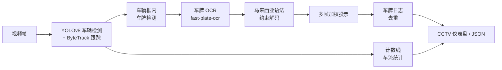
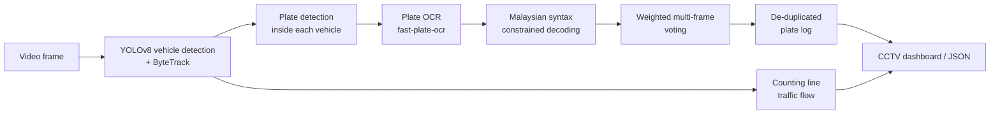

# SECS — Malaysian ALPR & Traffic Flow Monitoring / 马来西亚车牌识别与交通流量监控

[中文](#中文) | [English](#english)


---

## 中文

### 项目简介

本项目是软件工程小组项目，目标是帮助交警和保安**识别和记录马来西亚车牌、监控车流**，并为后续的违规车牌检测、
车流预测、AR/VR 和生成式 AI 功能打基础。目前代码已经实现：

| 功能 | 说明 |
|---|---|
| **静态图片车牌识别** | 整图车牌检测 → 裁剪 → 车牌专用 OCR → 马来西亚车牌语法校验，输出车牌号、是否合法格式、所属州属/类别 |
| **视频车牌识别** | 车辆检测 + ByteTrack 多目标跟踪 → 车辆内车牌检测 → OCR → 同一辆车多帧加权投票，结果分为 ACQUIRING / TENTATIVE / CONFIRMED |
| **车牌日志（去重）** | 每辆车只记一行；同一辆车被遮挡后重新出现（换了跟踪 ID）也不会重复计数 |
| **车流统计** | 计数线过线计数、分车型统计（轿车/摩托/巴士/卡车）、每分钟流量、每 10 秒时间序列（可作为车流预测的训练数据） |
| **马来西亚车牌规则** | 标准格式（如 `WA 1234 B`）、双排车牌、特殊号牌（GOLD、VIP、1M4U、PUTRAJAYA 等）、州属识别（Johor、Sabah、Sarawak、出租车、军车…），非法/非标准文字会被标记出来 |
| **两种界面** | CCTV 仪表盘（摄像头画面 + 车牌日志 + 车流指标）和行车记录仪 AR 卡片界面 |
| **评测工具** | 图片和视频都有基于人工核对标注的自动评测脚本 |

### 效果（全部基于人工逐块核对的马来西亚车牌）

**静态图片**：Malaysian Car Plate Dataset 验证集，89 张图 / 94 块车牌

| 方案 | 检测召回 | 车牌号完全正确 |
|---|---|---|
| 旧版（印度数据训练的检测器 + EasyOCR） | 82.1% | 41.5% |
| **当前版本** | **98.9%** | **94.7%**（双排车牌 100%，特殊号牌 100%） |


**视频**：马来西亚路边 ANPR 摄像头，三个人工标注的时间窗口，共 18 辆车

| 窗口 | 用途 | 正确 | 误报 |
|---|---|---|---|
| 48–82 s | 开发调参 | 4/4 | 0 |
| 100–130 s | 演示视频 | 8/9 | 0 |
| 0–44 s | 保留测试 | 5/5 | 0 |
| **合计** | | **17/18（94.4%）** | **0** |

唯一漏读的车牌几乎全程被另一辆车遮挡。旧版在演示窗口只有 6/9，并且会重复记录同一辆车。
评测细节和注意事项（例如保留窗口第一次运行时有 5 条误报，后来修复）见 [TEAM_GUIDE.md](TEAM_GUIDE.md)。

**演示视频**：`demo/malaysia_road_anpr_demo_30s.mp4`（1920×1080，30 秒）。

### 快速开始

```bash
pip install -r requirements.txt

# 静态图片（单张 / 文件夹 / 通配符），结果在 outputs/images_alpr/
python run_image.py --source path/to/images

# 视频：生成 30 秒 CCTV 演示视频 + 结果 JSON（需要先下载演示视频，见下文"数据"）
python run_alpr.py --profile malaysia_road_anpr

# 评测
python -m alpr.eval_images --dataset "../Malaysian Car Plate Dataset" --split val --gt alpr/gt/malaysia_val_plates.csv
python -m alpr.evaluate --pred outputs/malaysia_road_anpr_30s.plates.json --gt alpr/gt/malaysia_road_anpr_100-130s.txt

# 单元测试（不需要模型和 GPU）
python alpr/tests/test_alpr.py
```

### 工作流程（视频）



### 代码结构

| 路径 | 作用 |
|---|---|
| `run_image.py` / `run_alpr.py` | 静态图片 / 视频的命令行入口 |
| `alpr/config.yaml` | 所有参数和每段视频的配置（profile） |
| `alpr/image.py` | 静态图片识别 |
| `alpr/pipeline.py` | 视频识别：跟踪、读牌、投票、车牌日志、车流 |
| `alpr/ocr.py` | OCR 后端（fast-plate-ocr 默认，EasyOCR 备用） |
| `alpr/plates.py` | 马来西亚车牌语法、特殊号牌、州属、约束解码 |
| `alpr/voting.py` | 多帧投票 |
| `alpr/flow.py` | 车流计数 |
| `alpr/hud.py` | 仪表盘和 AR 界面渲染 |
| `alpr/gt/` | 人工核对的车牌标注（图片 + 视频） |
| `models/plate_malaysia.pt` | 在马来西亚车牌数据集上微调的车牌检测器（默认） |
| `models/finetuned.pt` | 旧版车牌检测器（印度车牌数据） |

### 模型与数据

- 车辆检测用 COCO 预训练的 `yolov8s.pt`，OCR 模型 `cct-s-v2-global-model`，二者第一次运行时会自动下载。
- 车牌检测器 `plate_malaysia.pt`：在 `finetuned.pt` 的基础上，用 Malaysian Car Plate Dataset 训练集（414 张）继续训练 40 轮。
- 数据集不在仓库里（放在仓库上一级目录 `../Malaysian Car Plate Dataset`）。
- 演示视频素材来自 YouTube：LILIN CCTV MALAYSIA 的 "INTEL AIDA ANPR TESTING"（https://www.youtube.com/watch?v=raQOCJ_wzKE），
  版权归原作者，仓库里不包含原视频，仅用于课程演示，请注明来源。下载方法：
  `python -m yt_dlp -f 137 -o data/videos/malaysia_lilin_anpr_road.mp4 https://www.youtube.com/watch?v=raQOCJ_wzKE`

### 已知局限与下一步

- 纯 CPU 约 3–7 FPS，实时需要 GPU 或导出 ONNX/OpenVINO；宽度小于 60 像素的车牌仍容易读错。
- **下一步**：车流预测（用 `flow.per_10s` 时间序列）、超速检测（需要先做相机标定）、车牌登记核验（过期/未登记/重复车牌）、
  AR/VR 显示、生成式 AI（例如复核低置信度车牌、自动生成交通报告）。

---

## English

### Overview

A software-engineering group project that helps traffic police and security guards **read and log Malaysian licence
plates and monitor traffic flow**, as the base for later features: illegal/unmatched plate checks, flow prediction,
AR/VR and generative AI. What the code does today:

| Feature | Description |
|---|---|
| **Image ALPR** | Whole-image plate detection → crop → plate-specific OCR → Malaysian plate syntax check; outputs plate number, legal-format flag and registration state/category |
| **Video ALPR** | Vehicle detection + ByteTrack multi-object tracking → plate detection inside each vehicle → OCR → weighted multi-frame voting per vehicle, with ACQUIRING / TENTATIVE / CONFIRMED status |
| **Plate log (de-duplicated)** | One row per vehicle; a vehicle re-acquired after an occlusion (new track ID) is not counted twice |
| **Traffic flow** | Counting-line crossings, per-type counts (car / motorcycle / bus / truck), vehicles per minute, 10-second time series (training data for flow prediction) |
| **Malaysian plate rules** | Standard format (e.g. `WA 1234 B`), two-row plates, special series (GOLD, VIP, 1M4U, PUTRAJAYA …), registration state (Johor, Sabah, Sarawak, taxi, military …); non-standard text is flagged |
| **Two HUDs** | CCTV dashboard (camera view + plate log + flow KPIs) and a dashcam AR-card overlay |
| **Evaluation tools** | Automatic image and video evaluation against hand-verified labels |

### Results (all measured on hand-verified Malaysian plates)

**Images** — Malaysian Car Plate Dataset validation split, 89 images / 94 plates

| Version | Detection recall | Exact plate match |
|---|---|---|
| Previous (Indian-plate detector + EasyOCR) | 82.1% | 41.5% |
| **Current** | **98.9%** | **94.7%** (two-row plates 100%, special series 100%) |

**Video** — Malaysian roadside ANPR camera, three hand-labelled windows, 18 vehicles

| Window | Purpose | Correct | False positives |
|---|---|---|---|
| 48–82 s | development / tuning | 4/4 | 0 |
| 100–130 s | demo video | 8/9 | 0 |
| 0–44 s | held-out test | 5/5 | 0 |
| **Total** | | **17/18 (94.4%)** | **0** |

The one missed plate is hidden behind another vehicle for almost the whole clip. The previous version read 6/9 in
the demo window and logged the same vehicle twice. Evaluation details and caveats (e.g. the held-out window's first
run had 5 false positives that were fixed afterwards) are in [TEAM_GUIDE.md](TEAM_GUIDE.md) (Chinese).

**Demo video**: `demo/malaysia_road_anpr_demo_30s.mp4` (1920×1080, 30 s).

### Quick start

```bash
pip install -r requirements.txt

# images (file / folder / glob) -> outputs/images_alpr/
python run_image.py --source path/to/images

# video: 30 s CCTV demo + results JSON (download the source clip first, see "Data")
python run_alpr.py --profile malaysia_road_anpr

# evaluation
python -m alpr.eval_images --dataset "../Malaysian Car Plate Dataset" --split val --gt alpr/gt/malaysia_val_plates.csv
python -m alpr.evaluate --pred outputs/malaysia_road_anpr_30s.plates.json --gt alpr/gt/malaysia_road_anpr_100-130s.txt

# unit tests (no models or GPU needed)
python alpr/tests/test_alpr.py
```

### Video pipeline



### Code layout

| Path | Purpose |
|---|---|
| `run_image.py` / `run_alpr.py` | command-line entry points for images / video |
| `alpr/config.yaml` | every threshold, plus one profile per video |
| `alpr/image.py` | image ALPR |
| `alpr/pipeline.py` | video ALPR: tracking, plate reading, voting, plate log, flow |
| `alpr/ocr.py` | OCR backends (fast-plate-ocr default, EasyOCR fallback) |
| `alpr/plates.py` | Malaysian plate syntax, special series, states, constrained decoding |
| `alpr/voting.py` | multi-frame voting |
| `alpr/flow.py` | traffic-flow counting |
| `alpr/hud.py` | dashboard and AR overlay rendering |
| `alpr/gt/` | hand-verified plate labels (images + video) |
| `models/plate_malaysia.pt` | plate detector fine-tuned on Malaysian plates (default) |
| `models/finetuned.pt` | previous plate detector (Indian-plate data) |

### Models and data

- Vehicles: COCO-pretrained `yolov8s.pt`; OCR: `cct-s-v2-global-model`. Both download automatically on first run.
- Plate detector `plate_malaysia.pt`: `finetuned.pt` trained 40 more epochs on the Malaysian Car Plate Dataset
  training split (414 images).
- The dataset is not in the repository (expected at `../Malaysian Car Plate Dataset`).
- Demo footage: "INTEL AIDA ANPR TESTING" by LILIN CCTV MALAYSIA on YouTube
  (https://www.youtube.com/watch?v=raQOCJ_wzKE). Copyright belongs to its owner; the source clip is not in the
  repository and is used for a course demo only, with attribution. To download:
  `python -m yt_dlp -f 137 -o data/videos/malaysia_lilin_anpr_road.mp4 https://www.youtube.com/watch?v=raQOCJ_wzKE`

### Limitations and next steps

- CPU only: ~3–7 FPS; real time needs a GPU or an ONNX/OpenVINO export. Plates narrower than ~60 px are still often misread.
- **Next**: traffic-flow prediction (from `flow.per_10s`), speeding detection (needs camera calibration first),
  registry checks (expired / unregistered / duplicate plates), AR/VR display, generative AI (e.g. re-checking
  low-confidence plates, automatic traffic reports).
