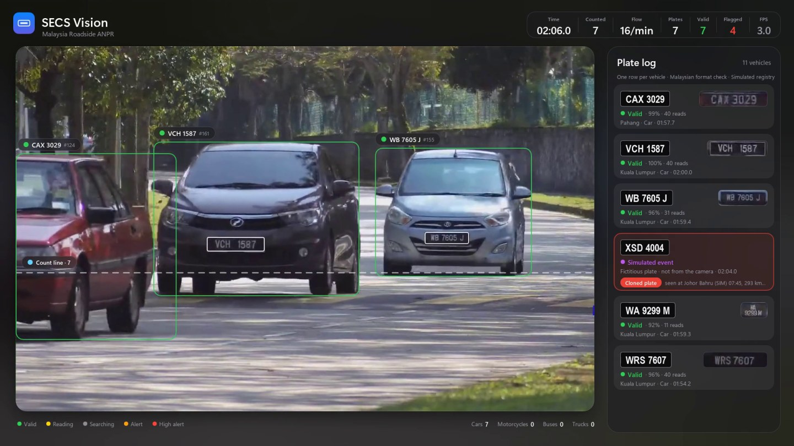
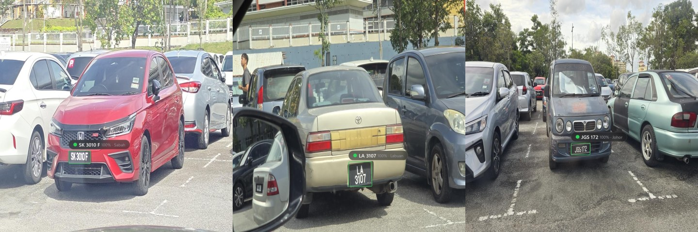
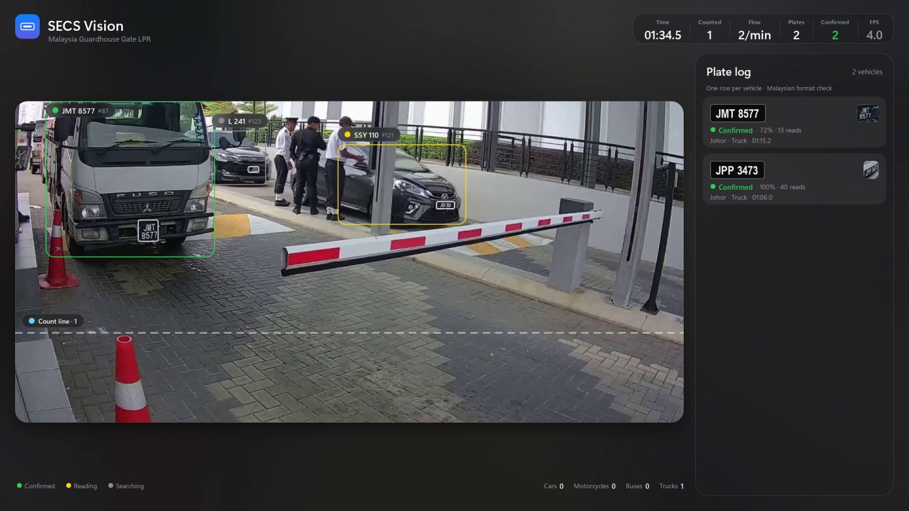
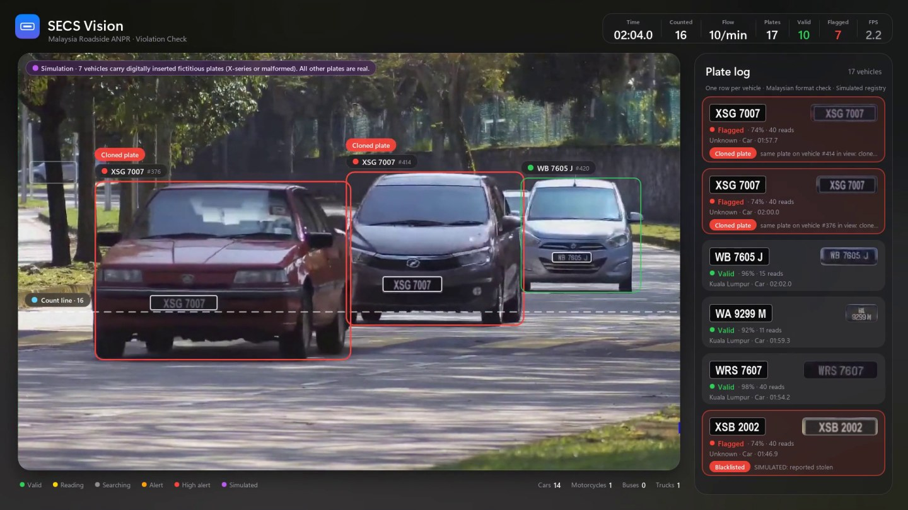
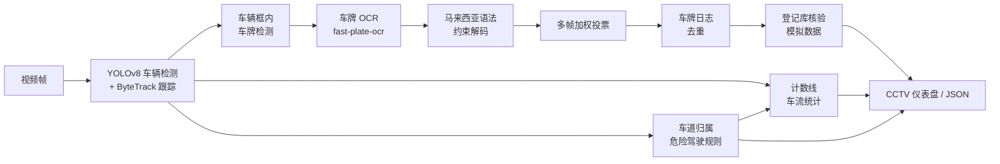
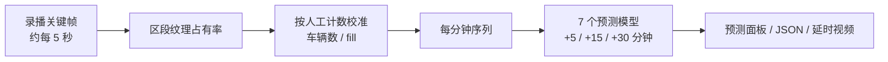
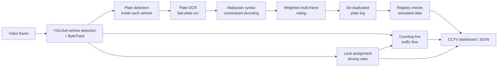
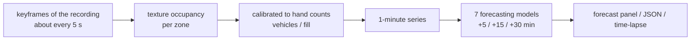

# SECS — Malaysian ALPR & Traffic Flow Monitoring / 马来西亚车牌识别与交通流量监控

[中文](#中文) | [English](#english) · Team guide / 团队使用说明: [English](TEAM_GUIDE_EN.md) | [中文](TEAM_GUIDE.md)



---

## 中文

### 项目简介

本项目是软件工程小组项目，目标是帮助交警和保安**识别和记录马来西亚车牌、对照登记库核验车牌、监控车流**，并为后续的
车流预测、AR/VR 和生成式 AI 功能打基础。目前代码已经实现：

| 功能 | 说明 |
|---|---|
| **静态图片车牌识别** | 整图车牌检测 → 裁剪 → 车牌专用 OCR → 马来西亚车牌语法校验，输出车牌号、是否合法格式、所属州属/类别 |
| **视频车牌识别** | 车辆检测 + ByteTrack 多目标跟踪 → 车辆内车牌检测 → OCR → 同一辆车多帧加权投票，结果分为 ACQUIRING / TENTATIVE / CONFIRMED |
| **车牌日志（去重）** | 每辆车只记一行；同一辆车被遮挡后重新出现（换了跟踪 ID）也不会重复计数 |
| **车流统计** | 计数线过线计数、分车型统计（轿车/摩托/巴士/卡车）、每分钟流量、每 10 秒时间序列（可作为车流预测的训练数据） |
| **高峰拥堵预测** | 新山关卡（CIQ）进站路的高位摄像头：只解码关键帧测量每个区段被车辆占满的程度（按人工计数校准），每分钟序列；7 个模型（持续、移动平均、日间规律、规律变化、ARIMA、LightGBM、GRU）提前 5 / 15 / 30 分钟预测拥堵，仪表盘上有预测面板 |
| **车道级车流与危险驾驶** | 每个固定摄像头配置车道多边形、行驶方向和实线；分车道计数、veh/min、占有率、密度和每 10 秒时间序列；变道、压实线、逆行、车道内停车；标定后测速和跟车过近（每个速度都带误差）。公开视频里真实车辆的违规不显示，只用标注清楚的模拟车辆演示 |
| **车牌核验与告警** | 每块确认的车牌对照**模拟**车辆登记库检查：未登记、路税过期、非法格式、黑名单、车型不符、套牌（两辆车同时挂同一车牌 / 跨摄像头不可能的行驶），告警显示在仪表盘和 JSON 里 |
| **马来西亚车牌规则** | 标准格式（如 `WA 1234 B`）、双排车牌、特殊号牌（GOLD、VIP、1M4U、PUTRAJAYA 等）、州属识别（Johor、Sabah、Sarawak、出租车、军车…），非法/非标准文字会被标记出来 |
| **界面** | 苹果风格的深色 CCTV 仪表盘（圆角画面卡片 + 毛玻璃车牌日志 + 车流指标 + 结尾汇总表）和行车记录仪 AR 卡片界面 |
| **评测工具** | 图片和视频都有基于人工核对标注的自动评测脚本 |

### 效果（全部基于人工逐块核对的马来西亚车牌）

**静态图片**：Malaysian Car Plate Dataset 验证集，89 张图 / 94 块车牌

| 方案 | 检测召回 | 车牌号完全正确 |
|---|---|---|
| 旧版（印度数据训练的检测器 + EasyOCR） | 82.1% | 41.5% |
| **当前版本** | **98.9%** | **94.7%**（双排车牌 100%，特殊号牌 100%） |



**视频（场景一）**：马来西亚路边 ANPR 摄像头，三个人工标注的时间窗口，共 18 辆车

| 窗口 | 用途 | 正确 | 误报 |
|---|---|---|---|
| 48–82 s | 开发调参 | 4/4 | 0 |
| 100–130 s | 演示视频 | 8/9 | 0 |
| 0–44 s | 保留测试 | 5/5 | 0 |
| **合计** | | **17/18（94.4%）** | **0** |

唯一漏读的车牌几乎全程被另一辆车遮挡。旧版在演示窗口只有 6/9，并且会重复记录同一辆车。
评测细节和注意事项（例如保留窗口第一次运行时有 5 条误报，后来修复）见 [TEAM_GUIDE.md](TEAM_GUIDE.md)。

**视频（场景二，验证泛化能力）**：马来西亚大楼门岗闸口 CCTV，斜前方近距离视角，车辆在闸口前停下再通过，
有货车、皮卡、面包车、轿车和摩托车。整段 186 秒在模型第一次运行前就人工标注完；**模型和所有阈值都没有为这段视频调整**，
只设置了画面裁剪和计数线：

| 车道 | 车牌 | 正确 | 误报 |
|---|---|---|---|
| 闸口车道（含 1 块双排车牌） | 5 | **5/5** | **0** |

另一条车道经过的车辆车牌只有 40–60 像素宽、角度很斜，人眼也无法核对，不计入成绩（系统也没有把它们记进车牌日志）。
过线计数 4 辆，和实际一致（最后一辆到视频结束时还停在闸口）。



**违规识别演示（合格车牌与违规车牌对比，2 分 35 秒，20 辆车）**：真实的车辆登记数据不公开，网上也没有"已知哪些车违规"的
真实视频，所以我们把场景一的**整段**路边视频中 7 辆车的车牌用数字方式替换成**虚构车牌**（X 字头，马来西亚没有任何州使用；
或故意做成非法格式），其余 13 辆保留真实车牌。替换是一个独立的预处理步骤（`python -m alpr.simulate`，配置在
`alpr/simulation.yaml`），识别系统不知道哪些车被替换过，必须自己从画面里读出车牌再核验。

| 车辆 | 车牌 | 系统判定 | 正确？ |
|---|---|---|---|
| 12 辆真实车辆（含 2 块双排车牌） | 真实车牌 | **合格**（VALID） | 12/12 车牌正确，**0 误报** |
| 白色本田 City | XSA 1001（虚构） | 路税过期 + 车型不符（登记为摩托车） | ✓ |
| 银色现代 | XSE 5005（虚构） | 未登记 | ✓ |
| 深色宝马 | XSD 4004（虚构） | 套牌：17 分钟前在新山出现过，相距 293 km | ✓ |
| 灰色马自达 CX-5 | WXY 12345（5 位数字） | 非法格式 | ✓ |
| 银色 Proton Persona | XSB 2002（虚构） | 黑名单（模拟：报失窃） | ✓ |
| 红色 Iswara + Bezza | 两辆车同时挂 XSG 7007 | 两辆都报套牌 | ✓ ✓ |
| **合计** | | **7/7 违规全部抓到，真实车辆 0 误报** | |

另外 1 辆真实车辆（被 CR-V 全程遮挡的 Myvi）没有读出；1 块真实车牌 `VCV 155` 因 OCR 在 `VCV155` / `VCV1555` 之间
摇摆，只给出"待确认"（不会报警）。视频结尾有一张汇总表，列出每辆车的车牌、车型、出现时间和判定结果。



**视频（场景三，车道级车流与危险驾驶）**：天桥上固定拍摄的吉隆坡 Taman Sri Selayang 城市快速路，双向各 4 车道，
来车方向畅通、去车方向拥堵。来车方向 120 秒内 183 辆车（含 58 辆摩托车）是在 slit-scan 图上**人工逐辆数的**，
不经过检测模型：

| 范围 | 分车道计数准确率（4 条车道平均） | 精确率 | 召回率 |
|---|---|---|---|
| 四轮车辆，0–120 s | **96.2%** | 98.4% | 98.4% |
| 全部车辆（含摩托车），0–120 s | **92.5%** | 98.8% | 91.8% |
| 全部车辆，保留窗口 40–120 s | 92.2% | 98.2% | 93.2% |

没有多计的车；漏掉的 13 辆全是远处的小摩托车，2 辆压线的车车道判错。四轮车辆的成绩和 Part 3 文献综述 Paper 4
报告的约 95% 相当。5 个模拟违规场景（逆行、超速、压实线、车道内停车、跟车过近）全部按预期触发；真实车辆的 10 次规则触发（快车道超过假设限速、几次 0.7 s 的跟车）
只计数、不显示。拥堵方向没有人工计数（走走停停的长队 + 沿车道线穿行的摩托车），不报告准确率。


**高峰拥堵预测（新山关卡进站路，两天约 10 小时的录播）**：两台高楼摄像头（A：周三；C：前一天周二，另一台摄像头、同一条路）
从夜里空路一直拍到早高峰排队。车太小、被护栏挡住，无法逐辆检测，所以测量"区段被车占满的程度"（fill，按人工计数校准；
fill ≥ 0.5 即超过 Greenshields 模型的临界密度，算拥堵），一天训练、另一天测试，两个方向都做：

| | A（周三，用 C 训练） | C（周二，用 A 训练） |
|---|---|---|
| 测量与人工计数对比（留一法，4 个区段合计） | 平均误差 7.0 辆 / 平均 21.6 辆，r = 0.83 | 5.8 辆 / 26.2 辆，r = 0.95 |
| 拥堵开始（人工计数确认在 07:00–07:15 之间） | 07:13（08:17 再次开始） | 07:12 |
| 15 分钟预测误差（fill）：持续 → 最好的模型 | 0.054 → 0.054（ARIMA） | 0.090 → **0.076**（GRU） |
| 30 分钟预测误差（fill）：持续 → 最好的模型 | 0.078 → 0.078（ARIMA） | 0.133 → **0.098**（LightGBM） |
| 提前预警（30 分钟预测，07:1x 那次） | 日间规律 31 分钟，LightGBM 17 分钟，持续 3 分钟 | LightGBM 35 分钟，日间规律 30 分钟，持续 1 分钟 |

只有两天、三次拥堵开始，差距没有统计意义，详见 [TEAM_GUIDE.md](TEAM_GUIDE.md) 第 10 节（包括局限）。


**演示视频**：
- **高峰拥堵预测（延时，51 秒）**：`demo/jb_ciq_forecast_timelapse.mp4`（1920×1080，A 摄像头 05:30–09:50，300 倍速）
- **车道级车流与危险驾驶（场景三，2 分 8 秒，含结尾汇总表）**：`demo/malaysia_selayang_lanes_demo.mp4`（1920×1080）
- **违规识别（主演示，2 分 43 秒，含结尾汇总表）**：`demo/malaysia_road_violations_demo.mp4`（1920×1080）
- 场景一（路边摄像头 + 车牌核验告警）：`demo/malaysia_road_anpr_demo_30s.mp4`（1920×1080，30 秒）
- 场景二（门岗闸口）：`demo/malaysia_guardhouse_demo_30s.mp4`（1920×1080，30 秒）

### 快速开始

```bash
# 装在项目自己的虚拟环境里（全局 Python 被别的项目升到 numpy 2.x 时 torch 会报错），之后的命令都用 venv 的 python
python -m venv .venv
.venv\Scripts\python -m pip install -r requirements.txt
.venv\Scripts\activate

# 静态图片（单张 / 文件夹 / 通配符），结果在 outputs/images_alpr/
python run_image.py --source path/to/images

# 视频：生成 30 秒 CCTV 演示视频 + 结果 JSON（需要先下载演示视频，见下文"数据"）
python run_alpr.py --profile malaysia_road_anpr
# 违规识别演示：先生成替换了虚构车牌的视频，再识别 + 核验整段视频，并对照标注评测
python -m alpr.simulate
python run_alpr.py --profile malaysia_road_violations
python -m alpr.evaluate --pred outputs/malaysia_road_violations.plates.json --gt alpr/gt/simulated/malaysia_road_violations_0-155s.txt

# 车道级车流 + 危险驾驶（场景三）：识别、对照人工计数评测、检查 / 绘制车道配置
python run_alpr.py --profile malaysia_selayang_lanes
python -m alpr.lane_eval --pred outputs/malaysia_selayang_lanes.plates.json --gt alpr/gt/malaysia_selayang_lanes_0-120s.txt
python -m alpr.lane_tool --profile malaysia_selayang_lanes --show outputs/lanes.jpg

# 车牌核验：生成模拟登记库（缺失时会自动生成）、查询单个车牌、图片识别时开启核验
python -m alpr.registry --make-demo
python -m alpr.registry --check "XSB 2002" --vtype Car
python run_image.py --source path/to/images --check

# 评测
python -m alpr.eval_images --dataset "../Malaysian Car Plate Dataset" --split val --gt alpr/gt/malaysia_val_plates.csv
python -m alpr.evaluate --pred outputs/malaysia_road_anpr_30s.plates.json --gt alpr/gt/malaysia_road_anpr_100-130s.txt

# 高峰拥堵预测（第 10 节）：下载录播、测量、校准、每分钟序列、预测评测、演示视频
python -m alpr.download_hls uAVdyvglPco 270 data/videos/causeway/jb_ciq_cam02_2023-03-22
python -m alpr.congestion --profile jb_ciq_cam02_2023-03-22 --measure
python -m alpr.congestion --profile jb_ciq_cam02_2023-03-22 --calibrate --series data/series/jb_ciq_cam02_2023-03-22.csv
python -m alpr.forecast --days data/series/jb_ciq_ipc_2023-03-21.csv data/series/jb_ciq_cam02_2023-03-22.csv --entity "To CIQ" --measures fill --extra none --pool TC1,TC2,TC3,TC4 --congestion 0.5 --congestion-measure fill
python -m alpr.forecast_demo --profile jb_ciq_cam02_2023-03-22 --train data/series/jb_ciq_ipc_2023-03-21.csv --test data/series/jb_ciq_cam02_2023-03-22.csv --pool TC1,TC2,TC3,TC4 --from 05:30 --to 09:50 --out demo/jb_ciq_forecast_timelapse.mp4

# 提速（第 11 节）：OpenVINO + 无界面模式，测速
python run_alpr.py --profile malaysia_road_anpr --backend openvino --headless
python -m alpr.benchmark --profile malaysia_road_anpr --frames 300

# 单元测试（不需要模型和 GPU）
python alpr/tests/test_alpr.py
```

### 工作流程（视频）



### 车牌核验与告警（模拟登记库）

> **登记库是模拟的，不是真实登记数据。** 马来西亚 JPJ 登记数据不公开，`python -m alpr.registry --make-demo`
> 生成的演示库里：虚构车辆的车牌全部以 `X` 开头（没有任何州使用 X 字头）；`alpr/gt/` 里人工标注过的真实车牌只是
> 中性占位记录（状态 ok、无路税日期、无车型颜色），任何规则都不会对真实车辆报警。

| 告警 | 含义 |
|---|---|
| `UNMATCHED` | 登记库里查不到这个车牌（只差 1 个字符的视为 OCR 误读，不报警） |
| `EXPIRED` | 路税在观测时间之前已过期 |
| `ILLEGAL_FORMAT` | 不是合法的马来西亚车牌格式 |
| `BLACKLIST` | 登记状态为黑名单（例如报失窃） |
| `TYPE_MISMATCH` | 观测车型（可选：车身颜色）与登记不符，例如摩托车的车牌装在轿车上 |
| `DUPLICATE` | 套牌嫌疑：画面里两辆分开的车同时挂同一车牌，或在另一个摄像头出现、时间内不可能开到 |

视频中，车辆进入车牌日志（CONFIRMED）时核验；仪表盘在车辆标签和日志行上显示红色（高）/ 橙色（中）告警徽章，
顶部栏显示 `ALERTS` 计数。因为真实车辆不会被报警，演示视频在 103 / 110 / 117 / 124 秒加入了 4 条**虚构车牌的
模拟事件**（紫色 `SIMULATED EVENT`，画面里没有对应车辆），分别演示黑名单、路税过期 + 车型不符、未登记、
跨摄像头套牌；它们在 JSON 里单独放在 `simulated_events`。详见 [TEAM_GUIDE.md](TEAM_GUIDE.md) 第 4 节。

### 车道级车流与危险驾驶（场景三）

每个固定摄像头在 `alpr/config.yaml` 里配置车道（多边形 + 行驶方向 + 方向组）、实线和标定点，可以用
`python -m alpr.lane_tool` 在"空路中值图"上点击绘制。车辆按**车框底边中点**归属车道（Part 3 文献综述 Paper 4 的方法），
我们加了一个透视修正（偏到画面一侧的车会露出侧面，底边中点会向消失点偏移），并对轨迹做平滑和迟滞。

| 事件 | 判定 | 级别 |
|---|---|---|
| 变道 `LANE_CHANGE` | 平滑后的车道在同一方向内改变（摩托车不报：它们沿车道线穿行） | 信息 |
| 压实线 `SOLID_LINE` | 越过实线并停在另一侧 | 违规 |
| 逆行 `WRONG_WAY` | 在车道内逆着车道方向移动 | 违规 |
| 车道内停车 `STOPPED` | 静止 5 秒而同方向其他车在走（排队不算，停靠区不是车道） | 危险 |
| 超速 `SPEEDING` | 需要标定；速度 95% 区间下限超过限速 | 违规 |
| 跟车过近 `TAILGATING` | 需要标定；同车道过计数线的时间间隔 < 0.8 s 且后车 ≥ 50 km/h（摩托车不参与，车头间距 < 4 m 视为并排） | 违规 |

**标定**：用车道宽 3.5 m 和**测出来的**虚线周期（6 m，用 5 辆车的轴距验证）拟合图像到路面的单应矩阵；
蒙特卡洛误差传播给出每个速度 ±6.5%（1σ）的标定误差，再加上轨迹拟合误差。没有标定的摄像头不输出 km/h。

**公开视频**：真实车辆的违规只计数、不显示、不关联车牌（JSON 里的 `lanes.withheld_violations`）；
违规规则用**模拟车辆**演示（紫色、标注 "Simulated"、虚构 X 字头车牌、路面坐标定义的轨迹），模拟车辆不计入车流。
详见 [TEAM_GUIDE.md](TEAM_GUIDE.md) 第 5 节。

### 高峰拥堵预测



- **为什么不逐辆检测**：CIQ 进站路上的车只有 15–40 像素宽、下半截被护栏挡住、排队时车头接车尾，COCO 检测器在放大 3 倍的小块上
  也只能找出不到一成（38 辆里 1 辆，53 辆里 5 辆）。改为像交通工程的视频检测器一样测"占有"：区段里边缘像素的比例，用人工计数逐区段校准成车辆数。
- **验证**：A 数了 16 帧、C 数了 10 帧（夜间、黎明、白天都有）；夜间误差约 2 辆，黎明最差（低光和护栏反光）。
- **预测**：严格只用过去的数据（单元测试检查），一天训练、另一天测试；LightGBM 和 GRU 用训练日 4 个区段的序列一起训练。
  5 分钟内持续 / ARIMA 最难超越；15–30 分钟机器学习模型更好；日间规律和 LightGBM 能提前约半小时预警。
- **B（长堤引道，轮播画面）**：用 `view_gate` 只分析 "Causeway Link" 画面；夜里的车灯无法人工计数，所以没有校准，不用于预测评测。
- **局限**：只有 2 天、2 台摄像头、1 条路；这些摄像头上测不了流量和速度（车太小、没有米制标定）。

### 代码结构

| 路径 | 作用 |
|---|---|
| `run_image.py` / `run_alpr.py` | 静态图片 / 视频的命令行入口 |
| `alpr/config.yaml` | 所有参数和每段视频的配置（profile） |
| `alpr/image.py` | 静态图片识别 |
| `alpr/pipeline.py` | 视频识别：跟踪、读牌、投票、车牌日志、车流 |
| `alpr/ocr.py` | OCR 后端（fast-plate-ocr 默认，EasyOCR 备用） |
| `alpr/plates.py` | 马来西亚车牌语法、特殊号牌、州属、约束解码 |
| `alpr/voting.py` | 多帧投票 |
| `alpr/flow.py` | 车流计数；分车道计数、占有率、密度、时间序列 |
| `alpr/lanes.py` | 车道几何、车道归属（参考点 + 透视修正 + 平滑）、标定与速度误差 |
| `alpr/behaviour.py` | 危险驾驶规则、公开视频的违规隐藏、模拟车辆 |
| `alpr/lane_tool.py` / `alpr/lane_eval.py` | 车道点击绘制工具 / 分车道计数评测（含 slit-scan 人工计数图） |
| `alpr/registry.py` | 模拟登记库（SQLite）、核验规则、模拟库生成 |
| `alpr/simulate.py` / `alpr/simulation.yaml` | 生成违规演示视频：把指定车辆的车牌替换成虚构车牌 |
| `alpr/hud.py` | 仪表盘和 AR 界面渲染（含拥堵预测面板） |
| `alpr/congestion.py` | 拥堵测量：关键帧 → 区段纹理占有率 → 校准 → 车辆数 / fill / 排队区段 → 每分钟序列 |
| `alpr/forecast.py` | 7 个预测模型、只用过去的特征、评测（MAE / RMSE、拥堵精确率 / 召回率 / 提前量） |
| `alpr/forecast_demo.py` / `alpr/forecast_figures.py` | 延时演示视频 / 文档插图 |
| `alpr/series.py` | 车道摄像头结果 JSON → 每分钟分车道序列 |
| `alpr/download_hls.py` | 多连接下载 YouTube 直播录播 |
| `alpr/benchmark.py` | 测速（各阶段耗时） |
| `alpr/gt/` | 人工核对的车牌标注（图片 + 视频） |
| `models/plate_malaysia.pt` | 在马来西亚车牌数据集上微调的车牌检测器（默认） |
| `models/finetuned.pt` | 旧版车牌检测器（印度车牌数据） |

### 模型与数据

- 车辆检测用 COCO 预训练的 `yolov8s.pt`，OCR 模型 `cct-s-v2-global-model`，二者第一次运行时会自动下载。
- 车牌检测器 `plate_malaysia.pt`：在 `finetuned.pt` 的基础上，用 Malaysian Car Plate Dataset 训练集（414 张）继续训练 40 轮。
- 数据集不在仓库里（放在仓库上一级目录 `../Malaysian Car Plate Dataset`）。
- 演示视频素材来自 YouTube：LILIN CCTV MALAYSIA 的 "INTEL AIDA ANPR TESTING"（https://www.youtube.com/watch?v=raQOCJ_wzKE），
  版权归原作者，仓库里不包含原视频，仅用于课程演示，请注明来源。下载方法：
  `python -m yt_dlp -f 137 -o data/videos/malaysia_lilin_anpr_road.mp4 https://www.youtube.com/watch?v=raQOCJ_wzKE`
- 场景二素材：LEAF SMART COMMUNITY 的 "License plate recognition system for guard house"
  （https://www.youtube.com/watch?v=eNIGPl-W2II），同样版权归原作者、仓库不含原视频。下载方法：
  `python -m yt_dlp -f 137 -o data/videos/malaysia_guardhouse_lpr.mp4 https://www.youtube.com/watch?v=eNIGPl-W2II`
- 场景三素材：Streetcctv 的 "Taman Sri Selayang Traffic Flow | Kuala Lumpur Morning || 4K"
  （https://www.youtube.com/watch?v=KGHhxfkqypg）的 15:00–17:00，同样版权归原作者、仓库不含原视频。该视频没有 137 格式，
  用 1080p60（格式 299）的片段下载，需要 ffmpeg（imageio-ffmpeg 自带一个）：
  `python -m yt_dlp -f 299 --download-sections "*900-1020" --ffmpeg-location <ffmpeg 路径> -o data/videos/malaysia_selayang_overhead.mp4 https://www.youtube.com/watch?v=KGHhxfkqypg`
- 拥堵预测素材：Causeway Link 交通直播的录播（Live Traffics 2/2：https://www.youtube.com/watch?v=uAVdyvglPco 、
  https://www.youtube.com/watch?v=uMBo-qx9M2U ；Live Traffics 1/2：https://www.youtube.com/watch?v=MjUd_NZOa4U ），
  版权归原作者，仓库不含原视频；用 `python -m alpr.download_hls <视频 ID> 270 <目录>` 下载（1080p，每段约 9–14 GB）。

### 已知局限与下一步

- 纯 CPU：原来约 3–5 FPS（含界面渲染）；OpenVINO + 无界面模式下明显更快，识别结果逐项不变（数字见 [TEAM_GUIDE.md](TEAM_GUIDE.md) 第 11 节），
  但 30 FPS 视频仍未完全实时，下一步是用 RTX 5070 独显（CUDA 版 torch）；宽度小于 60 像素的车牌仍容易读错。
- 拥堵预测：只有 2 天、2 台摄像头、3 次拥堵开始，模型之间的差距没有统计意义；测量在黎明误差最大；需要几周的数据再比较。
- 车牌核验用的是模拟登记库；在其他时间窗口运行时，未标注的真实车牌会显示 `UNMATCHED`，只表示"不在模拟库里"。
- 车道级：车道是每个摄像头手工配置的；远处的小摩托车仍会漏检（见上表）；拥堵方向没有人工计数，没有准确率；
  测速依赖标定，每个速度都带误差；真实视频里的违规不公开显示。
- **下一步**：更多天的拥堵数据、接入真实/授权的登记数据和多摄像头识别记录、AR/VR 显示、
  生成式 AI（例如复核低置信度车牌、自动生成交通报告）。

---

## English

### Overview

A software-engineering group project that helps traffic police and security guards **read and log Malaysian licence
plates, check them against a vehicle registry and monitor traffic flow**, as the base for later features: flow
prediction, AR/VR and generative AI. What the code does today:

| Feature | Description |
|---|---|
| **Image ALPR** | Whole-image plate detection → crop → plate-specific OCR → Malaysian plate syntax check; outputs plate number, legal-format flag and registration state/category |
| **Video ALPR** | Vehicle detection + ByteTrack multi-object tracking → plate detection inside each vehicle → OCR → weighted multi-frame voting per vehicle, with ACQUIRING / TENTATIVE / CONFIRMED status |
| **Plate log (de-duplicated)** | One row per vehicle; a vehicle re-acquired after an occlusion (new track ID) is not counted twice |
| **Traffic flow** | Counting-line crossings, per-type counts (car / motorcycle / bus / truck), vehicles per minute, 10-second time series (training data for flow prediction) |
| **Peak-congestion forecasting** | High cameras over the approach road to the Johor Bahru checkpoint (CIQ): only keyframes are decoded to measure how full each zone of the road is (calibrated to hand counts), as 1-minute series; seven models (persistence, moving average, daily profile, profile change, ARIMA, LightGBM, GRU) forecast congestion 5 / 15 / 30 minutes ahead; a forecast panel on the dashboard |
| **Lane-level flow & dangerous driving** | Per fixed camera: lane polygons, direction of travel and solid lines; per-lane counts, veh/min, occupancy, density and 10-second time series; lane change, solid-line crossing, wrong way, stopped in a lane; speed and tailgating once the camera is calibrated (every speed with an error bar). On public footage real vehicles are never shown as violators; clearly marked simulated vehicles demonstrate the rules |
| **Plate verification & alerts** | Every confirmed plate is checked against a **simulated** vehicle registry: unmatched, expired road tax, illegal format, blacklisted, wrong vehicle type, duplicate / cloned plate (two vehicles in view with one plate, or an impossible trip between cameras); alerts show on the dashboard and in the JSON |
| **Malaysian plate rules** | Standard format (e.g. `WA 1234 B`), two-row plates, special series (GOLD, VIP, 1M4U, PUTRAJAYA …), registration state (Johor, Sabah, Sarawak, taxi, military …); non-standard text is flagged |
| **UI** | Apple-style dark CCTV dashboard (rounded camera card, frosted-glass plate log, flow KPIs, end-of-session summary) and a dashcam AR-card overlay |
| **Evaluation tools** | Automatic image and video evaluation against hand-verified labels |

### Results (all measured on hand-verified Malaysian plates)

**Images** — Malaysian Car Plate Dataset validation split, 89 images / 94 plates

| Version | Detection recall | Exact plate match |
|---|---|---|
| Previous (Indian-plate detector + EasyOCR) | 82.1% | 41.5% |
| **Current** | **98.9%** | **94.7%** (two-row plates 100%, special series 100%) |


**Video, scene 1** — Malaysian roadside ANPR camera, three hand-labelled windows, 18 vehicles

| Window | Purpose | Correct | False positives |
|---|---|---|---|
| 48–82 s | development / tuning | 4/4 | 0 |
| 100–130 s | demo video | 8/9 | 0 |
| 0–44 s | held-out test | 5/5 | 0 |
| **Total** | | **17/18 (94.4%)** | **0** |

The one missed plate is hidden behind another vehicle for almost the whole clip. The previous version read 6/9 in
the demo window and logged the same vehicle twice. Evaluation details and caveats (e.g. the held-out window's first
run had 5 false positives that were fixed afterwards) are in the team guide ([English](TEAM_GUIDE_EN.md) / [中文](TEAM_GUIDE.md)).

**Video, scene 2 (generalisation check)** — Malaysian building guardhouse barrier-gate CCTV: oblique close-up
view, vehicles stop at the barrier, lorries / pickup / van / cars / motorcycles. The whole 186 s clip was hand-labelled
before the pipeline first ran on it, and **neither the model nor any threshold was changed for it** — only the frame
crop and the counting line were set:

| Lane | Plates | Correct | False positives |
|---|---|---|---|
| gate lane (incl. one two-row plate) | 5 | **5/5** | **0** |

Plates of vehicles passing in the far lane are only 40–60 px wide and very oblique; a human cannot verify them, so they
are not scored (the system did not log them either). The counting line counted 4 vehicles, which is correct (the last
one is still at the barrier when the clip ends).


**Violation check demo (valid vs flagged plates, 2 min 35 s, 20 vehicles)** — real registration data is not public
and no public footage comes with "these vehicles are in violation", so in the **whole** scene-1 roadside clip the plates
of 7 vehicles were digitally replaced with **fictitious** plates (X-series, which no Malaysian state uses, or a
deliberately malformed one); the other 13 keep their real plates. The replacement is a separate pre-processing step
(`python -m alpr.simulate`, configured in `alpr/simulation.yaml`): the recognition pipeline does not know which
vehicles were altered and has to read and check every plate itself.

| Vehicle | Plate | Verdict | Correct? |
|---|---|---|---|
| 12 real vehicles (incl. 2 two-row plates) | real plates | **VALID** | 12/12 plates right, **0 false alerts** |
| white Honda City | XSA 1001 (fictitious) | expired road tax + type mismatch (registered motorcycle) | ✓ |
| silver Hyundai | XSE 5005 (fictitious) | unmatched (no record) | ✓ |
| dark BMW | XSD 4004 (fictitious) | cloned: seen in Johor Bahru 17 min earlier, 293 km away | ✓ |
| grey Mazda CX-5 | WXY 12345 (five digits) | illegal format | ✓ |
| silver Proton Persona | XSB 2002 (fictitious) | blacklisted (simulated: reported stolen) | ✓ |
| red Iswara + Bezza | both carry XSG 7007 at once | both flagged as cloned | ✓ ✓ |
| **Total** | | **7/7 violations caught, 0 false alerts on real vehicles** | |

One more real vehicle (a Myvi hidden behind a CR-V the whole time) is not read, and the real plate `VCV 155` stays
TENTATIVE (never alerted) because the OCR flips between `VCV155` and `VCV1555`. The video ends with a summary card
listing every vehicle with its plate, type, time and verdict.


**Video, scene 3 (lane-level flow and dangerous driving)** — a fixed camera on a pedestrian bridge over a
4 + 4-lane urban highway at Taman Sri Selayang, Kuala Lumpur; inbound flows freely, outbound is queued. The 183
inbound vehicles in 120 s (58 of them motorcycles) were **counted by hand** on slit-scan images, without the detector:

| Scope | Per-lane count accuracy (mean of 4 lanes) | Precision | Recall |
|---|---|---|---|
| four-wheeled vehicles, 0–120 s | **96.2%** | 98.4% | 98.4% |
| all vehicles incl. motorcycles, 0–120 s | **92.5%** | 98.8% | 91.8% |
| all vehicles, held-out window 40–120 s | 92.2% | 98.2% | 93.2% |

No vehicle is counted twice or out of nothing; the 13 misses are all small far-away motorcycles and 2 vehicles riding
on a lane line get the wrong lane. The four-wheeled result matches the ~95 % reported by Paper 4 of the Part 3 review.
All 5 simulated violations (wrong way, speeding, solid line, stopped in a lane, tailgating) fire as intended; the
10 rule triggers on real vehicles (fast-lane cars above the assumed limit, a few 0.7 s headways) are counted, not shown. The queued outbound carriageway has no hand count (stop-and-go
trucks on the line, motorcycles filtering along the lane lines), so no accuracy is reported for it.


**Peak-congestion forecasting (approach road to the Johor Bahru checkpoint, two recordings of about 10 hours)**: two
high-rise cameras (A: a Wednesday; C: the Tuesday before, another camera on the same road) film from empty roads at
night into the morning queue. The vehicles are too small and too hidden by the parapets to be detected one by one, so
the system measures how full each zone is (fill, calibrated to hand counts; fill ≥ 0.5 is past the critical density of
the Greenshields model, i.e. congested). Train on one day, test on the other, both ways:

| | A (Wednesday, trained on C) | C (Tuesday, trained on A) |
|---|---|---|
| Measurement vs hand counts (leave-one-out, sum of 4 zones) | mean error 7.0 / mean 21.6 vehicles, r = 0.83 | 5.8 / 26.2 vehicles, r = 0.95 |
| Congestion onset (hand counts: between 07:00 and 07:15) | 07:13 (again at 08:17) | 07:12 |
| 15-minute forecast error (fill): persistence → best model | 0.054 → 0.054 (ARIMA) | 0.090 → **0.076** (GRU) |
| 30-minute forecast error (fill): persistence → best model | 0.078 → 0.078 (ARIMA) | 0.133 → **0.098** (LightGBM) |
| Early warning (30-minute forecast, the 07:1x onset) | daily profile 31 min, LightGBM 17 min, persistence 3 min | LightGBM 35 min, daily profile 30 min, persistence 1 min |

With only two days and three onsets the differences are not statistically significant; details, including the
limitations: [TEAM_GUIDE_EN.md](TEAM_GUIDE_EN.md), section 10.


**Demo videos**:
- **peak-congestion forecast (time-lapse, 51 s)**: `demo/jb_ciq_forecast_timelapse.mp4` (1920×1080, camera A 05:30–09:50, 300× speed)
- **lane-level flow and dangerous driving (scene 3, 2 min 8 s incl. summary card)**: `demo/malaysia_selayang_lanes_demo.mp4` (1920×1080)
- **violation check (main demo, 2 min 43 s incl. summary card)**: `demo/malaysia_road_violations_demo.mp4` (1920×1080)
- scene 1 (roadside camera + plate verification alerts): `demo/malaysia_road_anpr_demo_30s.mp4` (1920×1080, 30 s)
- scene 2 (guardhouse gate): `demo/malaysia_guardhouse_demo_30s.mp4` (1920×1080, 30 s)

### Quick start

```bash
# install into the project's own virtual environment (torch breaks when another project upgrades the global
# Python to numpy 2.x); every command below then runs with the venv's python
python -m venv .venv
.venv\Scripts\python -m pip install -r requirements.txt
.venv\Scripts\activate

# images (file / folder / glob) -> outputs/images_alpr/
python run_image.py --source path/to/images

# video: 30 s CCTV demo + results JSON (download the source clip first, see "Data")
python run_alpr.py --profile malaysia_road_anpr
# violation demo: build the video with fictitious plates, then read + check the whole clip and score it
python -m alpr.simulate
python run_alpr.py --profile malaysia_road_violations
python -m alpr.evaluate --pred outputs/malaysia_road_violations.plates.json --gt alpr/gt/simulated/malaysia_road_violations_0-155s.txt

# lane-level flow + dangerous driving (scene 3): run, score against the hand count, check / draw the lanes
python run_alpr.py --profile malaysia_selayang_lanes
python -m alpr.lane_eval --pred outputs/malaysia_selayang_lanes.plates.json --gt alpr/gt/malaysia_selayang_lanes_0-120s.txt
python -m alpr.lane_tool --profile malaysia_selayang_lanes --show outputs/lanes.jpg

# plate verification: build the simulated registry (also built automatically when missing),
# look up one plate, check plates found in photos
python -m alpr.registry --make-demo
python -m alpr.registry --check "XSB 2002" --vtype Car
python run_image.py --source path/to/images --check

# evaluation
python -m alpr.eval_images --dataset "../Malaysian Car Plate Dataset" --split val --gt alpr/gt/malaysia_val_plates.csv
python -m alpr.evaluate --pred outputs/malaysia_road_anpr_30s.plates.json --gt alpr/gt/malaysia_road_anpr_100-130s.txt

# peak-congestion forecasting (section 10): download, measure, calibrate, 1-minute series, evaluation, demo video
python -m alpr.download_hls uAVdyvglPco 270 data/videos/causeway/jb_ciq_cam02_2023-03-22
python -m alpr.congestion --profile jb_ciq_cam02_2023-03-22 --measure
python -m alpr.congestion --profile jb_ciq_cam02_2023-03-22 --calibrate --series data/series/jb_ciq_cam02_2023-03-22.csv
python -m alpr.forecast --days data/series/jb_ciq_ipc_2023-03-21.csv data/series/jb_ciq_cam02_2023-03-22.csv --entity "To CIQ" --measures fill --extra none --pool TC1,TC2,TC3,TC4 --congestion 0.5 --congestion-measure fill
python -m alpr.forecast_demo --profile jb_ciq_cam02_2023-03-22 --train data/series/jb_ciq_ipc_2023-03-21.csv --test data/series/jb_ciq_cam02_2023-03-22.csv --pool TC1,TC2,TC3,TC4 --from 05:30 --to 09:50 --out demo/jb_ciq_forecast_timelapse.mp4

# speed-up (section 11): OpenVINO + headless mode, benchmark
python run_alpr.py --profile malaysia_road_anpr --backend openvino --headless
python -m alpr.benchmark --profile malaysia_road_anpr --frames 300

# unit tests (no models or GPU needed)
python alpr/tests/test_alpr.py
```

### Video pipeline



### Plate verification and alerts (simulated registry)

> **The registry is SIMULATED, not real registration data.** Malaysian (JPJ) registration data is not public. In
> the demo registry built by `python -m alpr.registry --make-demo`, every fictitious vehicle has a plate starting
> with `X` (no state series uses X); the real plates hand-labelled in `alpr/gt/` are neutral placeholders (status
> ok, no road-tax date, no type or colour), so no rule can ever raise an alert against a real vehicle.

| Alert | Meaning |
|---|---|
| `UNMATCHED` | the plate is not in the registry (one character off a registered plate counts as an OCR misread, no alert) |
| `EXPIRED` | road tax expired before the observation time |
| `ILLEGAL_FORMAT` | not a legal Malaysian plate format |
| `BLACKLIST` | registry status is blacklisted (e.g. reported stolen) |
| `TYPE_MISMATCH` | observed vehicle type (optionally body colour) does not fit the record, e.g. a motorcycle's plate on a car |
| `DUPLICATE` | cloned plate suspected: two separate vehicles in view with the same plate, or seen at another camera too far away to have driven here in time |

In the video, a vehicle is checked when it enters the plate log (CONFIRMED); the dashboard shows a red (high) /
orange (medium) badge on the vehicle label and the plate-log row, and an `ALERTS` counter in the top bar. Because
real vehicles are never flagged, the demo adds 4 **simulated events with fictitious plates** at 103 / 110 / 117 /
124 s (purple `SIMULATED EVENT`, no vehicle box in the view): blacklist, expired road tax + type mismatch,
unmatched, and a cloned plate seen at another camera. They are kept apart in the JSON (`simulated_events`).
Details: [TEAM_GUIDE_EN.md](TEAM_GUIDE_EN.md), section 4.

### Lane-level flow and dangerous driving (scene 3)

Each fixed camera lists its lanes (polygon + direction of travel + carriageway), solid lines and calibration points in
`alpr/config.yaml`; `python -m alpr.lane_tool` draws them by clicking on an empty-road median image. A vehicle is in
the lane that contains the **bottom-centre of its box** (Paper 4 of the Part 3 review), with a perspective correction
(a vehicle off to one side shows its flank, which pulls the bottom-centre towards the vanishing point) and per-track
smoothing with hysteresis.

| Event | Rule | Level |
|---|---|---|
| `LANE_CHANGE` | the smoothed lane changes within one carriageway (not for motorcycles, which filter along lane lines) | info |
| `SOLID_LINE` | crosses a solid line and stays on the other side | violation |
| `WRONG_WAY` | moves against its lane's direction inside the lane | violation |
| `STOPPED` | stands still in a lane for 5 s while the rest of the carriageway moves (queues do not count; lay-bys are not lanes) | hazard |
| `SPEEDING` | needs calibration; the lower end of the 95 % speed interval is above the limit | violation |
| `TAILGATING` | needs calibration; time headway at the count line < 0.8 s in the same lane, follower ≥ 50 km/h (motorcycles take no part; < 4 m front to front is a vehicle beside, not in front) | violation |

**Calibration**: an image-to-road homography from the lane width (3.5 m) and the **measured** dash cycle of the lane
markings (6 m, checked against the wheelbases of 5 vehicles). Monte Carlo propagation gives ±6.5 % (1σ) calibration
error on every speed, plus the trajectory-fit error. Without a calibration no km/h is reported.

**Public footage**: violations of real vehicles are counted only, never drawn or tied to a plate
(`lanes.withheld_violations` in the JSON); the violation rules are demonstrated by **simulated vehicles** (purple,
labelled "Simulated", fictitious X-series plates, trajectories in road metres), which are not counted in the flow.
Details: [TEAM_GUIDE_EN.md](TEAM_GUIDE_EN.md), section 5.

### Peak-congestion forecasting



- **Why not detect vehicle by vehicle**: on the approach road to the CIQ the cars are 15–40 px wide, half hidden by
  the parapets and bumper to bumper in the queue; even on 3× enlarged tiles the COCO detector finds under a tenth of
  them (1 of 38, 5 of 53).
  Instead, like a traffic engineer's video detector, the system measures presence: the share of edge pixels in each
  zone, calibrated zone by zone to vehicles with hand counts.
- **Validation**: 16 hand-counted frames on A and 10 on C (night, dawn and daylight); about 2 vehicles of error at
  night, worst at dawn (low light, glare on the railings).
- **Forecasting**: strictly past-only (checked by a unit test), trained on one day and tested on the other; LightGBM
  and the GRU are trained on the training day's 4 zone series together. Within 5 minutes persistence / ARIMA are the
  hardest to beat; at 15–30 minutes the machine-learning models do better; the daily profile and LightGBM warn about
  half an hour ahead.
- **B (Causeway approach, rotating views)**: `view_gate` analyses only the "Causeway Link" view; the headlights at
  night cannot be counted by hand, so B has no calibration and is not used for the forecasting evaluation.
- **Limitations**: only 2 days, 2 cameras, 1 road; flow and speed cannot be measured on these cameras (vehicles too
  small, no metric calibration).

### Code layout

| Path | Purpose |
|---|---|
| `run_image.py` / `run_alpr.py` | command-line entry points for images / video |
| `alpr/config.yaml` | every threshold, plus one profile per video |
| `alpr/image.py` | image ALPR |
| `alpr/pipeline.py` | video ALPR: tracking, plate reading, voting, plate log, flow |
| `alpr/ocr.py` | OCR backends (fast-plate-ocr default, EasyOCR fallback) |
| `alpr/plates.py` | Malaysian plate syntax, special series, states, constrained decoding |
| `alpr/voting.py` | multi-frame voting |
| `alpr/flow.py` | traffic-flow counting; per-lane counts, occupancy, density, time series |
| `alpr/lanes.py` | lane geometry, lane assignment (reference point + perspective correction + smoothing), calibration and speed error |
| `alpr/behaviour.py` | driving-behaviour rules, withholding violations on public footage, simulated vehicles |
| `alpr/lane_tool.py` / `alpr/lane_eval.py` | click tool for lanes / per-lane counting evaluation (incl. slit-scan images for hand counting) |
| `alpr/registry.py` | simulated vehicle registry (SQLite), verification rules, demo-registry generator |
| `alpr/simulate.py` / `alpr/simulation.yaml` | builds the violation demo video: replaces chosen vehicles' plates with fictitious ones |
| `alpr/hud.py` | dashboard and AR overlay rendering (incl. the congestion forecast panel) |
| `alpr/congestion.py` | congestion measurement: keyframes → texture occupancy per zone → calibration → vehicles / fill / queued zones → 1-minute series |
| `alpr/forecast.py` | seven forecasting models, past-only features, evaluation (MAE / RMSE, congestion precision / recall / warning time) |
| `alpr/forecast_demo.py` / `alpr/forecast_figures.py` | time-lapse demo video / figures for the docs |
| `alpr/series.py` | lane camera results JSON → 1-minute per-lane series |
| `alpr/download_hls.py` | parallel download of recorded YouTube live streams |
| `alpr/benchmark.py` | speed benchmark (time per stage) |
| `alpr/gt/` | hand-verified plate labels (images + video) |
| `models/plate_malaysia.pt` | plate detector fine-tuned on Malaysian plates (default) |
| `models/finetuned.pt` | previous plate detector (Indian-plate data) |

### Models and data

- Vehicles: COCO-pretrained `yolov8s.pt`; OCR: `cct-s-v2-global-model`. Both download automatically on first run.
- Plate detector `plate_malaysia.pt`: `finetuned.pt` trained 40 more epochs on the Malaysian Car Plate Dataset
  training split (414 images).
- The dataset is not in the repository (expected at `../Malaysian Car Plate Dataset`).
- Demo footage: "INTEL AIDA ANPR TESTING" by LILIN CCTV MALAYSIA on YouTube
  (https://www.youtube.com/watch?v=raQOCJ_wzKE). Copyright belongs to its owner; the source clip is not in the
  repository and is used for a course demo only, with attribution. To download:
  `python -m yt_dlp -f 137 -o data/videos/malaysia_lilin_anpr_road.mp4 https://www.youtube.com/watch?v=raQOCJ_wzKE`
- Scene 2 footage: "License plate recognition system for guard house" by LEAF SMART COMMUNITY
  (https://www.youtube.com/watch?v=eNIGPl-W2II); same terms, not in the repository. To download:
  `python -m yt_dlp -f 137 -o data/videos/malaysia_guardhouse_lpr.mp4 https://www.youtube.com/watch?v=eNIGPl-W2II`
- Scene 3 footage: "Taman Sri Selayang Traffic Flow | Kuala Lumpur Morning || 4K" by Streetcctv
  (https://www.youtube.com/watch?v=KGHhxfkqypg), 15:00–17:00; same terms, not in the repository. There is no format
  137, so a 1080p60 section (format 299) is downloaded, which needs ffmpeg (imageio-ffmpeg ships one):
  `python -m yt_dlp -f 299 --download-sections "*900-1020" --ffmpeg-location <path to ffmpeg> -o data/videos/malaysia_selayang_overhead.mp4 https://www.youtube.com/watch?v=KGHhxfkqypg`
- Congestion forecasting footage: recordings of the Causeway Link traffic live streams (Live Traffics 2/2:
  https://www.youtube.com/watch?v=uAVdyvglPco , https://www.youtube.com/watch?v=uMBo-qx9M2U ; Live Traffics 1/2:
  https://www.youtube.com/watch?v=MjUd_NZOa4U ); same terms, not in the repository; downloaded with
  `python -m alpr.download_hls <video id> 270 <folder>` (1080p, about 9–14 GB each).

### Limitations and next steps

- CPU only: originally ~3–5 FPS including rendering; OpenVINO + headless mode is much faster with identical results
  (numbers in [TEAM_GUIDE_EN.md](TEAM_GUIDE_EN.md), section 11), but a 30 FPS video is still not fully real time; the
  next step is the RTX 5070 laptop GPU (a CUDA build of torch). Plates narrower than ~60 px are still often misread.
- Congestion forecasting: only 2 days, 2 cameras and 3 congestion onsets, so the differences between models are not
  statistically significant; the measurement is least accurate at dawn; several weeks of data are needed.
- Plate verification uses a simulated registry: run on other windows of the footage, real plates that are not in
  `alpr/gt` show as `UNMATCHED`, which only means "not in the simulated registry".
- Lanes: configured by hand per camera; small far-away motorcycles are still missed (see the table above); the
  congested carriageway has no hand count, so no accuracy; speed depends on the calibration and always carries an
  error bar; violations in real footage are not shown publicly.
- **Next**: more days of congestion data, real / authorised registry data and multi-camera sightings, AR/VR display,
  generative AI (e.g. re-checking low-confidence plates, automatic traffic reports).
