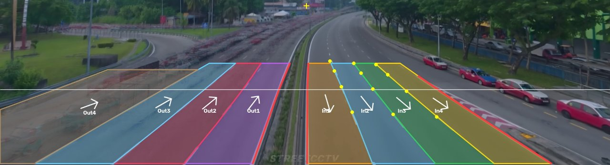
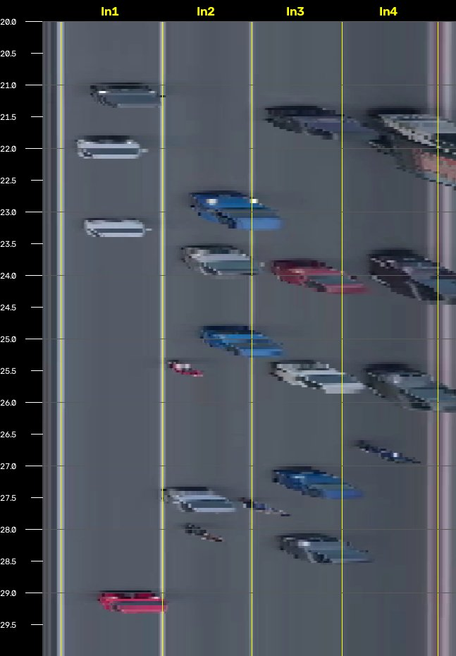
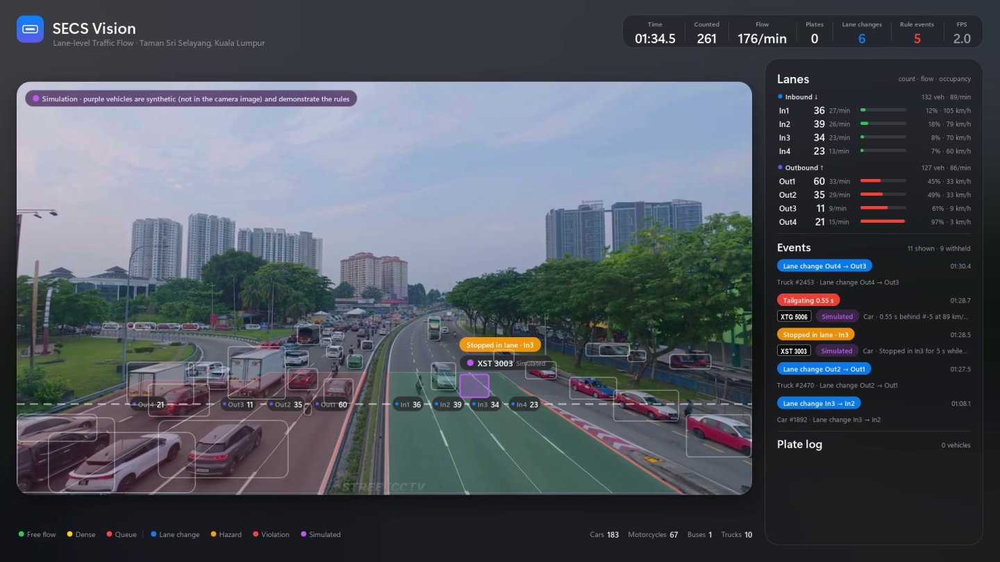
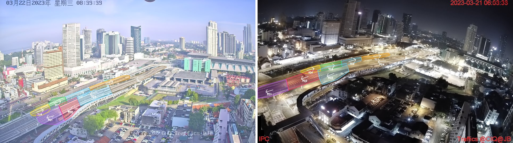
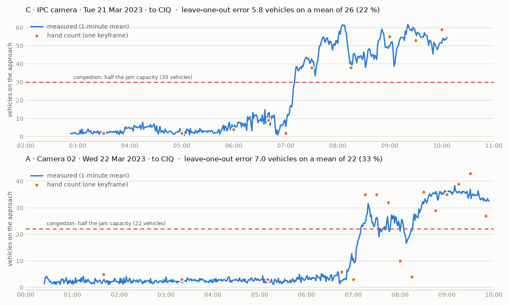
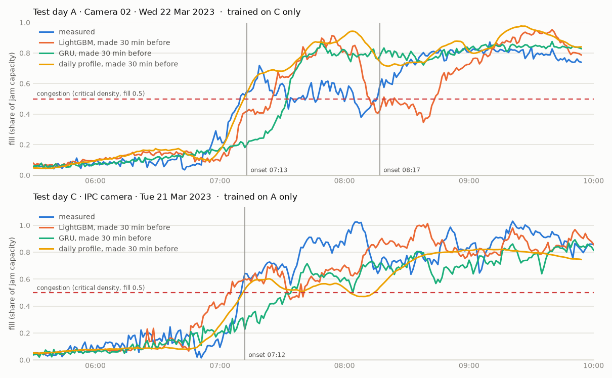
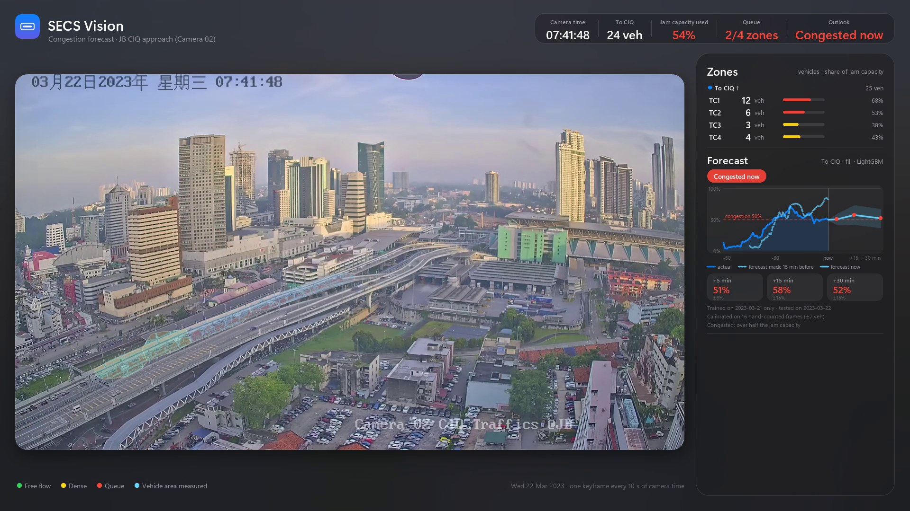

# Software Engineering Group Project: Malaysian ALPR and Traffic Flow Monitoring — Team Guide

[中文版 / Chinese version](TEAM_GUIDE.md)

This project targets **Malaysian licence plates**: still-image recognition; vehicle tracking, plate reading and traffic
counting in CCTV video; lane-level flow and dangerous-driving detection (section 5); peak-congestion forecasting on the
approach to the Johor Bahru checkpoint (section 10); and the speed-up (section 11).
Every accuracy figure was measured on Malaysian data whose **plate text was checked by hand, plate by plate** (see
"Evaluation method" below).

> About the "99.9%" in the old documents: that is the detector's mAP50 on the validation split of the `archive`
> dataset. `archive` contains **Indian plates**, its `valid` and `test` splits are the same images, and the best epoch
> was picked on those images, so the number says nothing about Malaysian plates.

## 1. Setup

Python 3.11 / 3.12. Install into the project's own virtual environment `.venv` (already in .gitignore), not into the
global Python. The reason: as soon as another project upgrades numpy to 2.x in the global environment (installing
xgboost / shap / pyarrow does that), torch 2.3's `torch.from_numpy` fails with "Numpy is not available" and the video
pipeline cannot run. From the repository root:

```bash
python -m venv .venv
.venv\Scripts\python -m pip install -r requirements.txt        # macOS / Linux: .venv/bin/python -m pip ...
```

Then run every command with `.venv\Scripts\python` (or run `.venv\Scripts\activate` once and use plain `python`).
`requirements.txt` pins `numpy<2`. In this venv all unit tests pass (now 85) and `malaysia_road_anpr` reproduces the committed
JSON field by field (tested with torch 2.3.1+cpu, ultralytics 8.4.171, numpy 1.26.4, opencv-python 4.11.0.86).

- Plate OCR uses `fast-plate-ocr` (its ~10 MB model downloads automatically on first run).
- The congestion measurement (section 10) decodes only keyframes with PyAV (`av`), which is in `requirements.txt`; a
  unit test checks that every third-party package the code imports is listed there
  (`test_requirements_cover_every_third_party_import`).
- Keep `requirements.txt` ASCII-only: pip on a Chinese-locale Windows reads it as GBK and stops at the first non-ASCII
  character.
- `fast-plate-ocr` / `easyocr` also pull in `opencv-python-headless`. If it is installed after `opencv-python`, `cv2` has
  no window support and the drawing window of `python -m alpr.lane_tool` fails with "The function is not implemented".
  Fix: `.venv\Scripts\python -m pip install --force-reinstall --no-deps opencv-python==4.11.0.86`.

## 2. Still images

```bash
python run_image.py --source "../Malaysian Car Plate Dataset/val/images"     # folder / single image / glob
```

Output goes to `outputs/images_alpr/`: an annotated copy of every image (green box = legal Malaysian plate,
orange box = non-standard text) and `results.json` (plate number, legal-format flag, state / category, OCR and
detector confidence).

Evaluate on a hand-labelled dataset:

```bash
python -m alpr.eval_images --dataset "../Malaysian Car Plate Dataset" --split val --gt alpr/gt/malaysia_val_plates.csv --save outputs/eval/val
```

Malaysian Car Plate Dataset validation split (89 images, 94 plates; plate text checked by hand, see
`alpr/gt/malaysia_val_plates.csv`):

| Setup | Detection recall | End-to-end exact | Two-row plates | Special series |
|---|---|---|---|---|
| Original code: detector trained on Indian data + EasyOCR | 82.1% | 41.5% | — | — |
| Indian detector + new OCR (fast-plate-ocr + Malaysian syntax-constrained decoding) | 82.1% | 79.8% | 12.5% | 83.3% |
| **Malaysian detector + new OCR (current default)** | **98.9%** | **94.7%** | **100%** | **100%** |

- Of the 5 remaining errors: 2 are blurry plates narrower than 60 px, 1 uses a custom font, 1 is a J/O confusion and
  1 is a missed detection.
- 13 detector "false positives", of which 11 are **real plates on background vehicles that the dataset did not label**
  (visible in `outputs/eval/val_final/`). Only 2 are true false detections (a parking sticker, and a phone number on a
  billboard, which is already marked "non-standard").
- Note: this validation split was used while developing the OCR (e.g. to choose the OCR model), so these are
  development-set results; the held-out video window is the clean test.

## 3. Video plate recognition + traffic flow

```bash
python run_alpr.py --profile malaysia_road_anpr                     # default 100-130 s, writes the demo video
python run_alpr.py --profile malaysia_road_anpr --start-sec 0 --duration 0   # whole clip
python -m alpr.evaluate --pred outputs/malaysia_road_anpr_30s.plates.json --gt alpr/gt/malaysia_road_anpr_100-130s.txt
```

Demo footage: "INTEL AIDA ANPR TESTING" by LILIN CCTV MALAYSIA (youtube.com/watch?v=raQOCJ_wzKE, a fixed roadside
ANPR camera). The video is a screen recording of the vendor's software, so `frame_crop` keeps only the camera view (the
vendor's own plate list is cropped out). Course demo use only; please credit the source.

**Demo video: `demo/malaysia_road_anpr_demo_30s.mp4`** (1920×1080, H.264, 30 s, 100–130 s). Layout: camera view on
the left (vehicle boxes + plate boxes + live readings; green = confirmed / valid, yellow = reading), plate log on the
right (one row per vehicle: plate, confidence, number of readings, state, vehicle type, sharpest plate crop), time /
crossing count / vehicles per minute / alert count in the top bar, per-type counts at the bottom.
Plate-verification alerts (red / orange badges) and the purple `SIMULATED EVENT` entries are explained in section 4.

The plates in all three time windows were checked by hand (`alpr/gt/malaysia_road_anpr_*.txt`):

| Window | Purpose | Plates | Correct | False positives |
|---|---|---|---|---|
| 48–82 s | development (tuning) | 4 | 4 | 0 |
| 100–130 s | demo video (looked at while diagnosing problems) | 9 | 8 | 0 |
| 0–44 s | held-out test (first run only after labelling) | 5 | 5 | 0 * |
| **Total** | | **18** | **17 (94.4%)** | **0** |

\* First run on the held-out window: 5/5 correct, but 5 extra entries (4 low-confidence TENTATIVE readings + 1 misread
from a fragment track of the same vehicle). The "log CONFIRMED only" and "merge near-identical plates" rules were
added afterwards to reach 0 false positives, so this 0 is no longer a completely clean test result.

Before the improvements (original video pipeline + new OCR) the demo window scored 6/9, and the same vehicle was
logged more than once. The only plate not read, `W 6954 F`, is hidden behind a CR-V for the whole of 106–111 s and
shows at the frame edge for less than a second.

What changed in the video pipeline (details in the comments at the top of `alpr/pipeline.py`):
1. **Tracking**: class-agnostic NMS (a pickup detected as both car and truck once split one vehicle into 17 tracks);
   low-score boxes go to ByteTrack's second association pass; a 2-second track buffer (tree occlusion); vehicle type
   and confidence thresholds are decided over the whole track.
2. **Two-row plates**: Malaysian detector + an aspect-ratio floor of 0.8.
3. **OCR-verified candidates**: the black grille below a plate gets detected as a "two-row plate"; when several
   candidate boxes overlap, the one that reads as a legal plate number wins.
4. **Voting**: weight = OCR confidence × quality × (plate width / 100 px)², so distant blurry readings (which are wrong
   in a consistent way) cannot outvote close, sharp ones; low-resolution readings are capped at 15, full-resolution
   readings are not capped; **every character needs a ≥60% majority** before the plate is CONFIRMED.
5. **Plate log**: one row per vehicle, CONFIRMED plates only; a plate identical to, or within 2 characters of, one seen
   in the last 10 seconds counts as the same vehicle (re-acquired).
6. **Traffic flow** (`alpr/flow.py`): counting line, per-type counts, vehicles per minute, a 10-second time series
   (the `flow` field of `*.plates.json`) that can be used directly as training data for a later flow-prediction model.

Speed: about 3–5 FPS on CPU only, including rendering (vehicle detection ~140 ms/frame, batched plate detection
~35 ms/vehicle, UI ~60 ms/frame, OCR very little). The demo videos are rendered offline and play back at a normal
30 FPS; real time needs a GPU, or exporting YOLO to OpenVINO / ONNX.

### Scene 2: guardhouse barrier gate (does the model work in more than one scene?)

```bash
python run_alpr.py --profile malaysia_guardhouse                              # 30 s demo (66–96 s)
python run_alpr.py --profile malaysia_guardhouse --start-sec 0 --duration 0   # whole 186 s clip
python -m alpr.evaluate --pred outputs/malaysia_guardhouse_30s.plates.json --gt alpr/gt/malaysia_guardhouse_0-186s.txt
```

Footage: "License plate recognition system for guard house" by LEAF SMART COMMUNITY
(youtube.com/watch?v=eNIGPl-W2II), a fixed CCTV at the barrier gate of a Malaysian building. Differences from scene 1:
an oblique close-up view, vehicles stop at the barrier (20–40 s) before passing, mostly lorries / pickups / vans, with
guards and motorcycles nearby. To download:
`python -m yt_dlp -f 137 -o data/videos/malaysia_guardhouse_lpr.mp4 https://www.youtube.com/watch?v=eNIGPl-W2II`

Method: **label first, run second**. All plates in the 186 s clip were checked by hand before the model ever ran on
it (`alpr/gt/malaysia_guardhouse_0-186s.txt`). The model and every threshold are the same as in scene 1; the
`malaysia_guardhouse` profile only sets the scene geometry: `frame_crop` removes the top 14.5% (plate text and a logo
overlaid by the vendor's system, which our OCR would otherwise read) and `count_line_y` places the counting line.

| Lane | Plates | Correct | False positives |
|---|---|---|---|
| Gate lane: `JKM 810`, `JPP 3473`, `JMT 8577` (two-row), `JME 5737`, `JMG 4910` | 5 | **5/5 (first run)** | **0** |

- Plates of vehicles in the other lane are only 40–60 px wide and very oblique; a human cannot verify them, so they are
  marked `?` in the GT. The system shows only yellow "reading" labels for them (e.g. a Myvi read as `SSY 110`); none
  of them enters the plate log.
- The counting line counts 4 vehicles, which is correct (the last one, `JMG 4910`, is still at the barrier when the
  clip ends).
- COCO vehicle detection classes pickups and vans as truck, so the log shows them as Truck.
- **Registry checks are off** for this clip: everything in view is a real vehicle, and with checks on, misread or
  unlisted plates would show as "unregistered".
- One UI issue was fixed while rendering: labels of several vehicles near the top of the frame used to overlap; they
  are now staggered automatically (both demo videos were re-rendered).

### Violation check demo: valid vs flagged plates (whole clip, 2 min 35 s)

```bash
python -m alpr.simulate                                  # builds data/videos/malaysia_road_violations_SIMULATED.mp4 (~25 min)
python run_alpr.py --profile malaysia_road_violations    # reads + checks the whole clip, ends with an 8 s summary card
python -m alpr.evaluate --pred outputs/malaysia_road_violations.plates.json --gt alpr/gt/simulated/malaysia_road_violations_0-155s.txt
```

**Why replace plates**: Malaysian registration data is not public, and there is no real footage online that comes
with "these vehicles are in violation". Even if a vehicle in view really were in violation, we could not verify it,
let alone label a real vehicle as a violator in a public repository. So in the whole scene-1 clip, 7 vehicles had their
plates digitally replaced with fictitious plates (X-series, or deliberately malformed), and their records were put
into the simulated registry; the other 13 vehicles keep their real plates and should all be judged valid.
A purple caption in the top-left corner says throughout that "7 vehicles carry digitally inserted fictitious plates".

**How the replacement works** (`alpr/simulate.py`, completely separate from the recognition pipeline, which does not
know which vehicles were altered):
1. Pass 1: track vehicles, detect and read plates with the same models as the pipeline, and find the target vehicles
   by their real plates (one vehicle is often split into several track segments; anything within 2 characters counts;
   of two segments visible at the same time only the one with more readings is kept, so a car passing in front is not
   mistaken for the target).
2. Pass 2: on every frame, re-detect the plate inside the vehicle box, pick the one whose reading is closest to the
   real plate, and replace it with a rendered Malaysian-style plate matched to the original's brightness, blur and
   noise. Nothing is pasted when the OCR is confident it is reading a *different* legal plate (that is a neighbouring
   vehicle), or when the plate is hidden.

**Results** (labels in `alpr/gt/simulated/`; each plate line ends with `! ALERT_CODE` giving the alert it should
raise, and `alpr.evaluate` checks every vehicle):

| Vehicle | Plate | Expected alert | Result |
|---|---|---|---|
| 12 real vehicles | real plates | none | plates 12/12 correct (`VCV 155` only "reading", see below), **0 false alerts** |
| white Honda City | XSA 1001 | EXPIRED + TYPE_MISMATCH | ✓ |
| silver Hyundai | XSE 5005 | UNMATCHED | ✓ |
| dark BMW | XSD 4004 | DUPLICATE (seen in Johor Bahru 17 minutes earlier, a simulated record from another camera) | ✓ |
| grey Mazda CX-5 | WXY 12345 | ILLEGAL_FORMAT | ✓ |
| silver Proton Persona | XSB 2002 | BLACKLIST | ✓ |
| red Iswara, Bezza | both carry XSG 7007 at the same time | DUPLICATE on both | ✓ ✓ |

**7/7 violations caught, 0 false alerts on real vehicles.** Also: the Myvi `W 6954 F`, hidden behind a CR-V the whole
time, is not read (same as scene 1); for `VCV 155` the OCR still flips half-and-half between `VCV155` and `VCV1555`
even when the plate is perfectly sharp, so it stays "reading" and is not checked.

Building this demo exposed 3 real problems, which were fixed (all with unit tests):
1. **An illegal plate was "corrected" into a legal one**: the OCR read the five-digit `WXY 12345` with high confidence,
   but the constrained decoder treated the fifth digit as an empty slot and produced the legal `WXY 1234`, letting the
   violation through. The decoder may now no longer drop (or invent) characters the OCR is confident about; a plate
   that would need a length change to become legal is judged non-standard, and consistent high-resolution readings
   over several frames raise `ILLEGAL_FORMAT`.
2. **Cloned plates were merged into one vehicle**: the second car confirmed its plate while stopped right behind the
   first, their boxes overlapped, and it was taken as "the same vehicle re-appearing"; 6 seconds of the two driving
   apart could not undo it. Now every frame records which vehicles are visible at the same time without overlapping;
   once two tracks in one log row are known to be separate vehicles, the later one is split into its own row and both
   rows are flagged as cloned.
3. **State of an illegal plate**: it used to show "Kuala Lumpur" based on the truncated plate; it now shows
   "non-standard format".

After these 3 changes every real video was re-run: the three scene-1 windows (5/5, 4/4, 8/9), scene 2 (5/5) and
still images (94.7%) are exactly as before, and no real vehicle raises an alert.

## 4. Plate verification and alerts (simulated registry)

> **The registry is SIMULATED, not real registration data.** Malaysian JPJ registration data is not public, so
> `data/registry/demo_registry.db` is a demo database generated by a script (SQLite, not in git). Because the
> repository is public:
> - fictitious vehicles' plates **all start with `X`** (no Malaysian state uses the X series), so they cannot match a
>   real vehicle;
> - the **real plates** hand-labelled in the demo videos and the dataset (the 112 plates in `alpr/gt/`) are only
>   **neutral placeholder records**: status ok, no road-tax date, no type or colour, so no rule can ever raise an
>   alert against them (the unit test `test_demo_registry_never_flags_a_real_plate` checks every one).

```bash
python -m alpr.registry --make-demo                        # build / rebuild the simulated registry (the pipeline builds it when missing)
python -m alpr.registry --check "XSB 2002" --vtype Car     # look up one plate
python run_alpr.py --profile malaysia_road_anpr            # video: checks are on in the demo profile
python run_image.py --source photos/ --check               # images: --check turns checks on (type unknown, so no TYPE_MISMATCH)
```

Six rules (`alpr/registry.py`, pure functions with unit tests):

| Alert | Meaning | Colour |
|---|---|---|
| `UNMATCHED` | the plate is not in the registry; one character off a registered plate is treated as an OCR misread and raises no alert (`registry_misread_tolerance`) | orange |
| `EXPIRED` | road tax expired before the observation time | orange |
| `ILLEGAL_FORMAT` | not a legal Malaysian plate format (`plates.parse_plate` / `OcrRead.valid`) | orange |
| `BLACKLIST` | registry status is blacklisted (e.g. reported stolen) | red |
| `TYPE_MISMATCH` | observed vehicle type does not match the registered type (e.g. a plate registered to a motorcycle on a car); optionally compares a rough HSV body colour (`registry_check_colour`, off by default, very sensitive to lighting) | orange |
| `DUPLICATE` | cloned plate suspected: the same plate on two separate vehicles in view at once (≥5 consecutive frames), or seen at another camera too far away to have driven here in the time between (implied speed > `registry_max_speed_kmh`, default 250 km/h) | red |

- **Video**: a vehicle is checked when it enters the plate log (CONFIRMED), and re-checked only when its CONFIRMED
  reading or vehicle type changes, so a passing TENTATIVE misread cannot raise or clear an alert. Alerts are written to
  `*.plates.json` (each plate row's `alerts`, plus a `registry` summary) and shown on the CCTV dashboard: a red /
  orange badge above the vehicle label, an alert line in the plate log (code + description), and the `ALERTS`
  counter in the top bar.
- Two vehicles **in view at the same time without overlapping** are no longer merged into one log row (previously,
  similar plates within 10 seconds were merged as one vehicle); an identical plate on both is a `DUPLICATE`.
- **Misread tolerance**: in the demo video VCH 1587 was briefly confirmed as VCR 1587, and VN 1683 as VW 1683; a
  plain lookup would have flagged these real vehicles as `UNMATCHED`. So a reading one character off a registered
  plate is treated as a misread (no alert, and none of that record's other rules apply). Every fictitious plate in the
  simulated registry is at least 2 characters away from every real plate, so a misread cannot land on a fictitious
  record.
- Type matching is lenient: SUVs / MPVs / pickups / vans are often detected as truck, so both Car and Truck count as a
  match; the mismatch that matters is something like "a motorcycle plate on a car".

**Simulated events in the demo**: real vehicles are never flagged, so the demo profile uses `registry_sim_events` to
add 4 simulated events with **fictitious plates** to the plate log at set times. On the dashboard they are marked with
a purple `SIMULATED EVENT` (there is no matching vehicle box in the view); in the JSON they are kept apart in
`simulated_events`, never mixed into the camera results, and do not affect `alpr.evaluate`.

| Time | Plate (fictitious) | Alert |
|---|---|---|
| 103 s | XSB 2002 | BLACKLIST (simulated: reported stolen) |
| 110 s | XSA 1001 | EXPIRED (road tax expired 2026-03-31) + TYPE_MISMATCH (registered as a motorcycle) |
| 117 s | XSE 5005 | UNMATCHED (not in the registry) |
| 124 s | XSD 4004 | DUPLICATE (seen in Johor Bahru 17 minutes earlier, about 290 km away) |

Notes:
- When run on other time windows (e.g. the whole clip), real plates outside `alpr/gt` are not in the simulated
  registry and show as `UNMATCHED`. That only means "not in the simulated registry", **not that the vehicle is
  unregistered**; OCR misreads 2 or more characters off also show as `UNMATCHED`. Do not publish this kind of output.
- `video_start_time` (2026-10-14 08:00) and `camera_latlon` (Kuala Lumpur) are a notional time and position for the
  demo, used for the road-tax and cross-camera travel-time calculations.
- All settings are under `registry_*` in `alpr/config.yaml`: `registry_enabled`, `registry_path`, `registry_rules`
  (to switch individual rules off), `registry_check_colour`, `registry_max_speed_kmh`, `registry_misread_tolerance`,
  `registry_sim_events`.

## 5. Lane-level flow and dangerous driving (Part 3, scene 3: fixed camera on a pedestrian bridge)

```bash
python run_alpr.py --profile malaysia_selayang_lanes          # whole 120 s + 8 s summary card (~30 min on CPU)
python -m alpr.lane_eval --pred outputs/malaysia_selayang_lanes.plates.json --gt alpr/gt/malaysia_selayang_lanes_0-120s.txt
python -m alpr.lane_tool --profile malaysia_selayang_lanes --show outputs/lanes.jpg     # check the lane configuration
python -m alpr.lane_tool --profile malaysia_selayang_lanes                             # draw lanes with the mouse (new camera)
```

**Footage**: "Taman Sri Selayang Traffic Flow | Kuala Lumpur Morning || 4K" by the Streetcctv channel
(youtube.com/watch?v=KGHhxfkqypg), 15:00–17:00, shot from a tripod on a pedestrian bridge (the image drifts < 2 px
over 120 s). Four lanes each way: the right-hand carriageway (Inbound, towards the camera) flows freely; the left-hand
carriageway (Outbound) is heavily congested, with motorcycles filtering along the lane lines. On the right there is
also a taxi lay-by (not a lane). The video has no format 137, so a 2-minute 1080p60 section (format 299) was
downloaded:
`python -m yt_dlp -f 299 --download-sections "*900-1020" --ffmpeg-location <imageio-ffmpeg's ffmpeg> -o data/videos/malaysia_selayang_overhead.mp4 https://www.youtube.com/watch?v=KGHhxfkqypg`
(`python -c "import imageio_ffmpeg; print(imageio_ffmpeg.get_ffmpeg_exe())"` finds ffmpeg).
None of the existing videos was suitable: the LILIN roadside camera is too low, faces the traffic head-on and has
faint lane lines; `malaysia_kl_traffic.mp4` is a dashcam; `candidates/malaysia_sgbuloh_overhead.mp4` has an elevated
view but is hand-held (shake and zoom). The Chinese clip `cctv_traffic_scene3.mp4` was kept only as a development
fallback and was not used in the end.

### 5.1 Lane configuration per camera

Everything lives in the `malaysia_selayang_lanes` profile in `alpr/config.yaml` (coordinates are fractions of the
frame, independent of resolution):
- `lanes`: one polygon per lane + direction of travel (`up` / `down`) + carriageway group (a lane change only counts
  within one group). Lanes are numbered from the central median, 1 = fast lane. Out4 includes the exit lane to the
  slip road (no lane line separates them at the counting line).
- `solid_lines`: solid lines (the edge of the hatched area on the right of the inbound carriageway, and the median
  edges on both sides).
- `calibration`: calibration points (see 5.3).
- Draw lanes with `python -m alpr.lane_tool`: the background is the **per-pixel median of 80 frames** across the clip,
  so moving vehicles disappear and only the empty road and markings remain. Left click adds a point, right click
  undoes, Enter finishes (type the lane name and direction in the console); `l / s / c` switch between lanes / solid
  lines / calibration points; the output is YAML ready to paste. This time the lane lines were fitted to a marking
  mask (top-hat filter) on the median image; `--show` draws the configuration back onto the image for checking.



**Lane assignment** (following Paper 4 of the Part 3 literature review): a vehicle's lane is decided by the
**bottom-centre of its box**, smoothed along the track. A new lane only counts after 0.3 s in a row and once the point
is some distance past the lane line (`lane_min_sec`, `lane_margin`), so a vehicle driving on a line does not flip back
and forth.
**We found and fixed a problem**: the camera is above the middle of the road, so vehicles off to one side show their
flank, their box widens towards the vanishing point and the bottom-centre shifts with it. For vehicles in the outermost
lanes the point sat at 13–26% of their own lane (ideally 50%), and near the bottom of the frame only 0.13 lane widths
from the line, so they were assigned to the neighbouring lane. The correction has a single parameter:
`x' = x + k·(x − x_vanishing)·(y − y_vanishing)/frame_height`, with k = 0.3 fitted on the first 40 s only; after the
correction the points of all four lanes sit at 46–62%.
See 5.5 for the effect (no change at the counting line, a clear improvement in the outer lanes near the camera).

### 5.2 Per-lane metrics (`alpr/flow.py`)

- **Per-lane counts**: the vehicle's lane is recorded when it crosses the counting line (`count_line_y`); **veh/min**
  over the last 60 seconds.
- **Occupancy**: time occupancy, i.e. the fraction of time the lane's stretch of the counting line is covered by a
  vehicle (a virtual loop). Note that this is occupancy in the image plane: the bodies of tall vehicles (lorries) make
  it read higher than an inductive loop would.
- **Density**: number of vehicles inside the lane polygon; with a calibration, divided by the length of the lane area,
  in veh/km.
- **Time series**: `lanes.per_10s` in `*.plates.json` has one row per lane every 10 seconds (count, veh/min,
  occupancy, mean number of vehicles, density, mean speed); `lanes.crossings` lists every crossing (used by
  `alpr.lane_eval` for scoring).
- On the dashboard lanes are tinted by occupancy: green = free flow (< 20%), yellow = dense, red = queue (≥ 45%).

### 5.3 Calibration, speed and error

Speed and following distance are computed **only after calibration**, and every speed carries an error bar; an
uncalibrated camera never outputs km/h.
- The homography (image → road surface, in metres) is fitted to 12 points: the far ends of the dashes over 4 dash
  cycles on three inbound lane lines. Lane width 3.5 m (JKR) gives the lateral scale, the dash cycle the longitudinal
  scale.
- **The dash cycle was measured**: the first calibration assumed the rural standard of a 4.5 m line + 7.5 m gap
  (12 m), which put the median free-flow speed at 135 km/h, clearly wrong. So the **wheelbase** was used as an
  independent check: both wheels touch the road, so the homography can measure the wheelbase directly. 3 parked
  Proton taxis (wheelbase 2.465 m) and 2 cars gave a cycle of 5.9 ± 0.35 m, and the dash / cycle ratio in the image is
  0.34 (2 m line + 4 m gap = 0.33), so 6 m was adopted. After calibration the median free-flow speed is about 67 km/h,
  which fits this urban expressway.
- Checks: fit residual RMS 0.13 m; the two lane lines not used in the fit give lane widths of 3.4–3.5 m.
- **Error**: 200 Monte Carlo runs (lane width ±5%, dash cycle ±6%, click position ±2 px) → 6.5% 1σ relative error on
  distance and speed, plus the residual of each track's straight-line fit. So a vehicle at 80 km/h is reported as about
  80 ± 5 km/h (1σ).
- Speeding uses the **lower end** of the 95% interval (speed − 2σ > limit); the 80 km/h limit is an assumed value for
  the demo.
- Tailgating: the **time headway** between two vehicles in the same lane at the counting line (front to front, using
  the same reference point, so vehicle length is not needed) < 0.8 s, with the follower at ≥ 50 km/h (again using the
  lower end). Motorcycles take no part (they ride side by side with cars inside a lane); a front-to-front gap < 4 m does
  not count (that is a vehicle alongside, or one vehicle split into two boxes). The first full run showed a 0.14 s
  (~3 m) "tailgate" for exactly this reason.

### 5.4 Dangerous-driving rules (`alpr/behaviour.py`, each with unit tests on synthetic trajectories)

| Event | Rule | Level |
|---|---|---|
| `LANE_CHANGE` | the smoothed lane changes within one carriageway group (not reported for motorcycles: they filter along lane lines in queued traffic, so "lane" has no meaning for them) | info (blue) |
| `SOLID_LINE` | the smoothed point crosses a solid line and stays on the other side (changing lanes across a solid line, cutting through the hatched area) | violation (red) |
| `WRONG_WAY` | inside one lane, moves ≥ 0.8 box heights against the lane's direction within 1 s | violation (red) |
| `STOPPED` | stands still in a lane for 5 s while other vehicles in the same direction are moving; **standing in a queue does not count**, and lay-bys / shoulders are not lanes | hazard (orange) |
| `SPEEDING` | needs calibration; the lower end of the 95% speed interval is above the limit | violation (red) |
| `TAILGATING` | needs calibration; time headway at the count line < 0.8 s in the same lane, follower ≥ 50 km/h (motorcycles take no part; a front-to-front gap < 4 m counts as side by side) | violation (red) |

Motion thresholds are measured in "box heights per second", so they work for near and far vehicles alike without a
calibration. Every event is linked to the vehicle's plate-log entry (the plate when it has been read, otherwise the
vehicle type and track ID).

> **How public footage is handled**: the repository is public, so **violations by real vehicles are not shown and not
> linked to a plate**; they are only counted in the console and the JSON (`lanes.withheld_violations`). Lane changes
> (info) and stopped vehicles (hazard warning) are not violations and are shown normally.
> The violation rules are demonstrated with **simulated vehicles**: `behaviour_sim_tracks` in the configuration defines
> trajectories in road coordinates (metres) with fictitious X-series plates. They are drawn as translucent purple
> vehicles labelled "Simulated", a purple caption stays in the top-left corner, and the end-of-session summary marks
> them separately. Simulated vehicles go through exactly the same rules as real ones but are not counted in the flow.
> Each scenario is placed in a time span where that lane has no real vehicle in the GT.

| Time | Simulated vehicle | Rule demonstrated |
|---|---|---|
| 8.0 s | XWW 1001, wrong way in In1 (~30 km/h) | WRONG_WAY |
| 15.5 s | XSP 4004, In2, 115 km/h | SPEEDING |
| 17.5 s | XSL 2002, cuts from In4 across the solid line into the hatched area | SOLID_LINE |
| 85.5 s | XST 3003, stops in In3 for 8.5 s | STOPPED |
| 87.0 s | XTG 5005 / XTG 5006, 0.55 s apart in In1 at 90 km/h | TAILGATING (the follower) |

### 5.5 Evaluation: per-lane counting accuracy

`alpr/gt/malaysia_selayang_lanes_0-120s.txt` was **counted by hand**: the video was first turned into a **slit-scan
image** (the pixel row at the counting line taken from every frame and stacked top to bottom in time order). Every
vehicle crossing the line leaves a "block" in the column of its lane, and a motorcycle leaves a thin streak. These were
counted one by one on the image, recording time and lane (for inbound traffic the top of the block = the front reaching
the line, and the lane is the one containing the centre of the vehicle's front). 6 unclear cases were confirmed against
the original video frames. The detector is not involved at any point.
`python -m alpr.lane_eval --slitscan --profile malaysia_selayang_lanes --group Inbound` regenerates the images.



The GT covers **every vehicle (motorcycles included) in the 4 inbound lanes, 183 in total** (117 cars, 8 lorries /
pickups / semi-trailers, 58 motorcycles). A further random sample of 12 GT entries was checked against the original
frames, and all 12 were correct.
The outbound carriageway is not labelled: it is a long stop-and-go queue, lorries stand on a line for ten seconds or
more, Out4 and the exit lane are mixed together, and about 1.5 motorcycles per second filter along the Out1|Out2 lane
line and cannot be assigned to any one lane.

Method (`alpr/lane_eval.py`): predicted crossings are matched one-to-one with the GT within ±1 second (same lane
first); a match in time but not in lane is a "wrong lane". Each lane reports the count accuracy
1 − |predicted − GT| / GT (the metric used by Paper 4), plus precision / recall.
The first 40 seconds are the development window (used to choose the input size, tracker settings and the correction
parameter k); 40–120 s is the held-out test.

**Results** (`demo/malaysia_selayang_lanes_demo.plates.json`, 183 inbound vehicles):

| Lane | GT | Predicted | Matched | Count accuracy | Precision | Recall |
|---|---|---|---|---|---|---|
| In1 | 44 | 42 | 42 | 95.5% | 100% | 95.5% |
| In2 | 57 | 51 | 51 | 89.5% | 100% | 89.5% |
| In3 | 51 | 50 | 48 | 98.0% | 96.0% | 94.1% |
| In4 | 31 | 27 | 27 | 87.1% | 100% | 87.1% |
| **All vehicles** | **183** | **170** | **168** | **mean 92.5%** (weighted 92.9%) | **98.8%** | **91.8%** |

| Scope | Per-lane count accuracy (mean) | Precision | Recall |
|---|---|---|---|
| All vehicles, 0–120 s | 92.5% | 98.8% | 91.8% |
| Four-wheeled vehicles (cars + lorries / buses), 0–120 s | **96.2%** | 98.4% | 98.4% |
| All vehicles, held-out window 40–120 s | 92.2% | 98.2% | 93.2% |
| Four-wheeled vehicles, held-out window 40–120 s | 93.9% | 97.5% | 97.5% |
| Motorcycles, 0–120 s | 45 / 58 counted (77.6%) | | |

- **No over-counting** (0 extra crossings). All 13 misses are motorcycles (only ~25 px wide in the distance, with
  detection scores hovering around the threshold). 2 vehicles got the wrong lane, both riding on a lane line as they
  crossed: a car straddling the In3|In4 line at 62.2 s, and a white car merging from In3 into In2 at 67.6 s (the system
  confirmed the lane change 0.5 s after it crossed, so it was counted in In3).
- The 96.2% for four-wheeled vehicles is in line with the ~95% reported by Paper 4.
- **Effect of some design decisions** (all decided on the 0–40 s development window):
  - Input size 960 → 1280: motorcycles 1/19 → 9/19; with looser ByteTrack settings on top
    (`alpr/trackers/bytetrack_small.yaml`, used only for this camera) → 12/19, still with 0 over-counts. The reason:
    motorcycle tracks broke every few frames and got a new ID, so they never crossed the counting line as one track.
  - Perspective correction k = 0.3: no change in the counts at the counting line (the shift has not yet crossed a lane
    line there); it acts on the outer lanes near the camera: the share of points at the bottom of the frame (y > 950)
    that stay in their own lane goes from 90% to 100% for In4 and from 91% to 100% for Out4 (this matters for per-lane
    occupancy and density).
  - The top edge of the lane polygons moved down from y = 0.64 to 0.70: further away the road starts to curve and the
    lane lines are extrapolated from the fit, so distant vehicles were assigned to the neighbouring lane and then
    "changed lanes" back as they came closer. All 9 such "lane changes" on the inbound side (checked by reviewing the
    tracks: all were false changes starting at the very top of the polygons) disappeared, with no change in the counts.
  - Wrong way: vehicles on the slip road curving back towards the camera were once flagged as wrong-way in Out4 (the
    vehicle had already left every lane polygon, but the tracker still remembered its lane). The rule now requires the
    vehicle to be in the same lane at both ends of the 1-second window, and the left edge of Out4 was pulled in 50 px
    from the guard-rail line.
  - The tracker settings and input size only affect this profile; the plate-recognition profiles are not affected (see
    the regression check below).

**How the rules behave on real footage** (whole 120 s):
- All 5 simulated scenarios fire as intended: wrong way (8.6 s), speeding 114 ± 15 km/h (16.6 s), solid line (19.7 s),
  stopped in a lane (88.5 s), tailgating 0.55 s (88.7 s).
- 7 lane changes are shown for real vehicles. Watching each one in the video: 4 are clear lane changes (an ambulance
  cutting into the fast lane through the congestion, and two lorries and a van merging into Out3 from the exit-lane
  side), and 3 are vehicles driving along a lane line and ending up on the other side (borderline cases). There is no
  lane-change GT, so this is a manual review, not a measured precision.
- Rule triggers on real vehicles that were **withheld**: 10. 7 cars in the fast lane In1 measured at 99–115 km/h (above
  the assumed 80 km/h limit, error ±13–15 km/h, judged on the lower end), and 3 headways of 0.72–0.76 s (62–81 km/h).
  These are only counted, not shown and not linked to a plate. No stopped or wrong-way events occurred for real
  vehicles. (Before the fixes there were 22: 12 of the "tailgates" were motorcycles side by side or two boxes on one
  vehicle, with front-to-front gaps as short as 3 m.)
- Measured speeds (after calibration, mean per lane): In1 fast lane 87 km/h, In2 67, In3 65, In4 58 km/h; on the
  congested side Out1–Out4 27 / 22 / 7 / 8 km/h with 58–91% occupancy, shown on the dashboard as a red "queue".
- This camera is too high: plates are only about a dozen pixels wide, so none can be read (the plate log is empty).
  Linking events to plates is verified by a unit test (`test_lane_events_link_to_the_plate_once_it_is_read`).

**Regression check** (re-run after the changes): scene 1, 100–130 s is still 8/9 with 0 false positives (plates, flow
and simulated events identical to the previous JSON); scene 2, whole clip, 5/5 with 0 false positives; the violation
demo, whole clip, still catches 7/7 violations with 0 false alerts on real vehicles (plates, alerts and flow identical
to the previous JSON). All 70 unit tests pass (the original 56 + 14 new).

**Demo video: `demo/malaysia_selayang_lanes_demo.mp4`** (1920×1080, H.264, 2 min 8 s = the whole 120 s + an 8 s
summary card). About 2 FPS on CPU only (vehicle detection at 1280 input is the bottleneck).



## 6. Code layout (`alpr/`)

| File | Purpose |
|---|---|
| `config.yaml` / `config.py` | every threshold and one configuration (profile) per video; `image` is the still-image profile |
| `image.py` | still images: whole-image plate detection → crop → OCR → Malaysian syntax |
| `pipeline.py` | video: vehicle detection + ByteTrack tracking → plate detection → OCR → multi-frame voting → plate log → flow counting; OpenVINO backend, headless mode, rotating-view filter (`view_gate`) (section 11) |
| `ocr.py` | OCR backends: `fast_plate_ocr` (default) / `easyocr` (fallback) |
| `plates.py` | Malaysian plate syntax: standard formats, special series (GOLD, VIP, 1M4U, PUTRAJAYA …), states, constrained decoding |
| `voting.py` | weighted voting over one vehicle's readings across frames (close, sharp readings weigh more) |
| `flow.py` | counting-line traffic flow (per type, vehicles per minute, 10-second time series for later flow prediction); per-lane counts, occupancy and density (`LaneMetrics`) |
| `lanes.py` | lane geometry: lane polygons, direction of travel, solid lines, reference point (bottom-centre + perspective correction), smoothed lane assignment (`LaneAssigner`), calibration and speed error (`Calibration`) |
| `behaviour.py` | dangerous-driving rules (lane change, solid line, wrong way, stopped in a lane, speeding, tailgating), withholding violations on public footage, simulated vehicles (`SimulatedTraffic`) |
| `lane_tool.py` | click tool for drawing lanes / solid lines / calibration points; `--show` draws the configuration onto the empty-road median image for checking |
| `lane_eval.py` | per-lane counting evaluation + the slit-scan images used for hand counting |
| `trackers/bytetrack_small.yaml` | looser ByteTrack settings for small objects (distant motorcycles), used only by the lane camera |
| `registry.py` | simulated registry (SQLite) + six verification rules + demo-registry generator (`python -m alpr.registry --make-demo`) |
| `simulate.py` / `simulation.yaml` | builds the violation demo video: replaces chosen vehicles' plates with fictitious ones (`python -m alpr.simulate`) |
| `hud.py` | rendering: CCTV dashboard (`dashboard`), dashcam AR card (`lead`), end-of-session summary card, plate badges, lane and event panels, congestion forecast panel (`render_forecast_panel`); Apple style (see section 9) |
| `congestion.py` | congestion measurement for distant, high cameras: keyframes → texture occupancy per zone → calibration to hand counts → vehicles, fill, queued zones → 1-minute series (section 10) |
| `forecast.py` | seven forecasting models, past-only features, evaluation (MAE / RMSE, congestion precision / recall / warning time) and CLI |
| `forecast_demo.py` / `forecast_figures.py` | time-lapse demo video with the forecast panel, and the figures of section 10 |
| `series.py` | turns a lane camera's results JSON into 1-minute per-lane series (flow, occupancy, density, speed) |
| `download_hls.py` | parallel download of recorded YouTube live streams (hourly pieces, resumable) |
| `benchmark.py` | speed benchmark: time per stage, original setup vs OpenVINO / headless (section 11) |
| `views/` | templates that recognise one view of a rotating stream (`view_gate`) |
| `dataset.py` | reads YOLO labels (polygons / boxes) and builds the single-class plate training set |
| `eval_images.py` / `evaluate.py` | image / video evaluation scripts |
| `gt/` | hand-verified plate-text labels; `malaysia_selayang_lanes_0-120s.txt` holds the hand-counted per-lane crossings; `causeway/` holds the hand counts of vehicles per zone and frame for the Causeway cameras |
| `tests/test_alpr.py` | unit tests (`python alpr/tests/test_alpr.py`, no models or GPU needed) |

## 7. Evaluation method and known limitations

- **The GT is checked by hand**: every plate was read character by character from a zoomed-in image; vehicles that
  cannot be made out are marked `?` in the video GT (counted neither as a hit nor as a false positive).
- **Still images**: only the validation split has text labels; the training split (414 images) was used to train the
  Malaysian detector (`models/plate_malaysia.pt`, trained 40 more epochs from `finetuned.pt`, always using the last
  epoch `last.pt`, with no epoch picked on the validation split). To reproduce the training:
  `python -m alpr.dataset --src "../Malaysian Car Plate Dataset" --dst data/malaysia_plates_yolo`, then train with
  ultralytics.
- **Known limitations**: small plates narrower than 60 px are still often misread; a few plates (e.g. `VCV 155`) make
  the OCR flip between two readings even when sharp, so they only reach "reading"; look-alike characters such as H/R
  and M/W can be misread briefly in shadow (corrected within about a second); diplomatic and dealer trade plates are not
  supported; on the CPU, plate reading is not yet fully real time (OpenVINO + headless mode: section 11).
- **Speeding / following distance** are computed only for calibrated cameras (section 5.3), and every speed carries an
  error bar; the calibration depends on the lane width and the measured dash cycle, so a new camera needs a new
  calibration.

## 8. Suggested next steps

1. Congestion forecasting has a first version (section 10); what it needs most is more days of data (several weeks,
   including Fridays, weekends and holidays), then the comparison of 10.5 again.
2. Lane-level flow and dangerous driving are done (section 5); a YOLOP-style model could find lane lines automatically
   (no manual configuration).
3. Real time: a CUDA build of torch on the RTX 5070 laptop GPU (section 11), followed by the accuracy regression.
4. Plate verification: the rules and the simulated registry are done (section 4); with real / authorised registration
   data only `registry_path` needs to change. For a multi-camera deployment, write every recognition into the
   `sightings` table and the cross-camera `DUPLICATE` check will run on real data.
5. AR / VR: the `lead` mode of `hud.py` already uses an AR-card style and can be connected to a glasses view.
6. Generative AI: e.g. a VLM re-checking low-confidence plates, or automatically generated traffic reports.

## 9. UI design and code optimisation (2026-10-15)

**UI (`alpr/hud.py`, inspired by Apple's dark-mode design)**:
- The camera view is a rounded card floating on an "ambient backdrop" (the current frame, heavily blurred and darkened),
  with a soft shadow under the card; the sidebar and labels are frosted glass.
- Apple system colours: green = valid / confirmed, yellow = reading, grey = searching for a plate, orange = alert,
  red = severe alert, purple = simulated event. Colour is used only for status dots, outlines and alert pills; large
  areas stay neutral.
- Text uses Segoe UI Variable (the closest font to SF Pro on Windows 11) in sentence case; alerts are written in plain
  language ("Road tax expired", "Cloned plate"), while the JSON keeps the alert codes.
- Plates are shown like real plates (white-on-black badge, Arial Narrow Bold), next to the plate crop captured by the
  camera for easy visual comparison.
- Distant vehicles whose plate has not been read yet get only a faint outline and no label, to reduce clutter.
- All rounded corners and thin lines are anti-aliased (4× supersampled masks, cached by size); still-image annotation,
  the dashcam HUD and the end-of-session summary card share the same style.

**Code optimisation** (after the changes, the recognition results of every video window and of the still images are
exactly the same as before, and all 56 unit tests passed):

| Problem | Improvement |
|---|---|
| The plate detector was called once per vehicle | All vehicles in a frame are detected in one batch; plate detection is ~35% faster |
| OpenCV wrote MPEG-4, then ffmpeg converted it to H.264 | Encoded straight to H.264 in one pass (faster, one less generation of quality loss) |
| The "seen together" record for vehicle pairs stored every frame number, and each update walked all pairs | Now a count + a per-vehicle index: memory no longer grows on long videos, and lookups are O(1) |
| The on-screen FPS excluded UI rendering time | Now the real frame rate (detection + rendering + video I/O) |
| Plate detection did not exclude watermark areas (in the dashcam video a plate box landed on the "MALAYSIA" watermark) | `ignore_zones` now applies to plates too |
| The simulated registry was rebuilt only after a manual version bump, so newly labelled real plates could be falsely flagged "unregistered" | A fingerprint of the labels is computed automatically; the registry rebuilds whenever they change |
| "Vehicles per minute" was inflated at the start of a video (1 vehicle in 3 s = 20 per minute) | The rate uses a span of at least 15 seconds |
| The new UI initially took 500 ms per frame | Outlines blend only the edge bands, the backdrop and shadow are computed at 1/4 resolution, and `cv2.blendLinear` is used: down to ~60 ms |

Overall speed: processing the whole 155 s violation video went from 1395 s to 1047 s (3.3 → 4.4 FPS). Although the
new UI is more complex, the whole run is about 25% faster.

**Further improvements (not done this time)**:
- Vehicle detection (YOLOv8s, ~140 ms/frame) is the biggest bottleneck on CPU; exporting to OpenVINO (Intel CPU) or
  using a GPU could get close to real time, but needs new dependencies. (The OpenVINO part is done in section 11.)
- `resolve_ligatures` in `voting.py` (the W↔VJ ligature fix) is legacy logic for EasyOCR, off by default, and can be
  deleted.
- For live streams lasting several hours, the tracking state of vehicles that have left the frame should be pruned
  periodically (so far only tested on video clips).

## 10. Peak-congestion forecasting (Part 3: machine learning / deep learning)

Goal: from what the cameras measure on the road, forecast 5, 15 and 30 minutes ahead whether the road into the Johor
Bahru checkpoint (CIQ, Bangunan Sultan Iskandar) will be congested.

```bash
# 1) download the recordings (YouTube live-stream archives, the best quality, 1080p; hourly pieces, parallel, resumable)
python -m alpr.download_hls uAVdyvglPco 270 data/videos/causeway/jb_ciq_cam02_2023-03-22
python -m alpr.download_hls uMBo-qx9M2U 270 data/videos/causeway/jb_ciq_ipc_2023-03-21 --end-sec 28440
# 2) measure: decode only the keyframes (about one every 5 s) -> texture occupancy per zone; ~3 min per 10 h of video
python -m alpr.congestion --profile jb_ciq_cam02_2023-03-22 --measure
# 3) hand counts + calibration: writes enlarged zone crops; the counts go into alpr/gt/causeway/<profile>.txt
python -m alpr.congestion --profile jb_ciq_cam02_2023-03-22 --gt-sheets 07:15 08:45
python -m alpr.congestion --profile jb_ciq_cam02_2023-03-22 --calibrate
# 4) 1-minute series: occupancy, vehicles, fill, queued zones
python -m alpr.congestion --profile jb_ciq_cam02_2023-03-22 --series data/series/jb_ciq_cam02_2023-03-22.csv
# 5) forecasting evaluation: train on one day, test on the other, both ways
python -m alpr.forecast --days data/series/jb_ciq_ipc_2023-03-21.csv data/series/jb_ciq_cam02_2023-03-22.csv \
    --entity "To CIQ" --measures fill --extra none --pool TC1,TC2,TC3,TC4 \
    --congestion 0.5 --congestion-measure fill --out outputs/forecast/to_ciq_AC_fill_pool.json
# 6) demo video (time-lapse + forecast panel) and the figures of this section
python -m alpr.forecast_demo --profile jb_ciq_cam02_2023-03-22 --train data/series/jb_ciq_ipc_2023-03-21.csv \
    --test data/series/jb_ciq_cam02_2023-03-22.csv --entity "To CIQ" --pool TC1,TC2,TC3,TC4 \
    --from 05:30 --to 09:50 --every 10 --out demo/jb_ciq_forecast_timelapse.mp4
python -m alpr.forecast_figures --out docs/images
```

Step 5 can be rerun without the videos: the 1-minute series and calibrations of the three cameras are in
`docs/data/causeway/`; copy them to `data/series/`.

### 10.1 Data: three recordings of about 10 hours each

| Code | Recording | Camera / place | Date | Time used (on-screen clock) | Download |
|---|---|---|---|---|---|
| A | youtube.com/watch?v=uAVdyvglPco (Live Traffics 2/2) | "Camera 02 CIQ Traffics @JB": a high-rise view of the elevated approach road to the CIQ | Wed 22 Mar 2023 | 00:25–09:55 | 1080p, 8.6 GB |
| C | youtube.com/watch?v=uMBo-qx9M2U (same channel) | the "IPC" camera: another building, the same approach road | Tue 21 Mar 2023 | 02:52–10:06 | 1080p, first 7.9 h only, 14 GB |
| B | youtube.com/watch?v=MjUd_NZOa4U (Live Traffics 1/2) | the Causeway approach; four views take turns every 10 s, only the "Causeway Link" view is used | Fri 12 Jan 2024 | 00:25–11:12 | 1080p, 12 GB |



- The videos live on drive D (`D:\SECS_data\causeway`) and are used through the directory junction
  `data/videos/causeway` (`data/` is not in the repository). Each hourly piece has a `.json` next to it with its start
  second within the whole stream, used for the clock.
- **Time follows the on-screen clock.** yt-dlp's `release_timestamp` (start of the live stream) differs from the
  on-screen clock by a constant: −13 s for A (checked on 19 frames), +145 s for C (the first 40 minutes of the recording
  have gaps, the offset jumps from −16 s to +145 s, so that part is not used), +15 s for B (the recording has a gap
  between 03:27 and 04:15 and the offset is −10 s before it; B is not part of the forecasting evaluation, so +15 s is
  used throughout).
- **Is the camera fixed?** Checked on YouTube's thumbnail storyboard (one thumbnail every 10 s for the whole stream): A
  and C show the same fixed view all night, with no cuts, pans or zooms. B rotates (four views, 10 s each); the
  "Causeway Link" text at the bottom left is template-matched (`view_gate` in the profile) and only that view is
  analysed (about 22 s per minute); tracking restarts every time the view comes back.
- The planned pair was A and B, but B is another place on another day and cannot be the training / test partner of A,
  so C was added: the same road as A, the day before, another camera. **The forecasting evaluation uses A↔C.**

### 10.2 Measurement: why not detect vehicle by vehicle

Both cameras sit on top of high-rise buildings. On the approach road to the CIQ the cars are only 15–40 px wide, the
parapet of the elevated road hides their lower half, and in the morning queue they stand bumper to bumper. Even on 3×
enlarged tiles at confidence 0.05, COCO's YOLOv8s finds 1 of the 38 cars queueing in camera C's four zones at 07:30, and
5 of 53 at 09:30. So vehicles are not counted one by one; like a traffic engineer's video
detector, the system measures *presence* (`alpr/congestion.py`):

1. **Only keyframes are decoded** (about one every 5 s, PyAV `skip_frame=NONKEY`): 10 hours of video take about
   3 minutes, roughly 200× real time.
2. **Zones**: each direction is split into 4 zones along the road, e.g. `TC1`–`TC4` towards the CIQ (`TC1` at the CIQ
   end, i.e. the head of the queue). The zones come from optical flow: the mean direction of motion of every pixel over
   08:00–09:30 marks where each direction's traffic runs, which is then cut into equal parts along the road; checked
   with `python -m alpr.lane_tool --show`.
3. **Texture occupancy**: the share of a zone's pixels that lie on an edge (Sobel gradient ≥ 40 after a slight blur).
   An empty road is smooth with a few lane markings and parapets; a queue is a dense texture of roofs, windows and gaps.
   The markings and parapets that every frame has are a constant per zone, removed by the calibration below. (A first
   version masked edges present in most frames of the day as "static background"; camera C's queue lasts all morning
   and was masked with them, so that idea was dropped.)
4. **Calibration to hand counts**: one line per zone, vehicles = a × occupancy + b (plus a constant under the street
   lights at night).
5. **Fill** = vehicles ÷ the zone's jam capacity (its largest hand count, i.e. a standstill queue). **Fill ≥ 0.5 is
   congestion**: in the Greenshields traffic-flow model, once the density passes half the jam density (the critical
   density) the flow falls as the density rises. Fill does not depend on the camera's distance or the zone's length, so
   both cameras' data can be used together.

### 10.3 Validation against hand counts (by lighting)

Hand counts: each zone of a keyframe is enlarged and the vehicles whose wheels are inside it are counted
(`alpr/gt/causeway/*.txt`; the system's numbers were not looked at while counting). A: 16 frames, C: 10 frames, four
zones each. Errors are leave-one-out: each frame is left out in turn, the calibration is fitted on the others and
then estimates the frame that was left out.

| Towards the CIQ (sum of 4 zones) | C (Tuesday) | A (Wednesday) |
|---|---|---|
| All frames: mean error / mean count | 5.8 / 26.2 vehicles (22%), r = 0.95 | 7.0 / 21.6 vehicles (33%), r = 0.83 |
| Night (street lights) | 2.3 vehicles (mean 4.2) | 2.3 vehicles (mean 4.2) |
| Dawn + queue forming (06:45–08:15) | 8.7 vehicles (mean 26.0) | 12.2 vehicles (mean 19.8) |
| Daylight queue (after 08:15) | 7.5 vehicles (mean 55.7) | 5.0 vehicles (mean 34.8) |
| Correlation r of single zones | 0.88–0.95 | 0.80–0.90 |



- **Dawn is the weakest part**: on A at 07:15 the light is low and flat and the queue is underestimated (35 vehicles,
  measured about 23); at 08:00–08:15 the sun is low, the railings glare, and a short gap in the queue is overestimated
  (4–10 vehicles, measured about 22). The congestion starts exactly at dawn, so its measured start can be off by a few
  minutes; the hand counts confirm that it started between 07:00 and 07:15 on both days (2–3 vehicles at 07:00,
  35–38 at 07:15–07:30).
- **B has no calibration and is not used for the forecasting evaluation**: B's peak towards Singapore is at night
  (04:00–07:00), when the queue is one band of headlights that cannot be counted by eye; the uncalibrated values mix
  lighting changes with traffic and cannot be trusted. B shows the measurement on another site and on a rotating view
  (`view_gate`).

### 10.4 Forecasting method (`alpr/forecast.py`)

- **1-minute series** (`data/series/*.csv`): for every zone and direction, occupancy, the part above the night baseline
  (excess), vehicles, fill, and queued zones (zones with fill ≥ 0.5).
- **Targets**: the fill of the direction towards the CIQ (main measure, camera-independent) and the texture occupancy
  (each camera's own units), 5 / 15 / 30 minutes ahead.
- **Seven models**:

| Model | What it does |
|---|---|
| persistence | future = now |
| moving average | mean of the last 15 minutes |
| daily profile | the other day's value at the same clock time (15-minute smoothing); uses nothing from the test day |
| profile change | today's value + the other day's change from t to t+h (keeps today's level, borrows the other day's shape) |
| ARIMA | statsmodels; order chosen by AIC on the training day ((2,1,1) / (1,1,1) chosen), parameters then fixed and the Kalman filter updated minute by minute on the test day |
| LightGBM | lags, rolling means / standard deviations, 5-minute trend, time of day (sin/cos); one model per horizon, predicting the *change*; trained on the training day's 4 zone series as well (a global model, 5× the data) |
| GRU (PyTorch) | the last 60 minutes + time of day, 24 hidden units, predicts the change; also trained on the 4 zone series (each standardised with its own mean / std); the last 20% of each series is used for early stopping, with a 30-minute gap before it so that no training target falls inside the validation period |

- **Strictly past-only**: a unit test rewrites all data after t and checks that the features and all seven models'
  forecasts made at t do not change.
- **Train on one day, test on the other, both ways** (C→A, A→C). All models are scored on exactly the same forecast
  origins (where every model has a forecast and the target exists; about 400 origins on A, 340 on C).
- **Congestion episodes**: congested while the 5-minute mean fill is ≥ 0.5; a dip shorter than 10 minutes stays part
  of the episode; an onset is the start of an episode lasting ≥ 10 minutes. **Warning time** = how many minutes before
  the onset a forecast made while the road was still free first said "congested at t+h".

### 10.5 Results

Lower is better, bold is the best in its column, RMSE in brackets. A fill of 0.05 is about 2 vehicles on A and 3 on C.

**Fill (towards the CIQ): MAE (RMSE)**

| Model | A +5 | A +15 | A +30 | C +5 | C +15 | C +30 |
|---|---|---|---|---|---|---|
| persistence | 0.032 (0.050) | 0.054 (0.096) | 0.078 (0.145) | 0.055 (0.082) | 0.090 (0.139) | 0.133 (0.197) |
| moving average | 0.042 (0.075) | 0.062 (0.116) | 0.088 (0.157) | 0.070 (0.109) | 0.101 (0.155) | 0.140 (0.211) |
| daily profile | 0.076 (0.127) | 0.077 (0.128) | 0.079 (0.131) | 0.093 (0.143) | 0.095 (0.145) | **0.098 (0.148)** |
| profile change | 0.036 (0.054) | 0.064 (0.102) | 0.094 (0.145) | 0.054 (0.080) | 0.088 (0.127) | 0.119 (0.168) |
| ARIMA | **0.031 (0.050)** | **0.054 (0.097)** | **0.078 (0.145)** | 0.054 (0.082) | 0.089 (0.139) | 0.134 (0.197) |
| LightGBM | 0.038 (0.058) | 0.057 (0.094) | 0.093 (0.136) | **0.053 (0.079)** | 0.083 (0.116) | 0.098 (0.135) |
| GRU | 0.042 (0.064) | 0.075 (0.119) | 0.080 (0.130) | 0.075 (0.106) | **0.078 (0.113)** | 0.106 (0.150) |

**Congestion (fill ≥ 0.5)**: A started at 07:13 and 08:17 (it cleared once, 08:00–08:15), C at 07:12.

| Model | A +15 precision / recall | A +30 precision / recall | A +30 warning (min) | C +15 precision / recall | C +30 precision / recall | C +30 warning | +30 false alarms (A, C) |
|---|---|---|---|---|---|---|---|
| persistence | 0.93 / 0.80 | 0.94 / 0.72 | 3, 1 | 1.00 / 0.91 | 1.00 / 0.82 | 1 | 0, 0 |
| moving average | 0.92 / 0.78 | 0.91 / 0.68 | 0, 10 | 1.00 / 0.87 | 1.00 / 0.77 | 0 | 0, 0 |
| daily profile | 0.93 / 1.00 | 0.93 / 1.00 | 31, 10 | 1.00 / 0.93 | 1.00 / 0.93 | 30 | 0, 0 |
| profile change | 0.94 / 0.90 | 0.94 / 0.80 | 28, 2 | 1.00 / 0.94 | 0.97 / 0.92 | 33 | 0, 1 |
| ARIMA | 0.93 / 0.80 | 0.94 / 0.72 | 3, 1 | 1.00 / 0.91 | 1.00 / 0.82 | 1 | 0, 0 |
| LightGBM | 0.94 / 0.90 | 0.95 / 0.75 | 17, 3 | 1.00 / 0.99 | 0.96 / 0.96 | 35 | 0, 1 |
| GRU | 0.93 / 0.93 | 0.93 / 0.87 | 10, 10 | 1.00 / 0.93 | 1.00 / 0.86 | 10 | 0, 0 |

**Texture occupancy: MAE** (each camera's own units)

| Model | A +5 | A +15 | A +30 | C +5 | C +15 | C +30 |
|---|---|---|---|---|---|---|
| persistence | 0.012 | 0.021 | 0.032 | 0.013 | 0.022 | 0.035 |
| daily profile | 0.187 | 0.187 | 0.187 | 0.187 | 0.186 | 0.185 |
| profile change | **0.011** | **0.018** | **0.025** | 0.013 | **0.020** | **0.028** |
| ARIMA | 0.012 | 0.021 | 0.032 | **0.012** | 0.022 | 0.036 |
| LightGBM | 0.015 | 0.024 | 0.034 | 0.016 | 0.028 | 0.029 |
| GRU | 0.015 | 0.037 | 0.068 | 0.015 | 0.023 | 0.062 |



Findings:
1. **5 minutes**: ARIMA / persistence are the hardest to beat (the AIC-chosen orders (2,1,1) / (1,1,1) behave almost
   like persistence). This is the usual result in traffic forecasting: little changes within a few minutes.
2. **15–30 minutes**: the machine-learning models start to help. On test day C the GRU cuts the 15-minute error from
   0.090 to 0.078 (−13%) and LightGBM the 30-minute error from 0.133 to 0.098 (−26%); on test day A the differences are
   small (30 minutes: ARIMA 0.078, GRU 0.080, but the GRU has the lowest RMSE, 0.130, i.e. fewer large misses).
3. **Early warning**: persistence / ARIMA only notice the congestion once it has started (1–3 minutes); the daily
   profile, profile change and LightGBM warn about half an hour ahead (A 07:13: 31 / 28 / 17 minutes; C 07:12: 30 / 33 /
   35 minutes) with almost no false alarms (0–1). Before A's second onset at 08:17 the road had been free for only
   about 10 minutes, so no model warns more than 10 minutes ahead of it.
4. **Occupancy**: profile change is best (A, 30 minutes: 0.025 vs 0.032 for persistence). Taking the other day's
   occupancy directly (daily profile) fails because the two cameras have different scales (error 0.187), which is why
   fill is the main measure.
5. Both machine-learning models were trained on "1 day × 5 series", clearly better than on one series (e.g. A→C,
   15 minutes: LightGBM 0.114 → 0.083).

### 10.6 Limitations (stated honestly)

- **Only 2 days, 2 cameras, 1 road and 3 congestion onsets**: differences of 0.01 in the tables are not statistically
  significant; they show that the method works end to end and which kinds of model look promising. A reliable
  conclusion needs at least several weeks of data (including Fridays, weekends, school and public holidays).
- The daily profile works because the queue started at almost the same time on Tuesday and Wednesday (07:12 / 07:13).
  On a holiday or after an incident at the checkpoint it will be wrong; the machine-learning models also look at the
  current trend and should cope better, but these two days cannot show it.
- Measurement error: 22–33% per frame (worst at dawn), less after the 1-minute averaging; it affects both the training
  targets and the scores.
- Flow (vehicles per minute) and speed cannot be measured on these cameras: the vehicles are too small to be tracked
  one by one, and there is no metric calibration (a lane width, but no scale along the road). So the series here are
  occupancy and density only. The Selayang camera of section 5 has flow and speed (`python -m alpr.series` turns its
  results into 1-minute series), but its 2-minute clip is too short for forecasting.
- B has no calibration and is not used for forecasting (see 10.3).

### 10.7 Dashboard panel and demo video



- **Forecast panel** (`hud.render_forecast_panel`, reusing the dashboard's frosted glass, palette and fonts): a status
  pill ("Congested now" / "Congestion in ~X min" / "Free flow"), the last hour as measured (blue line), the forecast made
  15 minutes earlier (dashed, so you can see at a glance whether the forecasts were right), the current forecast for
  +5 / +15 / +30 minutes with an error band (the model's mean error on the last 30% of the training day, which that fit
  did not see), and three number tiles. It appears in the lane sidebar whenever `lanes["forecast"]` is set; the
  existing lane camera is unchanged.
- **Demo video**: `demo/jb_ciq_forecast_timelapse.mp4` (51 s, 1920×1080, 26 MB): camera A from 05:30 to 09:50, one
  keyframe per 10 s of camera time (300× speed): empty roads at night → the queue starts at 07:13 → it clears briefly
  at 08:00 → full again from 08:17. The model was trained on C only (the day before, another camera).
- **JSON**: `demo/jb_ciq_forecast_timelapse.forecast.json` holds the test day's measured fill per minute and the
  +5 / +15 / +30 forecasts made at every minute; the JSON written by `python -m alpr.forecast --out` holds all seven
  models' forecasts and scores.
- **Unit tests**: all 76 pass (the original 70 + 6 new: past-only features, past-only forecasts of all seven models,
  error and warning-time computation, the clock of the 1-minute series, rendering and status text of the forecast
  panel, zone measurement + calibration + 1-minute series). The lane dashboard, lane summary card and plate dashboard
  render pixel-identically before and after the change.

## 11. Speed-up and real time (OpenVINO + headless mode)

```bash
python run_alpr.py --profile malaysia_road_anpr --backend openvino --headless   # no rendering, no video: JSON only
python -m alpr.benchmark --profile malaysia_road_anpr --frames 300              # time per stage: original vs new setup
# the first --backend openvino run exports to <model name>_openvino_model/ (not committed); by hand:
python -c "from ultralytics import YOLO; YOLO('yolov8s.pt').export(format='openvino', dynamic=True)"
python -c "from ultralytics import YOLO; YOLO('models/plate_malaysia.pt').export(format='openvino', dynamic=True)"
```

| Video (300 frames, same window) | original | .pt + OCR fix | .pt headless | OpenVINO | **OpenVINO headless** | speed-up |
|---|---|---|---|---|---|---|
| road ANPR 1496×945, 30 FPS | 3.4 | 5.6 | 7.1 | 7.1 | **10.5** | **3.1×** |
| guardhouse 1920×924, 30 FPS | 3.4 | 7.5 | 9.9 | 9.4 | **15.3** | **4.5×** |
| violation check 1496×944, 30 FPS | 5.6 | 7.2 | 9.3 | 9.3 | **14.8** | **2.7×** |
| Selayang lanes 1920×1080, 30 FPS (imgsz 1280) | 2.8 | 2.9 | 3.2 | 3.9 | **5.1** | **1.8×** |

| Time per frame (ms, road ANPR) | original | OpenVINO headless |
|---|---|---|
| decode | 6.0 | 6.1 |
| vehicle detection + tracking | 156.6 | 36.8 |
| plate detection | 81.0 | 45.6 |
| OCR | 7.0 | 6.1 |
| rendering | 39.8 | 0.0 |
| video encoding | 2.7 | 0.0 |
| other | 0.7 | 0.4 |
| total | 294 | 95 |

(Intel Core Ultra 9 275HX, CPU only; each configuration runs 20 warm-up frames, then 300 timed frames. "original" = the code before this change: .pt models, dashboard rendered, video written, ONNX Runtime default threads. OpenVINO headless on the integrated GPU (FP16) runs at 17.4 FPS but does not give exactly the CPU's results, see below.)

Changes (`alpr/pipeline.py`, `alpr/ocr.py`, `run_alpr.py`):
1. **The real bottleneck found**: ONNX Runtime, used by the plate OCR, takes all 24 cores by default and keeps its
   threads spinning after every call, which slowed the YOLO models running in between by 2–3× (vehicle detection on the
   same clip: 153 ms/frame → 46 ms/frame). The OCR now uses 2 threads without spinning (`ocr_threads: 2`; 0 = the old
   behaviour).
2. **OpenVINO** (`model_backend: openvino` or `--backend openvino`): both YOLO models (vehicles, plates) are exported to
   OpenVINO (CPU, FP32, dynamic input size, so the letterboxing is exactly that of the .pt); inference is about 40%
   faster. Without openvino, or if the export fails, the .pt is used.
3. **Headless mode** (`headless: true` or `--headless`): no dashboard rendering and no video, only the results JSON
   (plates, flow, per-lane series).
4. For flow / lanes without plates, `--no-plates` skips plate detection and OCR.

**Accuracy did not change**: with OpenVINO + headless mode, the four benchmarks give results JSON identical, field by
field, to the committed ones (plates, confidences, votes, track ids, first / last frames, alerts, flow, per-lane
crossings):
- `malaysia_road_anpr` (100–130 s): 8/9, 0 false positives;
- `malaysia_guardhouse`, whole clip: 5/5, 0 false positives;
- `malaysia_road_violations`: 7/7 violations, 0 false alerts;
- `malaysia_selayang_lanes`: all 355 crossings identical, per-lane accuracy 92.5% (all vehicles) / 96.2% (four-wheeled);
  the 10-second series has the same values, with one new field per row, `observed_sec` (how many of those 10 seconds
  were analysed; less than 10 on a rotating view).

Frame sampling was not changed (`frame_step` keeps its value), so these numbers do not depend on it. The new venv on
its own also reproduces the committed results field by field (section 1).

**GPU and NPU**: OpenVINO on the integrated GPU (Intel Graphics) and the NPU runs in FP16 and is faster (about 10 ms
per inference against 30 ms on the CPU), but its outputs differ from the CPU's (up to 13 in the raw output on the
iGPU) and would change detections, so the CPU stays the default (`--ov-device GPU` to try). This laptop also has an
RTX 5070 GPU: the venv's torch 2.3.1 is the CPU build, and the RTX 50 series needs a CUDA 12.8 build of torch (2.7 or
newer). Installing a CUDA build of torch (about 3 GB) is the next step to full real time, followed by the accuracy
regression above.

**Real time**:
- Plates + flow (road ANPR, 30 FPS video): 3.4 FPS before, 10.5 FPS now (35% of real time); 1.8–4.5× across the four
  scenes (table above). Two runs of the same setting differ by about ±20% (another run gave 13.2 FPS); the table comes
  from one continuous run. The CPU alone does not reach 30 FPS yet; the RTX 5070 GPU is the next step.
- Congestion measurement (section 10): keyframes only, about 3 minutes per 10 hours of video, roughly 200× real time, so a live stream is easy to keep up with; the forecast itself runs once a minute and costs next to nothing.

## 12. Code review fixes (2026-10-22)

A code review listed 15 problems (11 in the new features of sections 10 and 11, 4 in the older pipeline). Each was checked
against the code; the ones that exist were fixed, each with a unit test that fails on the code before the fix. There are
now 85 unit tests (the 76 before + 9 new), all passing. Re-run after the fixes: the plate results (roadside 8/9,
guardhouse 5/5, violations 7/7 with 0 false alerts) and the lanes (all 355 crossings) give results JSON identical, field
by field, to the committed ones; in the forecasting evaluation the predictions of all models except the GRU are unchanged.

| Reported problem | Does it exist? | What was done |
|---|---|---|
| `requirements.txt` lacks PyAV (`av`), which `alpr/congestion.py` uses to decode only keyframes | Yes: in a fresh venv `--measure` fails with `No module named 'av'` | added `av>=12.0`; a new unit test checks that every third-party package the code imports is in `requirements.txt` |
| Rotating view (`view_gate`): the reported FPS counted the skipped frames | Yes: in 60 s of recording B only 600 of 1,800 frames are analysed, and 46 FPS was reported | `frames_per_sec` counts analysed frames only (15.5 FPS); the speed at which the video is read is `view_gate.video_frames_per_sec` |
| Rotating view: the 10-second `veh_per_min` divided by the whole 10 s, not the seconds seen | Yes (rotating views only: 1 vehicle in 3 s seen read as 6 veh/min instead of 20) | divided by `observed_sec` when frames were skipped; videos without skipped frames are unchanged |
| GRU: `best_state` could stay empty | Only if every validation loss is NaN (e.g. a series whose first 60+ minutes are missing) | starts from a copy of the initial weights; windows ending on a missing value are not trained on |
| GRU: training targets fall inside the validation period (mild leakage into early stopping) | Yes | a 30-minute gap (the longest horizon) between training and validation |
| GRU: pooled series standardised with the main series' mean / std | Only for measures on different scales, such as a sum over zones (one zone's vehicles spread 1/3–1/7 as much as the direction's); the fill / occupancy used here are ratios on the same scale | scaling every series by its own statistics was tried: tested on the other camera the errors grew up to 4× (the test day can only be scaled with training statistics, and the two cameras differ in level), so it was not adopted; instead a pool whose spread differs by more than 3× raises an error (LightGBM checks the same) |
| ARIMA: `best` is None when every order fails | Practically unreachable: statsmodels "fits" even empty and constant series; the real risk is a meaningless model fitted silently on a day with almost no data | fewer than 10 observed training minutes raises a clear error; candidates with a non-finite AIC are skipped; random-walk fallback |
| ARIMA: near the end of the test day the model is rebuilt 30 times per minute | No: `get_prediction` already forecasts past the end of the series (checked on 200 origins: that branch never ran, identical results) | the dead branch removed; forecasts unchanged |
| Daily profile / profile change find no value across midnight | Yes (the current data does not cross midnight, so no result changes) | minute of day taken modulo 1440 |
| `observed_sec` fixed at 5 s per keyframe | Yes: the measured keyframe spacing is 5.07 s on A, 5.33 s on C and about 4.1 s on B | the spacing of every piece is measured and stored with each sample; the three recordings were re-measured, and every column except `observed_sec` is identical |
| Hand counts matched by HH:MM:SS only, which repeats after 24 hours | Yes (the current recordings are shorter than 24 hours) | full times `YYYY-MM-DDTHH:MM:SS` accepted; an HH:MM:SS that matches two dates raises |
| A cloned plate flagged only on the vehicle confirmed later | Not in the order described (when the second plate is first confirmed, both are flagged), but yes in another case: the second vehicle's reading changes to the same plate later, after the first vehicle has left the view | when an entry's twins (same plate, seen apart) change, the twins are re-checked too |
| Overlapping plate boxes OCR'd before the quality gate and the OCR budget | Yes | OCR compares the boxes only if a reading would be taken from one of them; otherwise no OCR call |
| `RuleParams.from_config` ignores `smooth_sec` and `speed_window_sec` | Yes, and the config had no such keys | added to the config (defaults unchanged) and passed through |
| `quality.assess` converts to grey twice; `render_hud` allocates a full 1920×1080 buffer per frame for the tether line | Yes | one grey conversion; a buffer the size of the line's bounding box (pixel-identical on 300 random lines) |

**New GRU numbers**: without the leakage into early stopping the GRU moves both ways (one random seed and one training
day: the GRU is unstable anyway): on test day C its 15-minute error is 0.078 (before 0.076), still the best in that column;
on test day A the 30-minute error is 0.080 (before 0.087); on test day C the 5-minute error is 0.075 (before 0.053), and
LightGBM is now the best there. The tables and findings of section 10.5 use the new numbers; the findings are unchanged.
