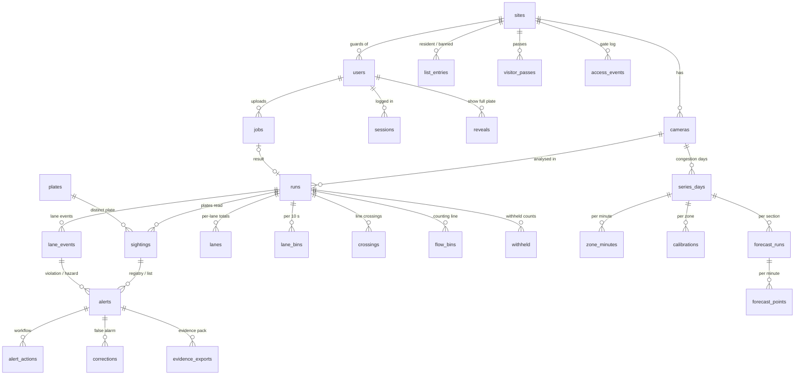

# SECS Vision web system: database

[中文版 / Chinese version](DATABASE_ZH.md) · System documents: [index](README.md)

## 1. Overview

- **Engine:** SQLite through Python's standard `sqlite3`, one file `data/web/secs.db` (gitignored, never committed).
  WAL journal, foreign keys on. Schema: [`webapp/schema.sql`](../../webapp/schema.sql) (version in `meta.schema_version`).
  Small helpers in `webapp/db.py` (`rows`, `row`, `scalar`, `insert`, `upsert`, `transaction`); the queries themselves
  are plain SQL in the service modules (`webapp/services/`).
- **Filled by** `python -m webapp.importer --demo [--demo-users]` from the committed results, and by the background
  worker for uploads (same import functions). The import is **idempotent**: rows have natural keys (section 4), so
  re-running it updates rows instead of duplicating them and keeps alert workflow states.
- **Times** are Malaysia time (MYT, UTC+8) as ISO 8601 text with milliseconds (`2026-10-14T08:00:23.000`), see
  `webapp/clock.py`. Demo runs have a *notional* clock (the public footage has no recording time); congestion series
  use the real on-screen clock.
- **Plates:** `compact` is the canonical form used for matching (`VJF1234`), `plate_text` the display form
  (`VJF 1234`).
- **Provenance** keeps real and simulated data apart on every observation-like row:

| Value | Meaning | Demo examples |
|---|---|---|
| `camera` | a real vehicle with its real plate, read from the footage | the unaltered plates of the road, gate and lane footage |
| `inserted_plate` | a real vehicle whose plate was digitally replaced by a fictitious one | the 7 vehicles of the violation demo (X-series and `WXY 12345`) |
| `synthetic` | no vehicle in the footage at all | simulated events of the road demo, simulated lane vehicles, gate arrivals, the Johor Bahru sighting |

## 2. Relationships

Police lists (`watch`, `blacklist`) have no site. The `audit_log` has no foreign keys on purpose (it must survive
deletions); it stores the username and role as text.

## 3. Tables

### 3.1 System and users

| Table | Purpose | Main columns | Filled by |
|---|---|---|---|
| `meta` | internal markers | `schema_version`, `demo_imported_at`, `audit_anchor` (last hash before a purge), `audit_purge` (switch for the purge) | `db.init`, importer, purge |
| `settings` | admin overrides of the defaults in `webapp/settings.py` | key, value (JSON) | Admin > Settings |
| `sites` | places with cameras | code, name, kind (road / condo / checkpoint / highway) | `seed/cameras.yaml` |
| `users` | accounts | username (unique, case-insensitive), display_name, role (police / guard / traffic / admin), site_id (guards), password_hash (scrypt), active, failed_logins, locked_until, demo | Admin > Users; demo accounts from `seed/demo_users.yaml` only with `--demo-users` |
| `sessions` | logins | token_hash (SHA-256 of the cookie; the token itself is never stored), csrf_token, created_at, last_seen_at, expires_at, ip | login |

### 3.2 Cameras and analysis runs

| Table | Purpose | Main columns | Filled from |
|---|---|---|---|
| `cameras` | every camera | code, name, kind (anpr / gate / lane / congestion), site_id, lat, lon, location_note, source_credit, status (replay / live / offline), stream_url (future RTSP), notional_clock | `seed/cameras.yaml` |
| `runs` | one analysis of one video or image | code, label, camera_id, origin (demo / upload), media, results_path + results_sha256, video_path, video_kind (annotated / source), **video_offset_sec** (source second where the played video starts, used for click-to-timestamp), image_path, profile, fps, frames, window_start_sec, window_end_sec, **clock_origin** (local time of source second 0), flow_primary, count_line_y, flow_total, flow_by_type, registry_rules, registry_disclaimer, processing, job_id | `*.plates.json`: `source`, `profile`, `fps`, `frames`, `window_sec`, `flow`, `processing`; seed |

### 3.3 Plates and alerts

| Table | Purpose | Main columns | Filled from |
|---|---|---|---|
| `plates` | distinct plates, for the fuzzy search | compact (PK), plate_text, length | every sighting |
| `sightings` | one vehicle (one plate-log row) seen in one run | run_id, camera_id, natural_key, compact, plate_text, confidence, votes, status (CONFIRMED / TENTATIVE / ACQUIRING), valid_format, vtype, region, track_ids, first/last_frame, first/last_sec, **seen_at** (= clock_origin + first_sec), last_seen_at, provenance, crop_path, scene_path, scene_info (frame, boxes), **recorded_at** (retention counts from here) | `plates[]` (every field), `simulated_events[]`, `evidence{}` of the opt-in pipeline output, gate arrivals of `seed/demo_lists.yaml` |
| `alerts` | everything that needs attention | natural_key, run_id, camera_id, sighting_id or lane_event_id, source (registry / lane / list / gate), code, severity (high / violation / hazard / medium), **rank** (1 high and violation, 2 hazard, 3 medium: the sort order), message, compact, plate_text, seen_at, provenance, **status** (new / acknowledged / resolved / false_alarm), created_at, updated_at, closed_at | `plates[].alerts[]`, `simulated_events[].alerts[]`, `lanes.events[]` (violation, hazard), list matching (WATCHLIST, BLACKLIST, BANNED_AT_SITE) |
| `alert_actions` | the workflow history | alert_id, user_id, action (created / acknowledge / resolve / false_alarm / reopen / evidence_export), from_status, to_status, note, corrected_plate, at | import, alert page |

All alerts are created by one function, `webapp/alerting.py: create_alert` (the hook for future push notifications).

### 3.4 Lanes and flow

| Table | Purpose | Main columns | Filled from |
|---|---|---|---|
| `lane_events` | lane changes, hazards, violations | run_id, natural_key, code, severity (info / hazard / violation), time_sec, seen_at, lane, from_lane, message, vtype, track_id, compact, plate_text, provenance, value (e.g. speed), error_1sigma | `lanes.events[]` |
| `lanes` | per-lane totals of a run | name, grp (Inbound / Outbound), direction, position, count, by_type, veh_per_min, occupancy, density, density_unit, zone_length_m, mean_speed_kmh | `lanes.per_lane{}` |
| `lane_bins` | per lane per 10 s | lane, t_start, t_end, count, veh_per_min, occupancy, mean_vehicles, density_veh_km, mean_speed_kmh, observed_sec | `lanes.per_10s{}` |
| `crossings` | every vehicle crossing a lane line | time_sec, seen_at, lane (empty = outside every lane, e.g. the lay-by), vtype, track_id, direction | `lanes.crossings[]` |
| `flow_bins` | counting-line flow per 10 s | t_start, t_end, total, by_type | `flow.per_10s[]` |
| `withheld` | real vehicles' violations: counted, never attributed | code, count, note | `lanes.withheld_violations{}`, `withheld_note` |

### 3.5 Congestion and forecasts

| Table | Purpose | Main columns | Filled from |
|---|---|---|---|
| `series_days` | one camera-day of 1-minute series | code, camera_id, label, date, csv_path + csv_sha256, calibrated, video_path (time-lapse), video_from_minute, video_to_minute, video_duration_sec | `docs/data/causeway/*.csv`, seed |
| `zone_minutes` | per minute per zone or direction | entity (TC1 … or To CIQ), minute, minute_of_day, occupancy, excess, density (calibrated vehicles), **fill** (vehicles / jam capacity), queue, observed_sec | CSV columns `<entity>.<measure>` |
| `calibrations` | count calibration per zone / group | kind (zone / group), slope, intercept, night_offset, n, loo_mae, loo_bias, mean_count, corr, relative_mae, capacity (jam capacity in vehicles) | `*.calibration.json` |
| `forecast_runs` | one forecast series per section | entity, model, train_day, horizons, congestion_fill (0.5), error_band (MAE per horizon on the held-out part of the training day), origin (**committed** JSON / **computed** at import), source_path, source_sha256 | `demo/jb_ciq_forecast_timelapse.forecast.json`; the other 9 sections computed at import with `alpr.forecast` (same recipe as `forecast_demo.py`) |
| `forecast_points` | per minute | minute, measured, f5, f15, f30 (**forecast made at this minute for minute + h**) | `measured_fill[]`, `forecast_fill{}` |

### 3.6 Lists and the gate

| Table | Purpose | Main columns | Filled by |
|---|---|---|---|
| `list_entries` | lists on top of the SIMULATED registry | list (resident / banned: per site; watch / blacklist: police, no site), compact, plate_text, label, unit_no, reason, valid_to, simulated, created_by, created_at, active | guard and police pages; demo entries from `seed/demo_lists.yaml` |
| `visitor_passes` | time-bounded visitor passes | site_id, compact, plate_text, unit_no, visitor_label (no names or IC numbers), valid_from, valid_to, status (active / cancelled), simulated, seed_key | guard page; demo passes from the seed |
| `access_events` | the gate's access log | site_id, camera_id, sighting_id, compact, plate_text, direction (entry / exit), decision (allowed / stopped / exited), identity (resident / visitor_pre / visitor_unregistered / banned), pass_id, unit_no, guard_id, note, at, simulated, seed_key | Allow / Stop & note / Exited buttons; demo events from the seed |

### 3.7 Privacy, work queue and exports

| Table | Purpose | Main columns |
|---|---|---|
| `reveals` | "Show full plate" by a masked role | user_id, sighting_id, compact (a plate-number search), reason_code, reason_note, at, expires_at (15 min) |
| `audit_log` | who did what, when and why | at, user_id, username, role, action, target_type, target_id, details (JSON: filters, result counts, `via`), reason (purpose / reveal reason), ip, **prev_hash**, **row_hash** |
| `jobs` | upload & analyse queue | kind (image / video), status (queued / running / done / failed / cancelled), progress, message, input_path, original_name, scene, render_video, camera_id, recorded_at, created_by, started_at, finished_at, run_id, error |
| `corrections` | OCR correction pool (false alarms with the correct plate) | alert_id, sighting_id, ocr_compact, corrected_compact, crop_path, created_by, created_at |
| `evidence_exports` | every evidence pack exported | alert_id, user_id, format (html / pdf), path, file_sha256, image_hashes (JSON name -> SHA-256), at |

## 4. Natural keys (why re-importing is safe)

| Rows | Natural key |
|---|---|
| plate-log rows | `p:<first_frame>:<compact>` within the run |
| simulated events | `s:<time_sec>:<compact>` |
| inserted plates of the violation demo | `i:<index>:<compact>` |
| simulated gate arrivals | `g:<at_sec>:<compact>` |
| lane events | `e:<time_sec>:<code>:<track_id>` |
| registry alerts | `<run code>|<sighting key>|<alert code>` |
| lane alerts | `<run code>|<event key>` |
| list alerts | `<run code>|<sighting key>|list:<entry id>` |

Upserts keep the columns that users change (`alerts.status`, `created_at`, `updated_at`, `closed_at`; the crop and
scene paths of sightings). Rows whose natural key is no longer in the results file are removed (`_drop_stale`).

## 5. Audit log: append-only and hash-chained

- Two triggers reject `UPDATE` and `DELETE` on `audit_log` (`RAISE(ABORT, 'audit_log is append-only')`). The only
  exception is the retention purge, which switches `meta.audit_purge` on for its one `DELETE` and records the last
  removed hash in `meta.audit_anchor`.
- `row_hash = SHA-256(JSON [prev_hash, every field in name order])`; the first row's `prev_hash` is `GENESIS` (or the
  anchor after a purge). Changing or removing any row breaks the chain; Admin > Privacy & audit > "Verify hash chain"
  (`GET /api/v1/audit/verify`) recomputes it.
- Logged actions: `login`, `login_failed`, `login_locked`, `logout`, `search` (with its filters and purpose), `view`, `view_scene`,
  `timeline`, `reveal`, `export`, `report`, `evidence_export`, `alert_<step>`, `list_alerts`, `list_add`,
  `list_remove`, `pass_issue`, `pass_cancel`, `gate_<decision>`, `upload`, `job_cancel`, `whatif`, `settings`,
  `user_add`, `user_update`, `import`, `purge`. Calls made by the future AI assistant will carry `via: assistant` in
  `details`.

## 6. Retention (Admin > Privacy & audit; daily task)

| Data | Deleted when | Default |
|---|---|---|
| ordinary sightings (no alert) + their crop and scene files | `recorded_at` older than `retention_days` | 30 days |
| sightings with alerts (+ those alerts) | every alert of the sighting closed longer ago than `retention_alert_days`; **never while an alert is open** | 180 days |
| access-log entries | older than `retention_access_days` | 90 days |
| correction pool | older than `retention_corrections_days` | 30 days |
| audit log | older than `retention_audit_days` | 365 days |
| reveals, sessions | expired | — |

"Preview" counts what would go (dry run) without deleting; "Purge now" deletes and writes a `purge` audit row.
Plates no longer seen in any sighting are removed from `plates` at the same time.

## 7. Files next to the database (`data/web/`, gitignored)

| Folder | Content |
|---|---|
| `media/runs/<run code>/` | plate crops and scene frames copied from the opt-in pipeline output, plus server-blurred copies (`*.masked.jpg`) for masked roles |
| `uploads/` | uploaded images and videos |
| `jobs/job_<id>/` | per-job config, log, results JSON, annotated output, H.264 playback copy |
| `exports/evidence/` | exported evidence packs |
| `corrections/` | crops of the correction pool |

## 8. Demo database after `python -m webapp.importer --demo --demo-users`

| Table | Rows | Table | Rows |
|---|---|---|---|
| sites | 3 | lanes | 8 |
| cameras | 6 | lane_bins | 104 |
| runs | 4 | crossings | 355 |
| plates | 30 | flow_bins | 32 |
| sightings | 35 | withheld | 2 |
| alerts | 21 | series_days | 3 |
| alert_actions | 21 (one `created` per alert) | zone_minutes | 16,540 |
| lane_events | 12 | calibrations | 10 |
| list_entries | 3 | forecast_runs | 10 (1 committed, 9 computed) |
| visitor_passes | 2 | forecast_points | 5,030 |
| access_events | 4 | users | 4 (demo accounts) |

The 21 alerts: 6 on the roadside demo window (5 registry alerts of simulated events + 1 watch-list hit), 9 on the
violation demo (8 registry alerts of inserted plates + 1 watch-list hit), 5 lane violations / hazards of simulated
lane vehicles, 1 banned-at-site gate arrival. Every one of them is about a fictitious plate.

## 9. Moving to another database

The SQL is standard apart from a few SQLite details: `INSERT … ON CONFLICT … DO UPDATE` (PostgreSQL has the same
syntax), the two audit triggers (PostgreSQL needs a trigger function), `COLLATE NOCASE` on usernames, `TOTAL()`,
`PRAGMA` calls in `db.connect`, and `BEGIN IMMEDIATE` in `db.transaction`. A move would change `db.py`, the schema file
and those few places; the service functions and the API stay as they are.
