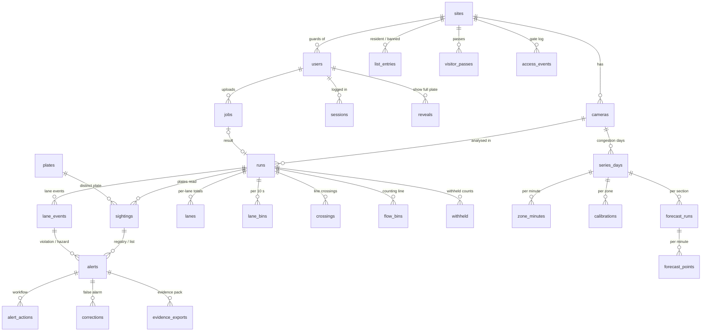

# SECS Vision 网页系统：数据库

[English version / 英文版](DATABASE_EN.md) · 系统文档目录：[索引](README.md)

## 1. 概述

- **引擎：** 用 Python 标准库 `sqlite3` 访问 SQLite，单个文件 `data/web/secs.db`（被 git 忽略，从不提交）。
  WAL 日志模式，外键检查开启。表结构：[`webapp/schema.sql`](../../webapp/schema.sql)（版本号在 `meta.schema_version`）。
  `webapp/db.py` 里是几个小工具函数（`rows`、`row`、`scalar`、`insert`、`upsert`、`transaction`）；查询本身是写在
  各服务模块（`webapp/services/`）里的普通 SQL。
- **数据来源：** `python -m webapp.importer --demo [--demo-users]` 从已提交的结果文件导入；上传文件由后台任务分析后用同一套
  导入函数写入。导入**可重复运行**：每行都有自然键（第 4 节），重复导入只会更新而不会重复插入，并保留告警的处理状态。
- **时间** 一律是马来西亚时间（MYT，UTC+8），以带毫秒的 ISO 8601 文本保存（`2026-10-14T08:00:23.000`），见
  `webapp/clock.py`。演示视频用的是*设定的*时钟（公开视频没有录制时间）；拥堵序列用画面上真实的时钟。
- **车牌：** `compact` 是用于匹配的规范形式（`VJF1234`），`plate_text` 是显示形式（`VJF 1234`）。
- **来源（provenance）** 把每条观测类数据的真实与模拟分开：

| 取值 | 含义 | 演示数据中的例子 |
|---|---|---|
| `camera` | 真实车辆、真实车牌，从视频中读出 | 路边、门岗、车道视频里未被修改的车牌 |
| `inserted_plate` | 真实车辆，但车牌被数字替换成虚构车牌 | 违规演示里的 7 辆车（X 开头的车牌和 `WXY 12345`） |
| `synthetic` | 视频里根本没有这辆车 | 路边演示的模拟事件、模拟的车道车辆、门岗模拟到达、新山的出现记录 |

## 2. 表之间的关系

警察的名单（`watch`、`blacklist`）不属于任何站点。`audit_log` 故意不设外键（删除其他数据后日志必须还在），用户名和角色
以文本保存。

## 3. 各表说明

### 3.1 系统与用户

| 表 | 用途 | 主要字段 | 由谁写入 |
|---|---|---|---|
| `meta` | 内部标记 | `schema_version`、`demo_imported_at`、`audit_anchor`（清理前最后一行的哈希）、`audit_purge`（清理时的开关） | `db.init`、导入程序、清理 |
| `settings` | 管理员对 `webapp/settings.py` 默认值的修改 | key、value（JSON） | 管理 > 设置 |
| `sites` | 安装摄像头的地点 | code、name、kind（road / condo / checkpoint / highway） | `seed/cameras.yaml` |
| `users` | 账号 | username（唯一，不区分大小写）、display_name、role（police / guard / traffic / admin）、site_id（保安）、password_hash（scrypt）、active、failed_logins、locked_until、demo | 管理 > 用户；演示账号只在加 `--demo-users` 时从 `seed/demo_users.yaml` 创建 |
| `sessions` | 登录会话 | token_hash（Cookie 的 SHA-256，令牌本身从不保存）、csrf_token、created_at、last_seen_at、expires_at、ip | 登录 |

### 3.2 摄像头与分析批次（run）

| 表 | 用途 | 主要字段 | 数据来源 |
|---|---|---|---|
| `cameras` | 所有摄像头 | code、name、kind（anpr / gate / lane / congestion）、site_id、lat、lon、location_note、source_credit、status（replay / live / offline）、stream_url（将来的 RTSP）、notional_clock | `seed/cameras.yaml` |
| `runs` | 对一段视频或一张图片的一次分析 | code、label、camera_id、origin（demo / upload）、media、results_path + results_sha256、video_path、video_kind（annotated / source）、**video_offset_sec**（播放的视频从源视频第几秒开始，用于点击跳转）、image_path、profile、fps、frames、window_start_sec、window_end_sec、**clock_origin**（源视频第 0 秒对应的本地时间）、flow_primary、count_line_y、flow_total、flow_by_type、registry_rules、registry_disclaimer、processing、job_id | `*.plates.json` 的 `source`、`profile`、`fps`、`frames`、`window_sec`、`flow`、`processing`；种子文件 |

### 3.3 车牌与告警

| 表 | 用途 | 主要字段 | 数据来源 |
|---|---|---|---|
| `plates` | 去重后的车牌，供模糊检索 | compact（主键）、plate_text、length | 每条识别记录 |
| `sightings` | 一个批次中看到的一辆车（车牌记录的一行） | run_id、camera_id、natural_key、compact、plate_text、confidence、votes、status（CONFIRMED / TENTATIVE / ACQUIRING）、valid_format、vtype、region、track_ids、first/last_frame、first/last_sec、**seen_at**（= clock_origin + first_sec）、last_seen_at、provenance、crop_path、scene_path、scene_info（帧号、框）、**recorded_at**（保留期限从此算起） | `plates[]`（全部字段）、`simulated_events[]`、识别流水线可选证据输出的 `evidence{}`、`seed/demo_lists.yaml` 里的门岗模拟到达 |
| `alerts` | 所有需要处理的事项 | natural_key、run_id、camera_id、sighting_id 或 lane_event_id、source（registry / lane / list / gate）、code、severity（high / violation / hazard / medium）、**rank**（1 = 高和违规，2 = 隐患，3 = 中：排序依据）、message、compact、plate_text、seen_at、provenance、**status**（new / acknowledged / resolved / false_alarm）、created_at、updated_at、closed_at | `plates[].alerts[]`、`simulated_events[].alerts[]`、`lanes.events[]`（违规、隐患）、名单比对（WATCHLIST、BLACKLIST、BANNED_AT_SITE） |
| `alert_actions` | 处理流程历史 | alert_id、user_id、action（created / acknowledge / resolve / false_alarm / reopen / evidence_export）、from_status、to_status、note、corrected_plate、at | 导入程序、告警页面 |

所有告警都由同一个函数 `webapp/alerting.py: create_alert` 创建（将来推送通知就挂在这里）。

### 3.4 车道与车流

| 表 | 用途 | 主要字段 | 数据来源 |
|---|---|---|---|
| `lane_events` | 变道、隐患、违规 | run_id、natural_key、code、severity（info / hazard / violation）、time_sec、seen_at、lane、from_lane、message、vtype、track_id、compact、plate_text、provenance、value（如车速）、error_1sigma | `lanes.events[]` |
| `lanes` | 一个批次的分车道合计 | name、grp（Inbound / Outbound）、direction、position、count、by_type、veh_per_min、occupancy、density、density_unit、zone_length_m、mean_speed_kmh | `lanes.per_lane{}` |
| `lane_bins` | 每条车道每 10 秒 | lane、t_start、t_end、count、veh_per_min、occupancy、mean_vehicles、density_veh_km、mean_speed_kmh、observed_sec | `lanes.per_10s{}` |
| `crossings` | 每辆车越过车道计数线 | time_sec、seen_at、lane（为空 = 不在任何车道内，例如路边停靠带）、vtype、track_id、direction | `lanes.crossings[]` |
| `flow_bins` | 计数线每 10 秒的车流 | t_start、t_end、total、by_type | `flow.per_10s[]` |
| `withheld` | 真实车辆的违规：只计数，不对应到车辆 | code、count、note | `lanes.withheld_violations{}`、`withheld_note` |

### 3.5 拥堵与预测

| 表 | 用途 | 主要字段 | 数据来源 |
|---|---|---|---|
| `series_days` | 一个摄像头一天的分钟级序列 | code、camera_id、label、date、csv_path + csv_sha256、calibrated、video_path（延时视频）、video_from_minute、video_to_minute、video_duration_sec | `docs/data/causeway/*.csv`、种子文件 |
| `zone_minutes` | 每个区段或方向每分钟 | entity（TC1 …… 或 To CIQ）、minute、minute_of_day、occupancy、excess、density（校准后的车辆数）、**fill**（车辆数 / 堵满容量）、queue、observed_sec | CSV 中的 `<entity>.<measure>` 列 |
| `calibrations` | 每个区段 / 分组的计数校准 | kind（zone / group）、slope、intercept、night_offset、n、loo_mae、loo_bias、mean_count、corr、relative_mae、capacity（堵满容量，辆） | `*.calibration.json` |
| `forecast_runs` | 每个路段一条预测序列 | entity、model、train_day、horizons、congestion_fill（0.5）、error_band（训练日留出部分上每个预测步长的 MAE）、origin（**committed** 已提交的 JSON / **computed** 导入时计算）、source_path、source_sha256 | `demo/jb_ciq_forecast_timelapse.forecast.json`；其余 9 个路段在导入时用 `alpr.forecast` 计算（与 `forecast_demo.py` 相同做法） |
| `forecast_points` | 每分钟 | minute、measured、f5、f15、f30（**在这一分钟做出的、对 minute + h 的预测**） | `measured_fill[]`、`forecast_fill{}` |

### 3.6 名单与门岗

| 表 | 用途 | 主要字段 | 由谁写入 |
|---|---|---|---|
| `list_entries` | 建在模拟登记库之上的名单 | list（resident / banned：按站点；watch / blacklist：警察，不属于任何站点）、compact、plate_text、label、unit_no、reason、valid_to、simulated、created_by、created_at、active | 保安和警察的页面；演示条目来自 `seed/demo_lists.yaml` |
| `visitor_passes` | 限时访客通行证 | site_id、compact、plate_text、unit_no、visitor_label（不存姓名或身份证号）、valid_from、valid_to、status（active / cancelled）、simulated、seed_key | 保安页面；演示通行证来自种子文件 |
| `access_events` | 门岗进出记录 | site_id、camera_id、sighting_id、compact、plate_text、direction（entry / exit）、decision（allowed / stopped / exited）、identity（resident / visitor_pre / visitor_unregistered / banned）、pass_id、unit_no、guard_id、note、at、simulated、seed_key | “放行”/“拦停并备注”/“已离开”按钮；演示记录来自种子文件 |

### 3.7 隐私、任务队列与导出

| 表 | 用途 | 主要字段 |
|---|---|---|
| `reveals` | 需打码的角色点“显示完整车牌” | user_id、sighting_id、compact（按车牌号检索时）、reason_code、reason_note、at、expires_at（15 分钟） |
| `audit_log` | 谁在何时做了什么、为什么 | at、user_id、username、role、action、target_type、target_id、details（JSON：筛选条件、结果数、`via`）、reason（用途 / 查看理由）、ip、**prev_hash**、**row_hash** |
| `jobs` | 上传与分析队列 | kind（image / video）、status（queued / running / done / failed / cancelled）、progress、message、input_path、original_name、scene、render_video、camera_id、recorded_at、created_by、started_at、finished_at、run_id、error |
| `corrections` | OCR 纠错样本池（带正确车牌的误报） | alert_id、sighting_id、ocr_compact、corrected_compact、crop_path、created_by、created_at |
| `evidence_exports` | 每次导出的证据包 | alert_id、user_id、format（html / pdf）、path、file_sha256、image_hashes（JSON：文件名 -> SHA-256）、at |

## 4. 自然键（为什么重复导入是安全的）

| 数据行 | 自然键 |
|---|---|
| 车牌记录行 | 同一批次内 `p:<first_frame>:<compact>` |
| 模拟事件 | `s:<time_sec>:<compact>` |
| 违规演示中被替换的车牌 | `i:<序号>:<compact>` |
| 门岗模拟到达 | `g:<at_sec>:<compact>` |
| 车道事件 | `e:<time_sec>:<code>:<track_id>` |
| 登记库告警 | `<批次代码>|<记录的键>|<告警代码>` |
| 车道告警 | `<批次代码>|<事件的键>` |
| 名单告警 | `<批次代码>|<记录的键>|list:<条目 id>` |

更新时保留用户会改动的字段（`alerts.status`、`created_at`、`updated_at`、`closed_at`；识别记录的截图和整帧路径）。
自然键已不在结果文件中的行会被删除（`_drop_stale`）。

## 5. 审计日志：只能追加、哈希成链

- 两个触发器拒绝对 `audit_log` 的 `UPDATE` 和 `DELETE`（`RAISE(ABORT, 'audit_log is append-only')`）。唯一的例外是
  保留期限清理：它只在执行那一条 `DELETE` 时打开 `meta.audit_purge`，并把被删除的最后一行的哈希记入 `meta.audit_anchor`。
- `row_hash = SHA-256(JSON [prev_hash, 按字段名排序的全部字段])`；第一行的 `prev_hash` 是 `GENESIS`（清理之后则是锚点）。
  任何一行被修改或删除都会让链断开；管理 > 隐私与审计 >“Verify hash chain”（`GET /api/v1/audit/verify`）会重新计算整条链。
- 记录的动作：`login`、`login_failed`、`login_locked`、`logout`、`search`（带筛选条件和用途）、`view`、`view_scene`、`timeline`、
  `reveal`、`export`、`report`、`evidence_export`、`alert_<步骤>`、`list_alerts`、`list_add`、`list_remove`、
  `pass_issue`、`pass_cancel`、`gate_<决定>`、`upload`、`job_cancel`、`whatif`、`settings`、`user_add`、
  `user_update`、`import`、`purge`。将来 AI 助手发起的调用会在 `details` 里带 `via: assistant`。

## 6. 数据保留期限（管理 > 隐私与审计；每日任务）

| 数据 | 何时删除 | 默认 |
|---|---|---|
| 普通识别记录（无告警）及其截图和整帧文件 | `recorded_at` 早于 `retention_days` | 30 天 |
| 有告警的识别记录（连同这些告警） | 该记录的所有告警都已关闭且超过 `retention_alert_days`；**只要还有未关闭的告警就绝不删除** | 180 天 |
| 进出记录 | 早于 `retention_access_days` | 90 天 |
| 纠错样本池 | 早于 `retention_corrections_days` | 30 天 |
| 审计日志 | 早于 `retention_audit_days` | 365 天 |
| 查看授权、会话 | 已过期 | — |

“Preview”只统计将会删除的数量（试运行），不删除；“Purge now”执行删除并写一条 `purge` 审计记录。不再出现在任何识别记录里的
车牌同时从 `plates` 中删除。

## 7. 数据库旁边的文件（`data/web/`，被 git 忽略）

| 文件夹 | 内容 |
|---|---|
| `media/runs/<批次代码>/` | 从识别流水线可选证据输出复制来的车牌截图和整帧画面，以及给需打码角色用的服务器端模糊副本（`*.masked.jpg`） |
| `uploads/` | 上传的图片和视频 |
| `jobs/job_<id>/` | 每个任务的配置、日志、结果 JSON、带标注的输出、H.264 播放副本 |
| `exports/evidence/` | 导出的证据包 |
| `corrections/` | 纠错样本池的截图 |

## 8. 运行 `python -m webapp.importer --demo --demo-users` 之后的演示数据库

| 表 | 行数 | 表 | 行数 |
|---|---|---|---|
| sites | 3 | lanes | 8 |
| cameras | 6 | lane_bins | 104 |
| runs | 4 | crossings | 355 |
| plates | 30 | flow_bins | 32 |
| sightings | 35 | withheld | 2 |
| alerts | 21 | series_days | 3 |
| alert_actions | 21（每条告警一条 `created`） | zone_minutes | 16,540 |
| lane_events | 12 | calibrations | 10 |
| list_entries | 3 | forecast_runs | 10（1 条已提交，9 条导入时计算） |
| visitor_passes | 2 | forecast_points | 5,030 |
| access_events | 4 | users | 4（演示账号） |

21 条告警：路边演示片段 6 条（模拟事件的 5 条登记库告警 + 1 条关注名单命中），违规演示 9 条（被替换车牌的 8 条登记库告警 +
1 条关注名单命中），模拟车道车辆的 5 条违规 / 隐患，门岗 1 条“本站点禁入”模拟到达。每一条针对的都是虚构车牌。

## 9. 换成其他数据库

除了几处 SQLite 特有的写法，SQL 都是标准的：`INSERT … ON CONFLICT … DO UPDATE`（PostgreSQL 语法相同）、两个审计触发器
（PostgreSQL 需要改成触发器函数）、用户名上的 `COLLATE NOCASE`、`TOTAL()`、`db.connect` 里的 `PRAGMA`、
`db.transaction` 里的 `BEGIN IMMEDIATE`。迁移只需改 `db.py`、表结构文件和这几处；服务函数和 API 不用动。
