# SECS Vision web system: demo walkthrough

[中文版 / Chinese version](DEMO_WALKTHROUGH_ZH.md) · System documents: [index](README.md)

A script for the defence: three scenarios of about three minutes each (a guard at the gate, a police officer tracing
a stolen and cloned plate, a traffic manager warned of the morning queue) and one minute on privacy. Every
screenshot below is the running system on the committed demo data.

## 0. Before you start

```bash
.venv\Scripts\python -m webapp.importer --demo --demo-users
```

```bash
.venv\Scripts\python -m webapp
```

Open <http://127.0.0.1:8000>. The four demo accounts (`police1`, `guard1`, `traffic1`, `admin1`) and their passwords
are in `webapp/seed/demo_users.yaml`; they exist for this local demo only. Everything runs offline (no CDN, no
internet), so a bad network at the defence does not matter.

Say once, at the start: *the plates are read from real public footage; every violator is a fictitious X-series plate
inserted into the video or simulated; the vehicle registry is simulated (we have no JPJ access); purple "Simulated"
pills mark everything that is not a real observation.*

## 1. The guard at the gate (log in as `guard1`)

The guard lands on the **Guardhouse**: the gate camera on the left (a replay of recorded footage), the latest plate
on the right as a big card in its identity colour, and two big buttons.

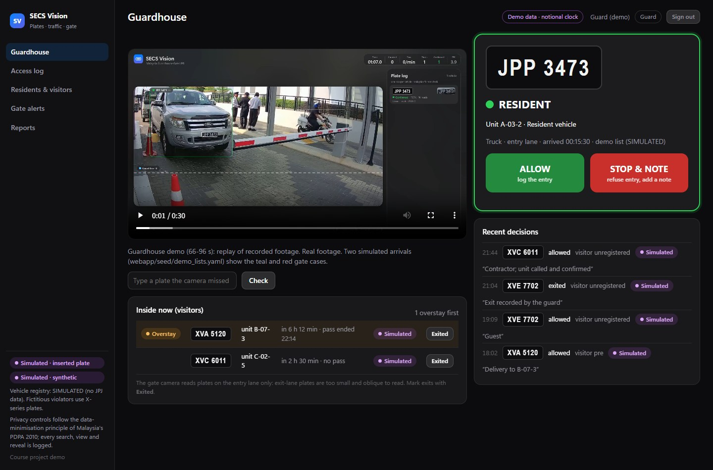

1. **0:00 — `JPP 3473`, green RESIDENT** (unit A-03-2). Press **ALLOW**: the entry goes into the access log with the
   guard's name and time. *Say:* the guard no longer writes plates in a book.
2. **0:09 — `JMT 8577`, yellow UNREGISTERED VISITOR**: not a resident and no valid pass.

   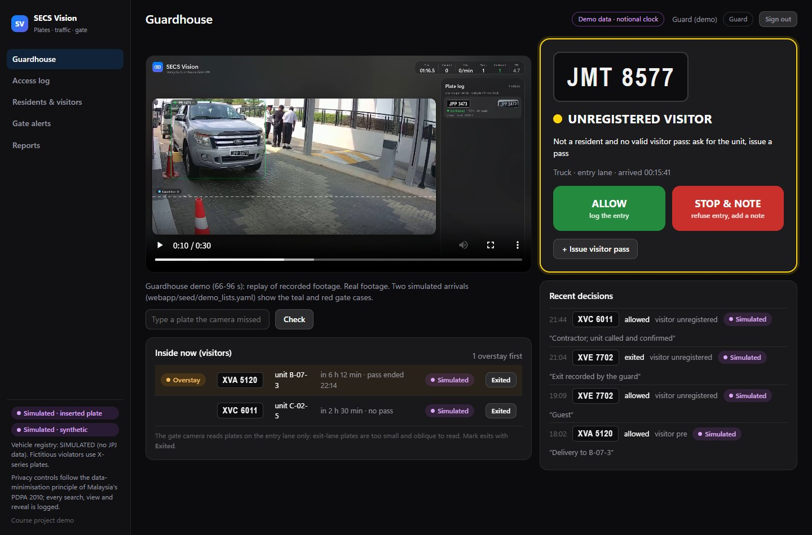

3. Press **+ Issue visitor pass**: unit A-05-2, label *Delivery*, valid 4 hours. The card turns **teal: PRE-REGISTERED
   VISITOR**, "pass valid until …". *Say:* only the plate, the unit and a short label are stored, no names or IC
   numbers.

   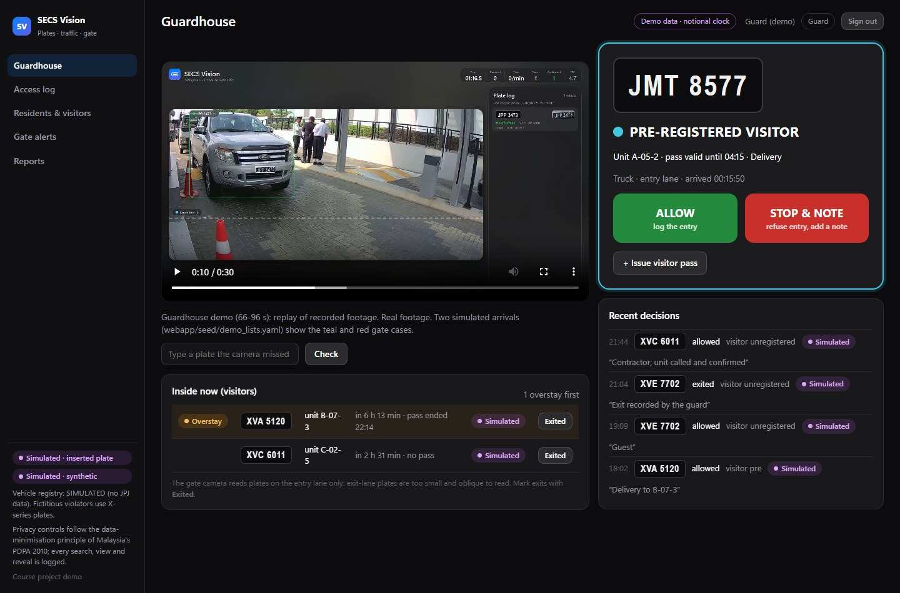

4. **0:24 — `XBN 4321`, red BANNED AT THIS SITE** (a simulated arrival with a fictitious plate; the purple note says
   there is no vehicle in the video at that moment). A warning toast appears. Press **STOP & NOTE** and type a note;
   allowing a banned vehicle would also demand a note.

   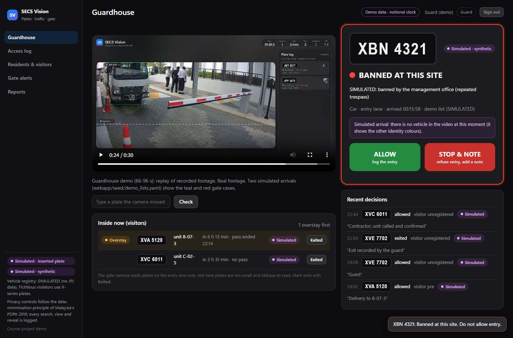

5. Open **Residents & visitors -> Inside & overstays**: `XVA 5120` has been inside 6 h 13 min and its pass ended, so it
   is pinned to the top as an **Overstay**. Press **Exited** when the car leaves.

   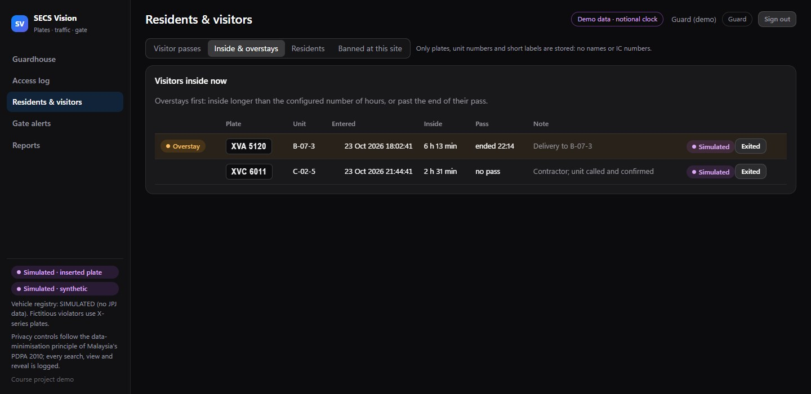

*Limitation to state:* the gate camera reads the entry lane only (exit-lane plates are too small and oblique), so
exits come from the guard's **Exited** button.

## 2. The police officer: a stolen and cloned plate (log in as `police1`)

1. **Overview.** The demo day (14 Oct 2026, notional clock): 374 vehicles counted by the roadside and lane cameras,
   20 open alerts (10 high, 1 hazard, 9 medium), all of them simulated, and the congestion card of the CIQ approach.

   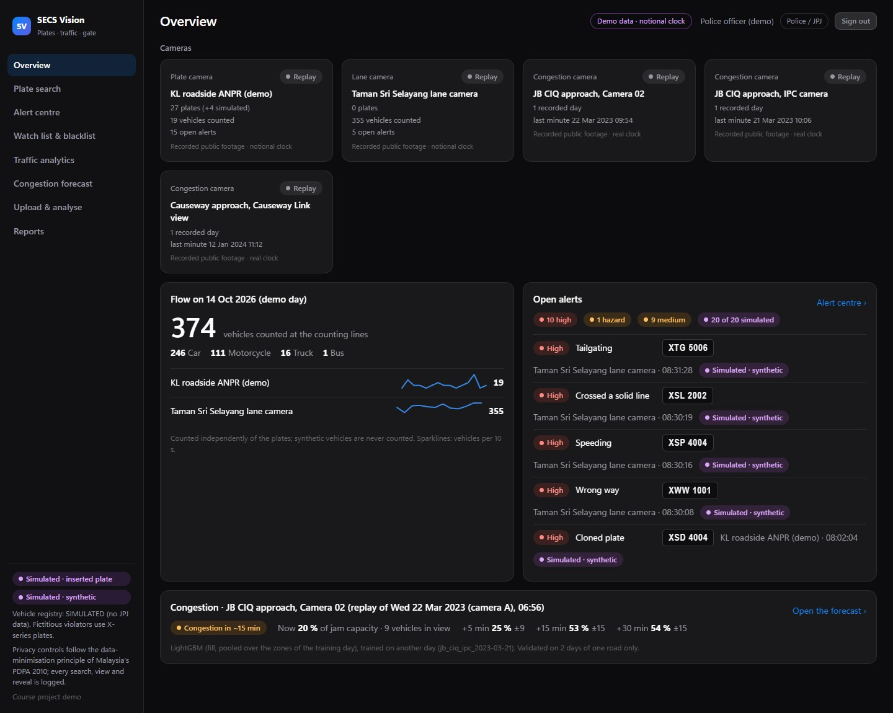

2. **Alert centre.** Alerts are sorted High -> Hazard -> Medium, newest first. Select **Blacklisted `XSB 2002`**: the
   video jumps to one second before the car appears; the best plate crop and the full camera frame; the table
   *Registry (SIMULATED) vs observed* (Sedan vs Car: match; road tax valid: match; status blacklisted: differs).
   Press **Acknowledge**. *Say:* closing an alert needs a note; a false alarm can carry the correct plate, which goes
   into the correction pool for retraining the OCR.

   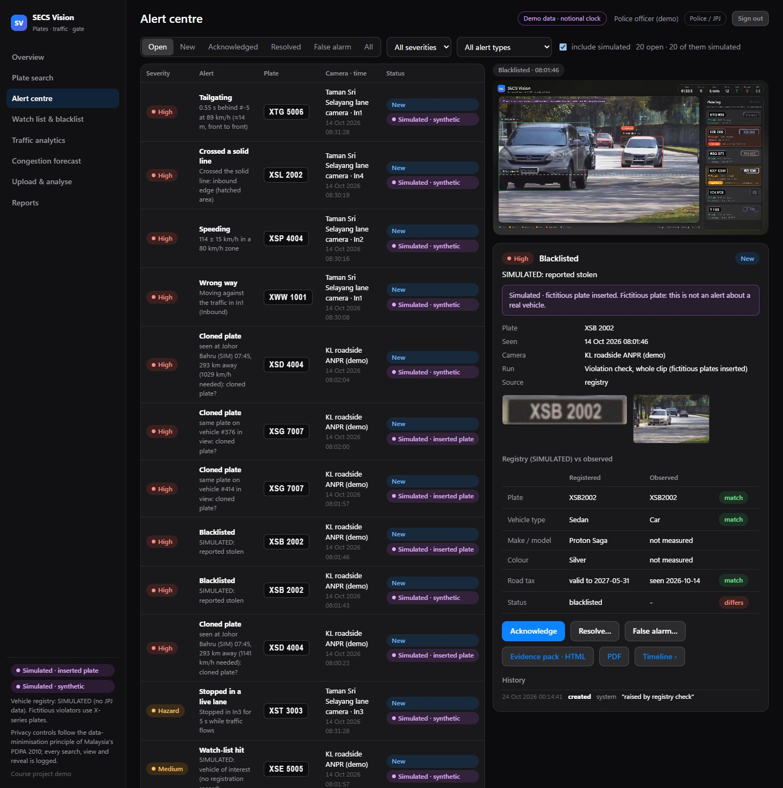

3. **Plate search.** Type `XSD 4OO4` — letters O instead of zeros, the classic OCR mistake — with OCR tolerance 2 and
   the purpose *Alert follow-up* (the purpose is required and goes into the audit log). Both sightings of `XSD 4004`
   are found (distance ≈ 1). Click one: the video plays from 08:00:22; the detail shows 74 % confidence over 40
   readings and the alert *Cloned plate: seen at Johor Bahru (SIM) 07:45, 293 km away (1141 km/h needed)*.

   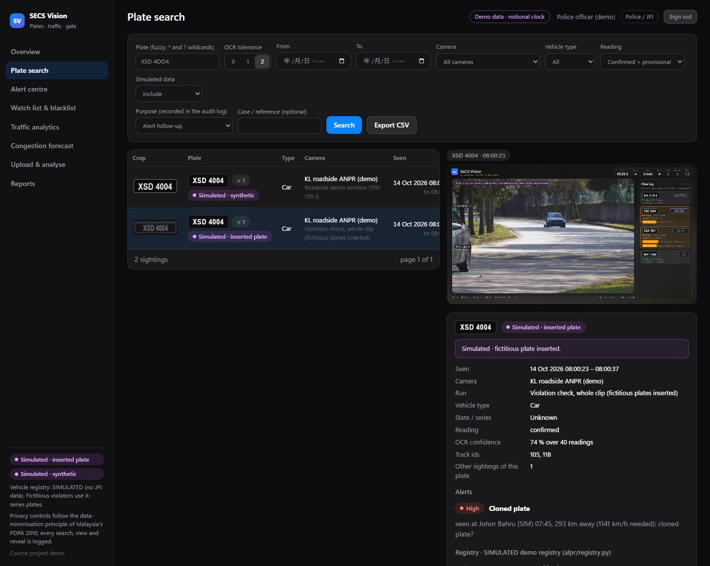

4. **Timeline across cameras.** Johor Bahru 07:45:00 -> KL roadside 08:00:23: *293 km in 15 min 24 s: 1141 km/h
   needed — impossible (more than 250 km/h): cloned plate?* -> KL roadside 08:02:04, 0 km (same site). *Say:* our
   cameras are at different places on different dates, so no real vehicle appears at two of them; this chain uses
   simulated sightings of a fictitious plate to show the check.

   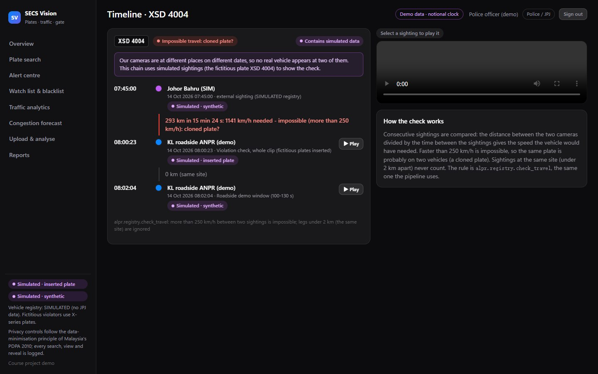

5. **Evidence pack** (back in the alert centre: *Evidence pack · HTML* or *PDF*). Every page carries the red mark
   **COURSE PROJECT DEMO — NOT AN OFFICIAL DOCUMENT**; the case summary; the camera frame with the vehicle (green) and
   plate (yellow) boxes; the best crop; the SHA-256 of every image, with the sentence that the hashes only prove the
   files did not change after export; the registry comparison; the verified Road Transport Act 1987 section with its
   source (for a stolen car, s. 51(1)); processing details. No PDRM or JPJ logos.

   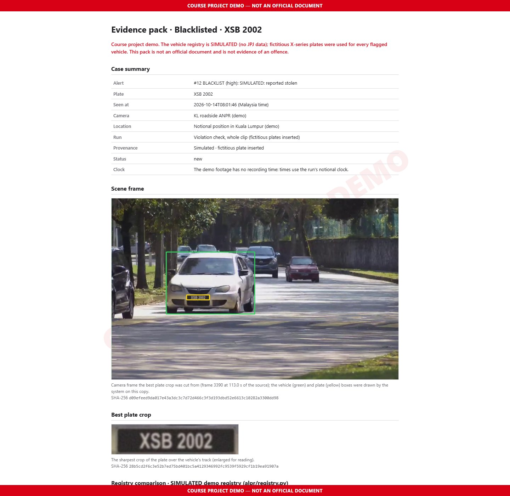

## 3. The traffic manager: the morning queue at the CIQ (log in as `traffic1`)

1. **Congestion forecast**, day *Wed 22 Mar 2023 (camera A)*, press **Go to the first warning**: the replay clock jumps
   to **06:56**. The whole approach is still free (20 %, 9 of 44 vehicles) but the model already says **Congestion in
   ~15 min**: +5 min 25 %, +15 min 53 %, +30 min 54 %, each with its error band. The time-lapse on the right follows
   the clock.

   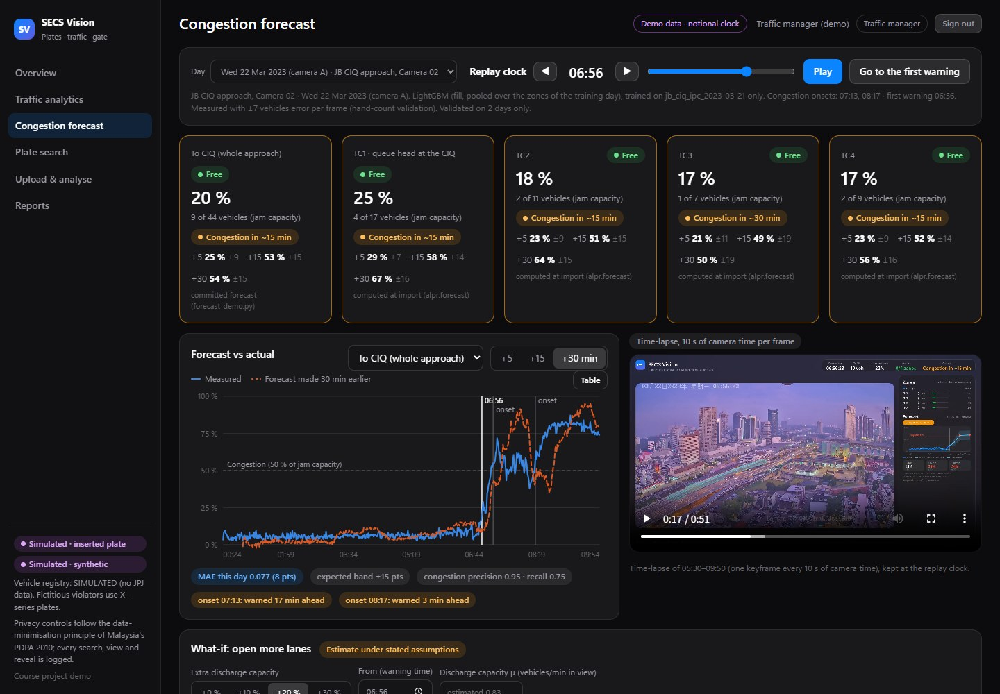

2. Press **Play** (or drag the clock) to 07:41: the approach is now **Queue — Congested now** (49 %), the queue head
   TC1 at 62 %. *Forecast vs actual* shows how honest the model is: MAE 0.077 on this day, precision 0.95, recall 0.75;
   the onset at 07:13 was warned 17 minutes ahead, the one at 08:17 only 3 minutes ahead.

   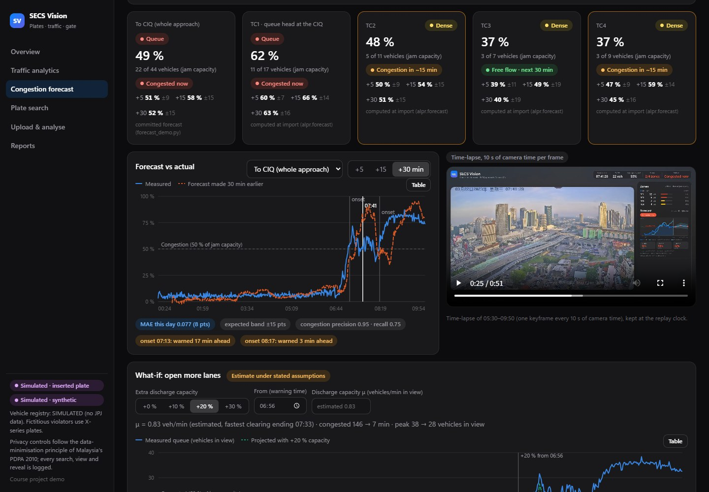

3. **What-if: open more lanes.** +20 % discharge capacity from 06:56: congested minutes 146 -> 7, peak 38 -> 28
   vehicles in view. *Say:* this is an **estimate under stated assumptions** (listed under the chart): a point queue,
   arrivals unchanged, the extra capacity available at once, μ = 0.83 vehicles/min estimated from the fastest clearing
   (a lower bound), and only the part of the queue inside the camera's view — which is why the gain looks large.

   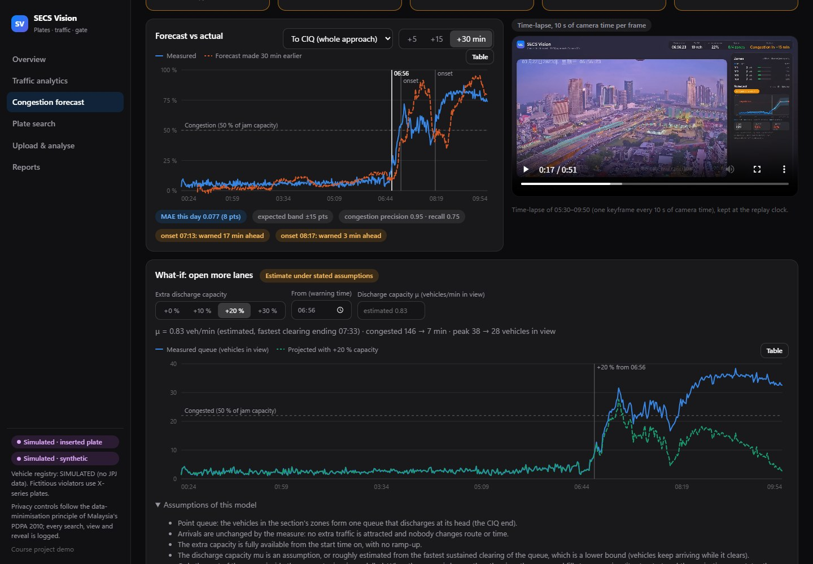

4. **Traffic analytics** (Taman Sri Selayang lane camera): 355 vehicles in 2 minutes (177.5 veh/min); inbound 70 km/h
   at 15 % occupancy, outbound 21 km/h at 72 %; per-lane counts, density and speed ± error; 4 crossings outside every
   lane (the lay-by); lane events with masked plates. Real vehicles' violations are withheld: counted, never shown.

   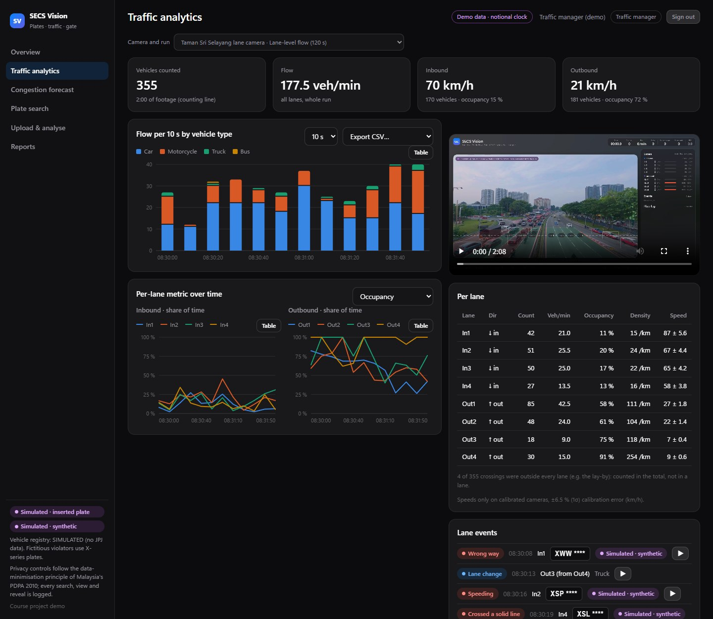

## 4. Privacy in one minute

1. Still as `traffic1`, **Plate search**: plates are masked (`VCV ****`) and crops blurred on the server. **Show full
   plate** asks for a reason, is logged, and lasts 15 minutes. Videos of plate cameras are not shown to this role,
   because they show every plate in full.

   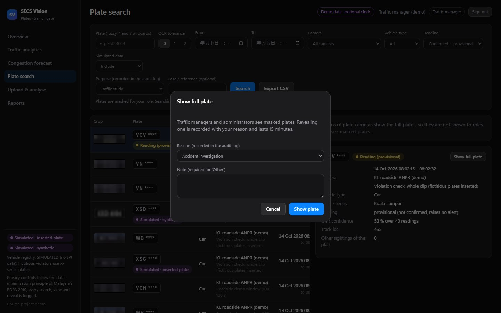

2. Log in as `admin1`, **Privacy & audit**: the retention periods (ordinary sightings 30 days by default; never while
   an alert is open), *Preview purge* / *Purge now*, and the audit log — who, when, what and why (the purpose) for
   every search, view, reveal and export. **Verify hash chain**: "intact". *Say:* the controls follow the
   data-minimisation principle of Malaysia's PDPA 2010; the PDPA does not apply to the Federal and State Governments,
   so we do not claim police use is bound by it — the same controls are applied as good practice.

   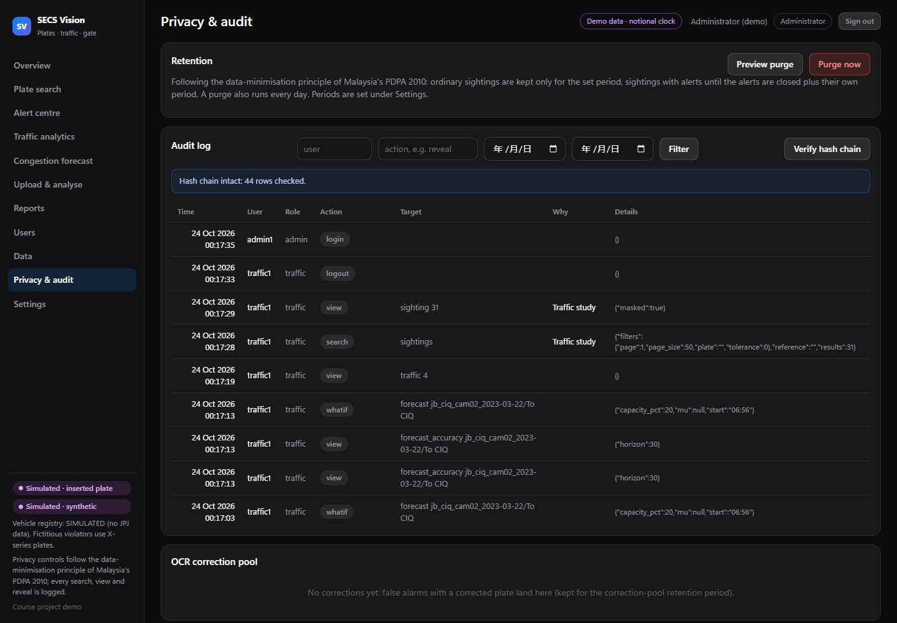

## 5. Likely questions

| Question | Answer |
|---|---|
| Is the data real? | The plates, flows and congestion measurements are from real public footage. Every violator is a fictitious X-series plate; the registry and the cross-camera sighting are simulated, and the pages say so. |
| Why no real violations? | They are real people in public footage: their violations are counted but withheld. |
| How good is the forecast? | MAE 0.077 (fill) on day A, warnings 17 and 3 minutes before the two onsets; validated on two days of one road only. |
| Is it real time? | CPU only: 10.5 FPS for the roadside scene (TEAM_GUIDE section 11); the GPU is the next step. Live RTSP cameras are designed for but not built. |
| Can someone change the audit log? | The database refuses updates and deletes, and each row carries the hash of the previous one; the admin can verify the chain. |
| Could an AI assistant use this? | Yes: every feature is a typed service function that takes the user, so an assistant would inherit the same permissions, masking and audit (next task). |
| Where are the limits? | [Requirements, section 8](REQUIREMENTS_EN.md) and [test report, section 11](TEST_PLAN_REPORT_EN.md). |
